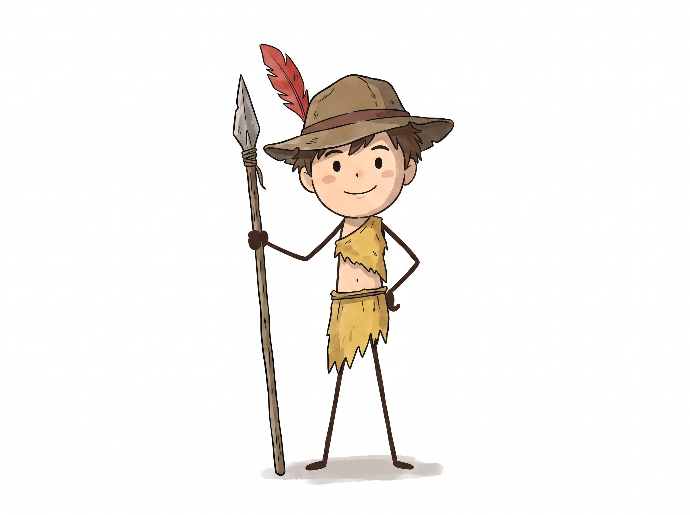

# Why Egypt Never Died: Scene-by-Scene Production Script

**Format:** 16:9, 1920×1080, 24 fps · **Scenes:** 176 (about 7–8 s each, average 7.5 s) · **Runtime:** ≈ 21.9 min · **Narration pace:** locked at ≈ 155–160 words per minute (the same pace as the reference video)

> The script you sent stops mid-sentence (*"Octavian, now Emperor Augustus, kept Egypt as his personal…"*). Scene 176 ends on that line. Send the rest and the next batch continues from Scene 177 in the same format.

## 1. Visual style bible (from the reference video)

What the reference video does, and what every scene below follows:

| Element | Rule |
|---|---|
| Art style | Flat 2D vector cartoon. Thin dark-brown outlines, flat colours, almost no shading. People are round-headed stick figures with dot eyes and thin stick limbs. |
| Frame | 16:9 picture. Keep important things inside the centre 90% (the reference is shown pillar-boxed). |
| Set A: satellite map | Realistic satellite Earth (green/brown land, deep blue sea). Empires are flat red/orange overlays that grow or shrink. Labels are white hand-lettered caps. The Guide stands in the **bottom-right corner**, knees up, and talks to camera. |
| Set B: grey studio | Plain light-grey background. The Guide stands **full-body in the left third**. Icons, flash cards, stick-figure rulers and red X stamps pop in on the right. |
| Set C: illustrated world | Simple cartoon landscapes: blue sky with puffy white clouds for normal beats, orange-to-purple sunset with pink clouds for dramatic/intro beats. Flat desert, river, buildings. |
| Set D: artefact close-up | A papyrus, stone relief or clay tablet, redrawn in the same cartoon line style (not a photo). Use for quotes, documents and inscriptions. |
| Text | Two kinds only. (1) **Labels:** white, hand-lettered, all caps, thin dark shadow. (2) **Punch words / numbers:** big bold **yellow comic lettering with a dark-brown outline**, slammed in (e.g. "THE CRAZY PART" in the reference). Numbers count up like a ticker. |
| Motion | Gentle, constant: slow push-ins and pans on maps; elements **pop** in with a small overshoot bounce; red X **stamps**; arrows **draw** themselves. One new idea on screen roughly every 2–3 seconds. |
| Pace of cuts | The reference changes picture about every 4–5 s (22 cuts in 102 s). Here each scene is 7–8 s (a few run 6–9 s so a cut never splits a phrase) with 2 visual beats inside it, so the screen changes every 3–4 s, like the reference. |
| Cuts | Hard cuts or quick whooshes between scenes, cut on the voice. No fancy transitions. |
| Music & SFX | Soft, low ambient/orchestral bed under the whole video (about −22 dB under the voice); small cartoon SFX for pops, stamps and whooshes. |
| Palette | Sand #D9B26B · Desert brown #A9773E · Nile blue #3A7CC3 · Black-land mud #3B2F2A · Field green #7FAF4E · Empire red #E2552D · Sky #9CCBEA · Sunset #F2994A → #6C4F8C · Studio grey #C9C9C9 · Text yellow #F6C934 |

Reference contact sheets: `reference_frames/reference_contact_sheet_1.png`, `reference_frames/reference_contact_sheet_2.png`

## 2. The Guide: your character (same in every scene)

The reference video already uses a narrator character with this exact design, so **your character replaces it as the on-screen narrator for the whole video.**

**Fixed design (never change):**
- Brown wide-brim hat with a darker brown band; **one red feather** standing up from the band on the left side of the hat.
- Messy brown hair under the hat, round peach face, rosy cheeks, black dot eyes, small smile.
- Ragged mustard-yellow one-shoulder tunic (over his right shoulder), bare middle, ragged yellow skirt, thin rope belt.
- Thin dark-brown stick arms and legs, small rounded dark-brown hands and feet.
- Always holds his **wooden spear with a grey stone/metal leaf-shaped head tied with rope**, in the hand on the viewer's left.

**Rules:**
- Draw him in the same flat, clean-line style as the rest of the video (match the reference). Your image is softer and watercolour-like, so either redraw him with clean lines or apply that watercolour texture to the **whole** video, not just to him.
- Same size per set: map scenes = bottom-right, ~40% of frame height; studio scenes = left third, ~55% height; world scenes = small, inside the scene.
- His mouth opens and closes while the voice speaks (2–3 mouth shapes are enough). Default pose: one hand on the spear, the other hand gesturing or on his hip.
- Reactions used in the plan: point with spear, shrug, raise eyebrow, hat tips back in surprise, hand on chin, thumbs up, eye-roll.
- AI tools: always attach `character_reference.png` as the character reference image and use the same seed/character ID for every scene.

**Character prompt (paste into every image prompt that includes him):**

> the Guide: a small cartoon boy explorer, round peach face, rosy cheeks, black dot eyes, gentle smile, messy brown hair, brown wide-brim hat with a dark band and one tall red feather, ragged mustard-yellow one-shoulder tunic and ragged skirt with rope belt, thin dark-brown stick arms and legs, holding a tall wooden spear with a grey leaf-shaped stone head tied with rope

## 3. Voice direction (same in every batch)

| Setting | Value |
|---|---|
| Voice | One narrator for the whole video. Warm, clear, curious storyteller; mid-low pitch; friendly and confident, like explaining to a smart friend. Not dramatic movie-trailer, not flat news-reader. |
| Speed | **≈ 155–160 words per minute**, about 4 syllables per second. Never speed up or slow down to fit a scene: each scene's length comes from the voice line, not the other way round. |
| Pauses | Comma ≈ 0.25 s · full stop ≈ 0.5 s · `...` (new paragraph) ≈ 0.9 s · before a big reveal ≈ 0.7 s |
| Emphasis | Lean slightly on numbers, dates and the key word of each line (shown in the on-screen text column). Questions go up at the end. |
| Energy | Keep it level across all batches. The hook (Scenes 1–3) can be 5% brighter; collapse and death beats 5% softer, same speed. |
| TTS settings (e.g. ElevenLabs) | Same voice and model for every batch · Stability 50% · Similarity 75% · Style 10% · Speaker boost on · Speed 1.0. Generate one batch (one chapter, 10–19 scenes) per take, and paste the last sentence of the previous batch as "previous text" so the tone carries on. |
| Recording yourself | Same mic, room and distance every session; read a whole batch in one take; do a 10-second "warm-up" read of the previous batch's last line first. |
| Mix | Voice peaks around −6 dB, music −22 dB under the voice, SFX −14 dB. |

**Pronunciation guide**

| Word | Say | Word | Say | Word | Say |
|---|---|---|---|---|---|
| Kemet | KEH-met | Deshret | DESH-ret | Nilometer | ny-LOM-eh-ter |
| Menes | MEH-neez | Narmer | NAR-mer | vizier | viz-EER |
| Osiris | oh-SY-ris | Isis | EYE-sis | Ma'at | mah-AHT |
| mastaba | MAS-tuh-buh | Djoser | JOE-ser | Imhotep | im-HOE-tep |
| Sneferu | sneh-FEH-roo | Khufu | KOO-foo | Khafre | KAF-ray |
| Menkaure | men-KOW-ray | Merer | MEH-rer | Tura | TOO-rah |
| Pepi | PEH-pee | Mentuhotep | men-too-HOE-tep | Faiyum | fy-YOOM |
| Nubia | NOO-bee-uh | Levant | leh-VANT | Avaris | AV-uh-ris |
| Hyksos | HICK-soss | Seqenenre | sek-en-EN-ray | Kush | KOOSH |
| Kamose | KAH-moze | Ahmose | AH-moze | Canaan | KAY-nun |
| Amun | AH-mun | Karnak | KAR-nak | Thutmose | thoot-MOE-seh |
| Euphrates | yoo-FRAY-teez | Hatshepsut | hat-SHEP-soot | Punt | POONT |
| Deir el-Bahari | DAIR el-buh-HAR-ee | Megiddo | meh-GID-oh | Amenhotep | ah-men-HOE-tep |
| Amarna | uh-MAR-nuh | Aten | AH-ten | Akhenaten | ah-ken-AH-ten |
| Nefertiti | nef-er-TEE-tee | Tutankhamun | too-tan-KAH-moon | Horemheb | HOR-em-heb |
| Carnarvon | kar-NAR-vun | Ramesses | RAM-eh-seez | Pi-Ramesses | pee-RAM-eh-seez |
| Abu Simbel | AH-boo SIM-bel | Kadesh | KAY-desh | Hittite | HIT-ite |
| Piye | PEE-yeh | Psamtik | SAM-tik | Necho | NEE-koe |
| Nebuchadnezzar | neb-yoo-kud-NEZ-er | Carchemish | KAR-keh-mish | Cambyses | kam-BY-seez |
| Pelusium | peh-LOO-see-um | Darius | duh-RY-us | Nectanebo | nek-tuh-NEE-boe |
| Siwa | SEE-wah | Ptolemy | TOL-eh-mee | Edfu | ED-foo |
| Dendera | den-DEH-ruh | Demotic | deh-MOT-ik | Plutarch | PLOO-tark |
| Caesarion | see-ZAIR-ee-on | Actium | AK-tee-um | Octavian | ok-TAY-vee-un |

Numbers: read years as "twenty-five sixty B C", Roman numerals as "Thutmose **the Third**", "Ptolemy **the Fifth**", "Cleopatra **the Seventh**".

## 4. Batch overview

| Batch | Scenes | Time | Chapter |
|---|---|---|---|
| 1 | 1–15 | 00:00.0–01:53.5 | The hook and the Nile |
| 2 | 16–27 | 01:53.5–03:21.5 | Unification, gods and the god-king |
| 3 | 28–37 | 03:21.5–04:34.1 | The first pyramids |
| 4 | 38–51 | 04:34.1–06:20.3 | Building the pyramids |
| 5 | 52–65 | 06:20.3–08:06.3 | Collapse and the Middle Kingdom |
| 6 | 66–78 | 08:06.3–09:43.5 | The Hyksos and the fight back |
| 7 | 79–90 | 09:43.5–11:14.4 | The New Kingdom and Hatshepsut |
| 8 | 91–108 | 11:14.4–13:29.8 | Thutmose III and Akhenaten |
| 9 | 109–121 | 13:29.8–15:04.2 | Tutankhamun |
| 10 | 122–134 | 15:04.2–16:41.1 | Ramesses II and the Bronze Age collapse |
| 11 | 135–147 | 16:41.1–18:21.2 | Strikes, outsiders and Assyria |
| 12 | 148–157 | 18:21.2–19:37.0 | Persia and Alexander |
| 13 | 158–176 | 19:37.0–21:56.5 | The Ptolemies and Cleopatra |

## 5. Scenes

How to read each scene: **VO** is the exact voice line. **Visual** is what we see and what the Guide does. **On-screen text** uses `/` between separate text pops (in order). **Length** is the scene length at the locked voice speed; cut the picture to the voice. **AI prompt** is ready to paste into an image/video generator together with `character_reference.png`.

### Batch 1: The hook and the Nile (Scenes 1–15, 00:00.0–01:53.5)

#### Scene 001 · 00:00.0–00:08.9 (8.9 s) · C · Illustrated world

**VO:** "You know the Giza pyramids. But almost nobody knows why Egypt never died after it lost its own kings for 2,300 years."

- **Visual:** Golden-hour Giza plateau: the three pyramids against an orange-to-purple sunset with pink cartoon clouds. The Guide walks in from the left, stops, points his spear at the pyramids, then turns to camera with a raised eyebrow. A small gold crown floats above Egypt and fades away on "lost its own kings".
- **On-screen text:** YOU KNOW THESE... / 2,300 YEARS
- **Camera / animation:** Slow push-in on the pyramids; "2,300 YEARS" slams in as yellow comic text
- **SFX / music:** soft desert wind, low drum hit on the number
- **Length:** 25 spoken words · 8.9 s at the locked voice speed
- **AI image prompt:** `Flat 2D vector cartoon, educational history YouTube explainer style, clean thin dark-brown outlines, simple flat colours with very light soft shading, characters with round heads, dot eyes and thin stick arms and legs, 16:9, 1920x1080, no photorealism, no 3D. Setting: flat 2D cartoon landscape, simple layered desert/river background, soft blue sky with puffy white cartoon clouds (or orange-to-purple sunset gradient with pink clouds for dramatic beats), dry-grass ground texture; small stick-limbed characters. Scene: Golden-hour Giza plateau: the three pyramids against an orange-to-purple sunset with pink cartoon clouds. The Guide walks in from the left, stops, points his spear at the pyramids, then turns to camera with a raised eyebrow. A small gold crown floats above Egypt and fades away on "lost its own kings". Include the Guide exactly as in the character reference. Text in frame: YOU KNOW THESE... / 2,300 YEARS.`
- **AI motion prompt:** `Slow push-in on the pyramids; "2,300 YEARS" slams in as yellow comic text. Gentle cartoon motion, elements pop in with a small bounce, 9 seconds.`

#### Scene 002 · 00:08.9–00:17.1 (8.2 s) · B · Grey studio

**VO:** "Persians, Greeks, Romans, Arabs, Turks, the British. Every one of those empires ruled Egypt, and every one of them is gone."

- **Visual:** Grey studio. The Guide stands left. Six stick-figure rulers pop in a row on the right, each in their own costume and labelled PERSIANS, GREEKS, ROMANS, ARABS, TURKS, BRITISH. On "every one of them is gone", a red X stamps over each one in quick order.
- **On-screen text:** PERSIANS · GREEKS · ROMANS · ARABS · TURKS · BRITISH / GONE
- **Camera / animation:** One pop per name; six fast stamps on "gone"
- **SFX / music:** six pops, six stamp sounds
- **Length:** 21 spoken words · 8.2 s at the locked voice speed
- **AI image prompt:** `Flat 2D vector cartoon, educational history YouTube explainer style, clean thin dark-brown outlines, simple flat colours with very light soft shading, characters with round heads, dot eyes and thin stick arms and legs, 16:9, 1920x1080, no photorealism, no 3D. Setting: plain flat light-grey background (#C9C9C9), no floor line; the Guide character standing full-body in the left third; flat icons, cards and stick figures on the right two-thirds. Scene: Grey studio. The Guide stands left. Six stick-figure rulers pop in a row on the right, each in their own costume and labelled PERSIANS, GREEKS, ROMANS, ARABS, TURKS, BRITISH. On "every one of them is gone", a red X stamps over each one in quick order. Include the Guide exactly as in the character reference. Text in frame: PERSIANS · GREEKS · ROMANS · ARABS · TURKS · BRITISH / GONE.`
- **AI motion prompt:** `One pop per name; six fast stamps on "gone". Gentle cartoon motion, elements pop in with a small bounce, 8 seconds.`

#### Scene 003 · 00:17.1–00:24.3 (7.2 s) · B · Grey studio

**VO:** "Egypt is still here. … The answer is in this picture. By the end of this video, you'll know exactly how it worked."

- **Visual:** The crossed-out rulers slide off. A little map of Egypt drops into the middle, untouched and glowing, with a green tick. The Guide picks up a framed picture card, still face-down, and taps it with a knowing smile.
- **On-screen text:** EGYPT IS STILL HERE / THE ANSWER IS IN THIS PICTURE
- **Camera / animation:** Egypt drops with a bounce; slow push toward the face-down card
- **SFX / music:** soft chime, card tap
- **Length:** 22 spoken words · 7.2 s at the locked voice speed
- **AI image prompt:** `Flat 2D vector cartoon, educational history YouTube explainer style, clean thin dark-brown outlines, simple flat colours with very light soft shading, characters with round heads, dot eyes and thin stick arms and legs, 16:9, 1920x1080, no photorealism, no 3D. Setting: plain flat light-grey background (#C9C9C9), no floor line; the Guide character standing full-body in the left third; flat icons, cards and stick figures on the right two-thirds. Scene: The crossed-out rulers slide off. A little map of Egypt drops into the middle, untouched and glowing, with a green tick. The Guide picks up a framed picture card, still face-down, and taps it with a knowing smile. Include the Guide exactly as in the character reference. Text in frame: EGYPT IS STILL HERE / THE ANSWER IS IN THIS PICTURE.`
- **AI motion prompt:** `Egypt drops with a bounce; slow push toward the face-down card. Gentle cartoon motion, elements pop in with a small bounce, 7 seconds.`

#### Scene 004 · 00:24.3–00:32.0 (7.7 s) · A · Satellite map

**VO:** "That line is the Nile. Nearly everyone in Egypt lives along it, because almost everything else is desert."

- **Visual:** The Guide flips the card and it becomes a full-screen satellite view of Egypt at night: dark desert and one thin glowing green line ending in a green fan (the delta). The Guide, bottom right, taps the line with his spear tip. Tiny people icons crowd along the green strip; the desert stays empty.
- **On-screen text:** THE NILE / NEARLY EVERYONE LIVES HERE
- **Camera / animation:** Card-flip transition; slow zoom down to the valley
- **SFX / music:** whoosh, light string swell
- **Length:** 18 spoken words · 7.7 s at the locked voice speed
- **AI image prompt:** `Flat 2D vector cartoon, educational history YouTube explainer style, clean thin dark-brown outlines, simple flat colours with very light soft shading, characters with round heads, dot eyes and thin stick arms and legs, 16:9, 1920x1080, no photorealism, no 3D. Setting: realistic satellite-photo map background (NASA Blue Marble look), flat red/orange semi-transparent territory overlays, white hand-lettered place labels; the Guide character in the bottom-right corner shown from the knees up, about 40% of frame height. Scene: The Guide flips the card and it becomes a full-screen satellite view of Egypt at night: dark desert and one thin glowing green line ending in a green fan (the delta). The Guide, bottom right, taps the line with his spear tip. Tiny people icons crowd along the green strip; the desert stays empty. Include the Guide exactly as in the character reference. Text in frame: THE NILE / NEARLY EVERYONE LIVES HERE.`
- **AI motion prompt:** `Card-flip transition; slow zoom down to the valley. Gentle cartoon motion, elements pop in with a small bounce, 8 seconds.`

#### Scene 005 · 00:32.0–00:39.4 (7.4 s) · A · Satellite map

**VO:** "Every summer, monsoon rains in the highlands of Ethiopia swelled the river. In Egypt, it flooded the valley"

- **Visual:** Satellite map pans south to the Ethiopian highlands. Grey cartoon rain clouds pour rain; a blue pulse runs north down the river into Egypt, and the valley starts to fill. The Guide, bottom right, holds his hat as the wind picks up.
- **On-screen text:** ETHIOPIA · MONSOON RAINS
- **Camera / animation:** Pan south, then follow the blue pulse north
- **SFX / music:** rain, rushing river
- **Length:** 18 spoken words · 7.4 s at the locked voice speed
- **AI image prompt:** `Flat 2D vector cartoon, educational history YouTube explainer style, clean thin dark-brown outlines, simple flat colours with very light soft shading, characters with round heads, dot eyes and thin stick arms and legs, 16:9, 1920x1080, no photorealism, no 3D. Setting: realistic satellite-photo map background (NASA Blue Marble look), flat red/orange semi-transparent territory overlays, white hand-lettered place labels; the Guide character in the bottom-right corner shown from the knees up, about 40% of frame height. Scene: Satellite map pans south to the Ethiopian highlands. Grey cartoon rain clouds pour rain; a blue pulse runs north down the river into Egypt, and the valley starts to fill. The Guide, bottom right, holds his hat as the wind picks up. Include the Guide exactly as in the character reference. Text in frame: ETHIOPIA · MONSOON RAINS.`
- **AI motion prompt:** `Pan south, then follow the blue pulse north. Gentle cartoon motion, elements pop in with a small bounce, 7 seconds.`

#### Scene 006 · 00:39.4–00:47.8 (8.4 s) · C · Illustrated world

**VO:** "for about three months, and when the water pulled back, it left a layer of black, fertile mud. Egyptians named their country after it:"

- **Visual:** Cut-away view of the valley: water covers the fields (counter ~3 MONTHS), then slides back and leaves a thick black stripe of mud along the river. The Guide crouches, scoops the black mud and shows it to camera with a grin.
- **On-screen text:** ~3 MONTHS / BLACK, FERTILE MUD
- **Camera / animation:** Water rises, holds, drains left and right
- **SFX / music:** flood rush, squelch
- **Length:** 24 spoken words · 8.4 s at the locked voice speed
- **AI image prompt:** `Flat 2D vector cartoon, educational history YouTube explainer style, clean thin dark-brown outlines, simple flat colours with very light soft shading, characters with round heads, dot eyes and thin stick arms and legs, 16:9, 1920x1080, no photorealism, no 3D. Setting: flat 2D cartoon landscape, simple layered desert/river background, soft blue sky with puffy white cartoon clouds (or orange-to-purple sunset gradient with pink clouds for dramatic beats), dry-grass ground texture; small stick-limbed characters. Scene: Cut-away view of the valley: water covers the fields (counter ~3 MONTHS), then slides back and leaves a thick black stripe of mud along the river. The Guide crouches, scoops the black mud and shows it to camera with a grin. Include the Guide exactly as in the character reference. Text in frame: ~3 MONTHS / BLACK, FERTILE MUD.`
- **AI motion prompt:** `Water rises, holds, drains left and right. Gentle cartoon motion, elements pop in with a small bounce, 8 seconds.`

#### Scene 007 · 00:47.8–00:55.7 (7.9 s) · C · Illustrated world

**VO:** "Kemet, the Black Land. The desert on both sides was Deshret, the Red Land. … The Egyptian year was even built around the river."

- **Visual:** Same cut-away: the black strip gets the chalk label KEMET (BLACK LAND), the yellow desert on both sides DESHRET (RED LAND). Then a round calendar wheel rolls in and stops in front of the river. The Guide is not in this shot.
- **On-screen text:** KEMET = BLACK LAND / DESHRET = RED LAND
- **Camera / animation:** Labels write themselves; wheel rolls in
- **SFX / music:** two label pops, rolling
- **Length:** 23 spoken words · 7.9 s at the locked voice speed
- **AI image prompt:** `Flat 2D vector cartoon, educational history YouTube explainer style, clean thin dark-brown outlines, simple flat colours with very light soft shading, characters with round heads, dot eyes and thin stick arms and legs, 16:9, 1920x1080, no photorealism, no 3D. Setting: flat 2D cartoon landscape, simple layered desert/river background, soft blue sky with puffy white cartoon clouds (or orange-to-purple sunset gradient with pink clouds for dramatic beats), dry-grass ground texture; small stick-limbed characters. Scene: Same cut-away: the black strip gets the chalk label KEMET (BLACK LAND), the yellow desert on both sides DESHRET (RED LAND). Then a round calendar wheel rolls in and stops in front of the river. Text in frame: KEMET = BLACK LAND / DESHRET = RED LAND.`
- **AI motion prompt:** `Labels write themselves; wheel rolls in. Gentle cartoon motion, elements pop in with a small bounce, 8 seconds.`

#### Scene 008 · 00:55.7–01:02.2 (6.5 s) · B · Grey studio

**VO:** "It had three seasons: Flood, Growing and Harvest. Farming, taxes and festivals all followed that cycle."

- **Visual:** Grey studio: the calendar wheel has three slices: blue FLOOD (waves), green GROWING (sprout), gold HARVEST (wheat). The Guide points at each slice as it lights up. Small icons orbit: a farmer's hoe, a tax scroll, a festival drum.
- **On-screen text:** FLOOD · GROWING · HARVEST / FARMING · TAXES · FESTIVALS
- **Camera / animation:** Wheel turns one slice per season; icons orbit
- **SFX / music:** three click-ticks, soft drum
- **Length:** 16 spoken words · 6.5 s at the locked voice speed
- **AI image prompt:** `Flat 2D vector cartoon, educational history YouTube explainer style, clean thin dark-brown outlines, simple flat colours with very light soft shading, characters with round heads, dot eyes and thin stick arms and legs, 16:9, 1920x1080, no photorealism, no 3D. Setting: plain flat light-grey background (#C9C9C9), no floor line; the Guide character standing full-body in the left third; flat icons, cards and stick figures on the right two-thirds. Scene: Grey studio: the calendar wheel has three slices: blue FLOOD (waves), green GROWING (sprout), gold HARVEST (wheat). The Guide points at each slice as it lights up. Small icons orbit: a farmer's hoe, a tax scroll, a festival drum. Include the Guide exactly as in the character reference. Text in frame: FLOOD · GROWING · HARVEST / FARMING · TAXES · FESTIVALS.`
- **AI motion prompt:** `Wheel turns one slice per season; icons orbit. Gentle cartoon motion, elements pop in with a small bounce, 6 seconds.`

#### Scene 009 · 01:02.2–01:09.6 (7.4 s) · C · Illustrated world

**VO:** "That mud gave Egypt something rare in the ancient world: a reliable surplus. Farmers grew far more grain than they needed,"

- **Visual:** Bright field with cartoon clouds: a farmer holds a small bowl next to a mountain of grain sacks that grows in three quick steps. The word SURPLUS slams in. The Guide whistles at the size of the pile.
- **On-screen text:** A RELIABLE SURPLUS
- **Camera / animation:** Grain pile grows in 3 steps; yellow word slams in
- **SFX / music:** grain pouring, sparkle
- **Length:** 21 spoken words · 7.4 s at the locked voice speed
- **AI image prompt:** `Flat 2D vector cartoon, educational history YouTube explainer style, clean thin dark-brown outlines, simple flat colours with very light soft shading, characters with round heads, dot eyes and thin stick arms and legs, 16:9, 1920x1080, no photorealism, no 3D. Setting: flat 2D cartoon landscape, simple layered desert/river background, soft blue sky with puffy white cartoon clouds (or orange-to-purple sunset gradient with pink clouds for dramatic beats), dry-grass ground texture; small stick-limbed characters. Scene: Bright field with cartoon clouds: a farmer holds a small bowl next to a mountain of grain sacks that grows in three quick steps. The word SURPLUS slams in. The Guide whistles at the size of the pile. Include the Guide exactly as in the character reference. Text in frame: A RELIABLE SURPLUS.`
- **AI motion prompt:** `Grain pile grows in 3 steps; yellow word slams in. Gentle cartoon motion, elements pop in with a small bounce, 7 seconds.`

#### Scene 010 · 01:09.6–01:16.5 (6.9 s) · C · Illustrated world

**VO:** "and that extra grain could feed builders, soldiers, priests and officials. It paid for everything you're about to see."

- **Visual:** Arrows run from the grain pile to a builder, a soldier, a priest and a scribe. Then a golden glow flies from the pile toward pyramids and temples on the horizon. The Guide is not in this shot.
- **On-screen text:** FEEDS BUILDERS · SOLDIERS · PRIESTS · OFFICIALS
- **Camera / animation:** Arrows draw one by one; glow flies to the horizon
- **SFX / music:** pop on each icon, shimmer
- **Length:** 19 spoken words · 6.9 s at the locked voice speed
- **AI image prompt:** `Flat 2D vector cartoon, educational history YouTube explainer style, clean thin dark-brown outlines, simple flat colours with very light soft shading, characters with round heads, dot eyes and thin stick arms and legs, 16:9, 1920x1080, no photorealism, no 3D. Setting: flat 2D cartoon landscape, simple layered desert/river background, soft blue sky with puffy white cartoon clouds (or orange-to-purple sunset gradient with pink clouds for dramatic beats), dry-grass ground texture; small stick-limbed characters. Scene: Arrows run from the grain pile to a builder, a soldier, a priest and a scribe. Then a golden glow flies from the pile toward pyramids and temples on the horizon. Text in frame: FEEDS BUILDERS · SOLDIERS · PRIESTS · OFFICIALS.`
- **AI motion prompt:** `Arrows draw one by one; glow flies to the horizon. Gentle cartoon motion, elements pop in with a small bounce, 7 seconds.`

#### Scene 011 · 01:16.5–01:23.4 (6.9 s) · C · Illustrated world

**VO:** "They measured the flood on stone stairways called Nilometers. A high flood meant big harvests and higher taxes."

- **Visual:** A stone stairway going down into the river, tick marks carved in the wall: a Nilometer. A scribe writes numbers. Water rises to the HIGH mark; a fat wheat sheaf and a tax scroll pop in. The Guide stands on the top step.
- **On-screen text:** NILOMETER / HIGH FLOOD = BIG HARVEST + HIGHER TAXES
- **Camera / animation:** Tilt down the steps; water rises
- **SFX / music:** water lapping, scroll unrolls
- **Length:** 18 spoken words · 6.9 s at the locked voice speed
- **AI image prompt:** `Flat 2D vector cartoon, educational history YouTube explainer style, clean thin dark-brown outlines, simple flat colours with very light soft shading, characters with round heads, dot eyes and thin stick arms and legs, 16:9, 1920x1080, no photorealism, no 3D. Setting: flat 2D cartoon landscape, simple layered desert/river background, soft blue sky with puffy white cartoon clouds (or orange-to-purple sunset gradient with pink clouds for dramatic beats), dry-grass ground texture; small stick-limbed characters. Scene: A stone stairway going down into the river, tick marks carved in the wall: a Nilometer. A scribe writes numbers. Water rises to the HIGH mark; a fat wheat sheaf and a tax scroll pop in. The Guide stands on the top step. Include the Guide exactly as in the character reference. Text in frame: NILOMETER / HIGH FLOOD = BIG HARVEST + HIGHER TAXES.`
- **AI motion prompt:** `Tilt down the steps; water rises. Gentle cartoon motion, elements pop in with a small bounce, 7 seconds.`

#### Scene 012 · 01:23.4–01:29.9 (6.5 s) · B · Grey studio

**VO:** "A low one meant famine. Keep that in mind: everything in this story rises and falls with the river."

- **Visual:** Water drops to LOW: the wheat wilts and an empty bowl appears. Then grey studio: a white wave line (river level) runs across the screen behind the Guide, rising and falling. He points at the camera, serious.
- **On-screen text:** LOW FLOOD = FAMINE / EVERYTHING RISES AND FALLS WITH THE RIVER
- **Camera / animation:** Water drains; wave line draws left to right
- **SFX / music:** sad note, low drone
- **Length:** 19 spoken words · 6.5 s at the locked voice speed
- **AI image prompt:** `Flat 2D vector cartoon, educational history YouTube explainer style, clean thin dark-brown outlines, simple flat colours with very light soft shading, characters with round heads, dot eyes and thin stick arms and legs, 16:9, 1920x1080, no photorealism, no 3D. Setting: plain flat light-grey background (#C9C9C9), no floor line; the Guide character standing full-body in the left third; flat icons, cards and stick figures on the right two-thirds. Scene: Water drops to LOW: the wheat wilts and an empty bowl appears. Then grey studio: a white wave line (river level) runs across the screen behind the Guide, rising and falling. He points at the camera, serious. Include the Guide exactly as in the character reference. Text in frame: LOW FLOOD = FAMINE / EVERYTHING RISES AND FALLS WITH THE RIVER.`
- **AI motion prompt:** `Water drains; wave line draws left to right. Gentle cartoon motion, elements pop in with a small bounce, 6 seconds.`

#### Scene 013 · 01:29.9–01:38.1 (8.2 s) · A · Satellite map

**VO:** "The river was also Egypt's highway. The current carried boats north, and the wind usually blows from the north, so boats could sail back south."

- **Visual:** Satellite map of the Nile valley. A boat icon floats north on a blue CURRENT arrow. Then a sail opens and a white WIND arrow from the north pushes it back south. The Guide sits on a boat at the bottom right, waving.
- **On-screen text:** EGYPT'S HIGHWAY / CURRENT ↑ NORTH · WIND ↓ SOUTH
- **Camera / animation:** Arrows animate both ways; boat loops
- **SFX / music:** wind gust, sail flap, water
- **Length:** 25 spoken words · 8.2 s at the locked voice speed
- **AI image prompt:** `Flat 2D vector cartoon, educational history YouTube explainer style, clean thin dark-brown outlines, simple flat colours with very light soft shading, characters with round heads, dot eyes and thin stick arms and legs, 16:9, 1920x1080, no photorealism, no 3D. Setting: realistic satellite-photo map background (NASA Blue Marble look), flat red/orange semi-transparent territory overlays, white hand-lettered place labels; the Guide character in the bottom-right corner shown from the knees up, about 40% of frame height. Scene: Satellite map of the Nile valley. A boat icon floats north on a blue CURRENT arrow. Then a sail opens and a white WIND arrow from the north pushes it back south. The Guide sits on a boat at the bottom right, waving. Include the Guide exactly as in the character reference. Text in frame: EGYPT'S HIGHWAY / CURRENT ↑ NORTH · WIND ↓ SOUTH.`
- **AI motion prompt:** `Arrows animate both ways; boat loops. Gentle cartoon motion, elements pop in with a small bounce, 8 seconds.`

#### Scene 014 · 01:38.1–01:45.8 (7.7 s) · A · Satellite map

**VO:** "Moving grain, stone and armies along the valley was easy. … And the deserts on either side worked like walls. For centuries,"

- **Visual:** Boats loop up and down the river carrying grain sacks, stone blocks and soldiers. Then tall cartoon stone walls rise out of the desert on both sides of the green Nile. The Guide is not in this shot.
- **On-screen text:** GRAIN · STONE · ARMIES / NATURAL WALLS
- **Camera / animation:** Boats loop; walls rise from the sand
- **SFX / music:** river, stone rumble
- **Length:** 21 spoken words · 7.7 s at the locked voice speed
- **AI image prompt:** `Flat 2D vector cartoon, educational history YouTube explainer style, clean thin dark-brown outlines, simple flat colours with very light soft shading, characters with round heads, dot eyes and thin stick arms and legs, 16:9, 1920x1080, no photorealism, no 3D. Setting: realistic satellite-photo map background (NASA Blue Marble look), flat red/orange semi-transparent territory overlays, white hand-lettered place labels; the Guide character in the bottom-right corner shown from the knees up, about 40% of frame height. Scene: Boats loop up and down the river carrying grain sacks, stone blocks and soldiers. Then tall cartoon stone walls rise out of the desert on both sides of the green Nile. Text in frame: GRAIN · STONE · ARMIES / NATURAL WALLS.`
- **AI motion prompt:** `Boats loop; walls rise from the sand. Gentle cartoon motion, elements pop in with a small bounce, 8 seconds.`

#### Scene 015 · 01:45.8–01:53.5 (7.7 s) · A · Satellite map

**VO:** "they kept large armies out, so Egypt could grow rich without constantly defending itself. … Around 3100 BC,"

- **Visual:** Tiny enemy army icons march in from east and west, bump into the desert walls and turn back. Inside, grain and gold stack up. The Guide leans on his spear, relaxed. A year card flips to 3100 BC.
- **On-screen text:** KEPT ARMIES OUT / 3100 BC
- **Camera / animation:** Armies bounce off; year card flips
- **SFX / music:** march, bonk, page flip
- **Length:** 20 spoken words · 7.7 s at the locked voice speed
- **AI image prompt:** `Flat 2D vector cartoon, educational history YouTube explainer style, clean thin dark-brown outlines, simple flat colours with very light soft shading, characters with round heads, dot eyes and thin stick arms and legs, 16:9, 1920x1080, no photorealism, no 3D. Setting: realistic satellite-photo map background (NASA Blue Marble look), flat red/orange semi-transparent territory overlays, white hand-lettered place labels; the Guide character in the bottom-right corner shown from the knees up, about 40% of frame height. Scene: Tiny enemy army icons march in from east and west, bump into the desert walls and turn back. Inside, grain and gold stack up. The Guide leans on his spear, relaxed. A year card flips to 3100 BC. Include the Guide exactly as in the character reference. Text in frame: KEPT ARMIES OUT / 3100 BC.`
- **AI motion prompt:** `Armies bounce off; year card flips. Gentle cartoon motion, elements pop in with a small bounce, 8 seconds.`

**Batch 1 consistency check:** same voice + settings · the Guide matches the reference (hat, red feather, yellow tunic, spear) · labels white hand-lettered, punch words yellow comic · music bed continuous across the batch boundary.

### Batch 2: Unification, gods and the god-king (Scenes 16–27, 01:53.5–03:21.5)

#### Scene 016 · 01:53.5–02:00.4 (6.9 s) · A · Satellite map

**VO:** "a king from the south conquered the north and united Upper and Lower Egypt. Upper Egypt was the south,"

- **Visual:** Satellite map of Egypt in two colours: the long south valley and the northern delta fan. A stick king in a tall white crown marches up from the south and plants a flag in the north; both colours merge into one. The Guide taps the label UPPER = SOUTH.
- **On-screen text:** UPPER + LOWER EGYPT UNITED / UPPER = SOUTH
- **Camera / animation:** Colour merge wipes from south to north
- **SFX / music:** march drum, merge whoosh
- **Length:** 19 spoken words · 6.9 s at the locked voice speed
- **AI image prompt:** `Flat 2D vector cartoon, educational history YouTube explainer style, clean thin dark-brown outlines, simple flat colours with very light soft shading, characters with round heads, dot eyes and thin stick arms and legs, 16:9, 1920x1080, no photorealism, no 3D. Setting: realistic satellite-photo map background (NASA Blue Marble look), flat red/orange semi-transparent territory overlays, white hand-lettered place labels; the Guide character in the bottom-right corner shown from the knees up, about 40% of frame height. Scene: Satellite map of Egypt in two colours: the long south valley and the northern delta fan. A stick king in a tall white crown marches up from the south and plants a flag in the north; both colours merge into one. The Guide taps the label UPPER = SOUTH. Include the Guide exactly as in the character reference. Text in frame: UPPER + LOWER EGYPT UNITED / UPPER = SOUTH.`
- **AI motion prompt:** `Colour merge wipes from south to north. Gentle cartoon motion, elements pop in with a small bounce, 7 seconds.`

#### Scene 017 · 02:00.4–02:08.3 (7.9 s) · D · Artefact / relief close-up

**VO:** "because the Nile flows north. Egyptians remembered the founder as Menes; historians link him to a king called Narmer."

- **Visual:** A white arrow on the map shows the Nile flowing north. Then a simple cartoon stone slab (the Narmer Palette) slides in with two name tags, MENES (legend) and NARMER (history), linked by a dotted line and a question mark. The Guide is not in this shot.
- **On-screen text:** THE NILE FLOWS NORTH / MENES = NARMER?
- **Camera / animation:** Arrow flows north; palette slides in from the right
- **SFX / music:** map ping, pen scribble
- **Length:** 19 spoken words · 7.9 s at the locked voice speed
- **AI image prompt:** `Flat 2D vector cartoon, educational history YouTube explainer style, clean thin dark-brown outlines, simple flat colours with very light soft shading, characters with round heads, dot eyes and thin stick arms and legs, 16:9, 1920x1080, no photorealism, no 3D. Setting: close-up of an ancient object drawn in the same flat cartoon line style (papyrus, stone relief, clay tablet), warm paper-texture background, subtle vignette. Scene: A white arrow on the map shows the Nile flowing north. Then a simple cartoon stone slab (the Narmer Palette) slides in with two name tags, MENES (legend) and NARMER (history), linked by a dotted line and a question mark. Text in frame: THE NILE FLOWS NORTH / MENES = NARMER?.`
- **AI motion prompt:** `Arrow flows north; palette slides in from the right. Gentle cartoon motion, elements pop in with a small bounce, 8 seconds.`

#### Scene 018 · 02:08.3–02:14.8 (6.5 s) · A · Satellite map

**VO:** "The capital, Memphis, sat where the valley meets the delta, so it could control both. … Around the same time,"

- **Visual:** Satellite map zooms to where the valley opens into the delta: a city icon MEMPHIS. Two arrows reach out, one to the delta and one down the valley. The Guide nods approvingly.
- **On-screen text:** MEMPHIS / CONTROLS BOTH
- **Camera / animation:** Zoom in; arrows draw
- **SFX / music:** ping, whoosh
- **Length:** 19 spoken words · 6.5 s at the locked voice speed
- **AI image prompt:** `Flat 2D vector cartoon, educational history YouTube explainer style, clean thin dark-brown outlines, simple flat colours with very light soft shading, characters with round heads, dot eyes and thin stick arms and legs, 16:9, 1920x1080, no photorealism, no 3D. Setting: realistic satellite-photo map background (NASA Blue Marble look), flat red/orange semi-transparent territory overlays, white hand-lettered place labels; the Guide character in the bottom-right corner shown from the knees up, about 40% of frame height. Scene: Satellite map zooms to where the valley opens into the delta: a city icon MEMPHIS. Two arrows reach out, one to the delta and one down the valley. The Guide nods approvingly. Include the Guide exactly as in the character reference. Text in frame: MEMPHIS / CONTROLS BOTH.`
- **AI motion prompt:** `Zoom in; arrows draw. Gentle cartoon motion, elements pop in with a small bounce, 6 seconds.`

#### Scene 019 · 02:14.8–02:22.2 (7.4 s) · B · Grey studio

**VO:** "hieroglyphic writing appeared. One of its first big jobs was running the state: recording harvests, taxes and stores,"

- **Visual:** Grey studio: a papyrus scroll unrolls in front of the Guide and hieroglyphs appear one by one (owl, reed, water line, eye). A scribe stick figure sits cross-legged filling a second scroll with tally marks next to grain, tax and storehouse icons.
- **On-screen text:** HIEROGLYPHS / RECORDING HARVESTS · TAXES · STORES
- **Camera / animation:** Scroll unrolls left to right; tallies tick in
- **SFX / music:** brush strokes, counting clicks
- **Length:** 18 spoken words · 7.4 s at the locked voice speed
- **AI image prompt:** `Flat 2D vector cartoon, educational history YouTube explainer style, clean thin dark-brown outlines, simple flat colours with very light soft shading, characters with round heads, dot eyes and thin stick arms and legs, 16:9, 1920x1080, no photorealism, no 3D. Setting: plain flat light-grey background (#C9C9C9), no floor line; the Guide character standing full-body in the left third; flat icons, cards and stick figures on the right two-thirds. Scene: Grey studio: a papyrus scroll unrolls in front of the Guide and hieroglyphs appear one by one (owl, reed, water line, eye). A scribe stick figure sits cross-legged filling a second scroll with tally marks next to grain, tax and storehouse icons. Include the Guide exactly as in the character reference. Text in frame: HIEROGLYPHS / RECORDING HARVESTS · TAXES · STORES.`
- **AI motion prompt:** `Scroll unrolls left to right; tallies tick in. Gentle cartoon motion, elements pop in with a small bounce, 7 seconds.`

#### Scene 020 · 02:22.2–02:29.4 (7.2 s) · B · Grey studio

**VO:** "so one king could govern a country hundreds of kilometres long. … Below the king, a chief minister, the vizier,"

- **Visual:** A long Egypt map stretches across the bottom of the screen with a ruler: HUNDREDS OF KM; the Guide raises an eyebrow at its length. Then a pyramid-shaped chart builds: the king at the top, the vizier (white robe, scroll) just below.
- **On-screen text:** HUNDREDS OF KM / THE VIZIER
- **Camera / animation:** Ruler slides; chart builds top-down
- **SFX / music:** ruler slide, soft pop
- **Length:** 19 spoken words · 7.2 s at the locked voice speed
- **AI image prompt:** `Flat 2D vector cartoon, educational history YouTube explainer style, clean thin dark-brown outlines, simple flat colours with very light soft shading, characters with round heads, dot eyes and thin stick arms and legs, 16:9, 1920x1080, no photorealism, no 3D. Setting: plain flat light-grey background (#C9C9C9), no floor line; the Guide character standing full-body in the left third; flat icons, cards and stick figures on the right two-thirds. Scene: A long Egypt map stretches across the bottom of the screen with a ruler: HUNDREDS OF KM; the Guide raises an eyebrow at its length. Then a pyramid-shaped chart builds: the king at the top, the vizier (white robe, scroll) just below. Include the Guide exactly as in the character reference. Text in frame: HUNDREDS OF KM / THE VIZIER.`
- **AI motion prompt:** `Ruler slides; chart builds top-down. Gentle cartoon motion, elements pop in with a small bounce, 7 seconds.`

#### Scene 021 · 02:29.4–02:36.6 (7.2 s) · B · Grey studio

**VO:** "ran the government, and the country was divided into about 40 provinces, each with its own governor."

- **Visual:** Under the vizier, a grid of 40 small province houses pops in fast; each gets a governor stick figure. The Guide is not in this shot.
- **On-screen text:** 40 PROVINCES / A GOVERNOR EACH
- **Camera / animation:** Cascading pops
- **SFX / music:** cascading pops
- **Length:** 17 spoken words · 7.2 s at the locked voice speed
- **AI image prompt:** `Flat 2D vector cartoon, educational history YouTube explainer style, clean thin dark-brown outlines, simple flat colours with very light soft shading, characters with round heads, dot eyes and thin stick arms and legs, 16:9, 1920x1080, no photorealism, no 3D. Setting: plain flat light-grey background (#C9C9C9), no floor line; the Guide character standing full-body in the left third; flat icons, cards and stick figures on the right two-thirds. Scene: Under the vizier, a grid of 40 small province houses pops in fast; each gets a governor stick figure. Text in frame: 40 PROVINCES / A GOVERNOR EACH.`
- **AI motion prompt:** `Cascading pops. Gentle cartoon motion, elements pop in with a small bounce, 7 seconds.`

#### Scene 022 · 02:36.6–02:43.8 (7.2 s) · C · Illustrated world

**VO:** "Remember those governors. … Egyptians worshipped many gods tied to the world around them: Ra, the sun; Osiris,"

- **Visual:** The governors glow; the Guide narrows his eyes and taps his temple. Hard cut to a sky scene: Ra, falcon-headed with a sun disc, rises over the horizon; Osiris (green skin, white crown, crook and flail) appears beside the river.
- **On-screen text:** REMEMBER THE GOVERNORS / RA · OSIRIS
- **Camera / animation:** Highlight pulse; hard cut; sun rises behind Ra
- **SFX / music:** ominous note, choir hum
- **Length:** 17 spoken words · 7.2 s at the locked voice speed
- **AI image prompt:** `Flat 2D vector cartoon, educational history YouTube explainer style, clean thin dark-brown outlines, simple flat colours with very light soft shading, characters with round heads, dot eyes and thin stick arms and legs, 16:9, 1920x1080, no photorealism, no 3D. Setting: flat 2D cartoon landscape, simple layered desert/river background, soft blue sky with puffy white cartoon clouds (or orange-to-purple sunset gradient with pink clouds for dramatic beats), dry-grass ground texture; small stick-limbed characters. Scene: The governors glow; the Guide narrows his eyes and taps his temple. Hard cut to a sky scene: Ra, falcon-headed with a sun disc, rises over the horizon; Osiris (green skin, white crown, crook and flail) appears beside the river. Include the Guide exactly as in the character reference. Text in frame: REMEMBER THE GOVERNORS / RA · OSIRIS.`
- **AI motion prompt:** `Highlight pulse; hard cut; sun rises behind Ra. Gentle cartoon motion, elements pop in with a small bounce, 7 seconds.`

#### Scene 023 · 02:43.8–02:51.5 (7.7 s) · C · Illustrated world

**VO:** "god of the dead and of rebirth, linked to the flood's yearly return; and his wife, Isis. These gods would last for 3,000 years."

- **Visual:** The river rises beside Osiris with a circular arrow around a flood icon. Isis (throne headdress, wings) joins him. A timeline bar under the gods stretches across the screen: 3,000 YEARS. The Guide looks up in awe.
- **On-screen text:** REBIRTH = THE YEARLY FLOOD / ISIS / 3,000 YEARS
- **Camera / animation:** Loop arrow spins; timeline bar extends
- **SFX / music:** rising water, shimmer
- **Length:** 25 spoken words · 7.7 s at the locked voice speed
- **AI image prompt:** `Flat 2D vector cartoon, educational history YouTube explainer style, clean thin dark-brown outlines, simple flat colours with very light soft shading, characters with round heads, dot eyes and thin stick arms and legs, 16:9, 1920x1080, no photorealism, no 3D. Setting: flat 2D cartoon landscape, simple layered desert/river background, soft blue sky with puffy white cartoon clouds (or orange-to-purple sunset gradient with pink clouds for dramatic beats), dry-grass ground texture; small stick-limbed characters. Scene: The river rises beside Osiris with a circular arrow around a flood icon. Isis (throne headdress, wings) joins him. A timeline bar under the gods stretches across the screen: 3,000 YEARS. The Guide looks up in awe. Include the Guide exactly as in the character reference. Text in frame: REBIRTH = THE YEARLY FLOOD / ISIS / 3,000 YEARS.`
- **AI motion prompt:** `Loop arrow spins; timeline bar extends. Gentle cartoon motion, elements pop in with a small bounce, 8 seconds.`

#### Scene 024 · 02:51.5–02:59.7 (8.2 s) · C · Illustrated world

**VO:** "The king wasn't just a ruler. Egyptians believed he was a god on earth, whose job was to keep Ma'at, the order of the universe,"

- **Visual:** The pharaoh on a throne with the double crown, glowing like the sun. The Guide does a playful bow. A balance scale with a feather labelled MA'AT lowers in above the pharaoh, holding the sun, the river and the stars in balance.
- **On-screen text:** GOD ON EARTH / MA'AT = THE ORDER OF THE UNIVERSE
- **Camera / animation:** Glow pulse; scale lowers in
- **SFX / music:** gong, soft bell
- **Length:** 25 spoken words · 8.2 s at the locked voice speed
- **AI image prompt:** `Flat 2D vector cartoon, educational history YouTube explainer style, clean thin dark-brown outlines, simple flat colours with very light soft shading, characters with round heads, dot eyes and thin stick arms and legs, 16:9, 1920x1080, no photorealism, no 3D. Setting: flat 2D cartoon landscape, simple layered desert/river background, soft blue sky with puffy white cartoon clouds (or orange-to-purple sunset gradient with pink clouds for dramatic beats), dry-grass ground texture; small stick-limbed characters. Scene: The pharaoh on a throne with the double crown, glowing like the sun. The Guide does a playful bow. A balance scale with a feather labelled MA'AT lowers in above the pharaoh, holding the sun, the river and the stars in balance. Include the Guide exactly as in the character reference. Text in frame: GOD ON EARTH / MA'AT = THE ORDER OF THE UNIVERSE.`
- **AI motion prompt:** `Glow pulse; scale lowers in. Gentle cartoon motion, elements pop in with a small bounce, 8 seconds.`

#### Scene 025 · 02:59.7–03:06.6 (6.9 s) · B · Grey studio

**VO:** "so the sun rose and the river flooded on time. That made him all-powerful, as long as the river behaved."

- **Visual:** Grey studio: the pharaoh holds up two icons, a sun rising on time and a river flooding on time, both with green ticks. Then a small dark cloud and a shrinking river appear in the corner and his glow flickers. The Guide glances at it nervously.
- **On-screen text:** ALL-POWERFUL... / ...AS LONG AS THE RIVER BEHAVED
- **Camera / animation:** Ticks pop; flicker on the last line
- **SFX / music:** ding, ding, flicker buzz
- **Length:** 21 spoken words · 6.9 s at the locked voice speed
- **AI image prompt:** `Flat 2D vector cartoon, educational history YouTube explainer style, clean thin dark-brown outlines, simple flat colours with very light soft shading, characters with round heads, dot eyes and thin stick arms and legs, 16:9, 1920x1080, no photorealism, no 3D. Setting: plain flat light-grey background (#C9C9C9), no floor line; the Guide character standing full-body in the left third; flat icons, cards and stick figures on the right two-thirds. Scene: Grey studio: the pharaoh holds up two icons, a sun rising on time and a river flooding on time, both with green ticks. Then a small dark cloud and a shrinking river appear in the corner and his glow flickers. The Guide glances at it nervously. Include the Guide exactly as in the character reference. Text in frame: ALL-POWERFUL... / ...AS LONG AS THE RIVER BEHAVED.`
- **AI motion prompt:** `Ticks pop; flicker on the last line. Gentle cartoon motion, elements pop in with a small bounce, 7 seconds.`

#### Scene 026 · 03:06.6–03:14.8 (8.2 s) · C · Illustrated world

**VO:** "Egyptians believed the king's spirit lived on after death, and that his afterlife helped keep the whole country in order."

- **Visual:** Night scene: a glowing spirit bird with the king's face flies up from his body to the stars. Golden lines from the spirit connect down to villages, fields and the river, keeping them in order. The Guide is not in this shot.
- **On-screen text:** THE KING'S SPIRIT LIVES ON
- **Camera / animation:** Spirit rises; lines draw down to the villages
- **SFX / music:** magical twinkle, night insects
- **Length:** 20 spoken words · 8.2 s at the locked voice speed
- **AI image prompt:** `Flat 2D vector cartoon, educational history YouTube explainer style, clean thin dark-brown outlines, simple flat colours with very light soft shading, characters with round heads, dot eyes and thin stick arms and legs, 16:9, 1920x1080, no photorealism, no 3D. Setting: flat 2D cartoon landscape, simple layered desert/river background, soft blue sky with puffy white cartoon clouds (or orange-to-purple sunset gradient with pink clouds for dramatic beats), dry-grass ground texture; small stick-limbed characters. Scene: Night scene: a glowing spirit bird with the king's face flies up from his body to the stars. Golden lines from the spirit connect down to villages, fields and the river, keeping them in order. Text in frame: THE KING'S SPIRIT LIVES ON.`
- **AI motion prompt:** `Spirit rises; lines draw down to the villages. Gentle cartoon motion, elements pop in with a small bounce, 8 seconds.`

#### Scene 027 · 03:14.8–03:21.5 (6.7 s) · C · Illustrated world

**VO:** "So his tomb mattered to everyone. Early kings were buried under flat mudbrick tombs called mastabas."

- **Visual:** Villagers turn to look at a tomb on the horizon. Cut to daylight desert: a low, flat, rectangular mudbrick tomb with a chalk label. The Guide sits on top of it, swinging his legs.
- **On-screen text:** THE TOMB MATTERED / MASTABA
- **Camera / animation:** Hard cut; side view of the mastaba
- **SFX / music:** murmurs, brick thud
- **Length:** 16 spoken words · 6.7 s at the locked voice speed
- **AI image prompt:** `Flat 2D vector cartoon, educational history YouTube explainer style, clean thin dark-brown outlines, simple flat colours with very light soft shading, characters with round heads, dot eyes and thin stick arms and legs, 16:9, 1920x1080, no photorealism, no 3D. Setting: flat 2D cartoon landscape, simple layered desert/river background, soft blue sky with puffy white cartoon clouds (or orange-to-purple sunset gradient with pink clouds for dramatic beats), dry-grass ground texture; small stick-limbed characters. Scene: Villagers turn to look at a tomb on the horizon. Cut to daylight desert: a low, flat, rectangular mudbrick tomb with a chalk label. The Guide sits on top of it, swinging his legs. Include the Guide exactly as in the character reference. Text in frame: THE TOMB MATTERED / MASTABA.`
- **AI motion prompt:** `Hard cut; side view of the mastaba. Gentle cartoon motion, elements pop in with a small bounce, 7 seconds.`

**Batch 2 consistency check:** same voice + settings · the Guide matches the reference (hat, red feather, yellow tunic, spear) · labels white hand-lettered, punch words yellow comic · music bed continuous across the batch boundary.

### Batch 3: The first pyramids (Scenes 28–37, 03:21.5–04:34.1)

#### Scene 028 · 03:21.5–03:27.7 (6.2 s) · C · Illustrated world

**VO:** "Around 2650 BC, King Djoser's official Imhotep built his tomb in stone instead,"

- **Visual:** Imhotep (shaved head, scroll of plans) stands beside King Djoser at the mastaba and places one cut-stone block on top of it. The Guide is not in this shot.
- **On-screen text:** 2650 BC / DJOSER · IMHOTEP / STONE, NOT MUDBRICK
- **Camera / animation:** Block drops with a bounce
- **SFX / music:** stone clack
- **Length:** 16 spoken words · 6.2 s at the locked voice speed
- **AI image prompt:** `Flat 2D vector cartoon, educational history YouTube explainer style, clean thin dark-brown outlines, simple flat colours with very light soft shading, characters with round heads, dot eyes and thin stick arms and legs, 16:9, 1920x1080, no photorealism, no 3D. Setting: flat 2D cartoon landscape, simple layered desert/river background, soft blue sky with puffy white cartoon clouds (or orange-to-purple sunset gradient with pink clouds for dramatic beats), dry-grass ground texture; small stick-limbed characters. Scene: Imhotep (shaved head, scroll of plans) stands beside King Djoser at the mastaba and places one cut-stone block on top of it. Text in frame: 2650 BC / DJOSER · IMHOTEP / STONE, NOT MUDBRICK.`
- **AI motion prompt:** `Block drops with a bounce. Gentle cartoon motion, elements pop in with a small bounce, 6 seconds.`

#### Scene 029 · 03:27.7–03:34.9 (7.2 s) · C · Illustrated world

**VO:** "stacking six layers about 62 metres high. The Step Pyramid is the oldest large cut-stone building in the world,"

- **Visual:** Stone layers stack up one by one, six in total, into the Step Pyramid. A height ruler reads 62 M. A gold badge pops: OLDEST LARGE CUT-STONE BUILDING. The Guide, tiny at its base, cranes his neck up.
- **On-screen text:** 6 LAYERS · 62 M / OLDEST LARGE CUT-STONE BUILDING
- **Camera / animation:** Each layer drops on a beat; tilt up
- **SFX / music:** six heavy stone thuds, fanfare sting
- **Length:** 21 spoken words · 7.2 s at the locked voice speed
- **AI image prompt:** `Flat 2D vector cartoon, educational history YouTube explainer style, clean thin dark-brown outlines, simple flat colours with very light soft shading, characters with round heads, dot eyes and thin stick arms and legs, 16:9, 1920x1080, no photorealism, no 3D. Setting: flat 2D cartoon landscape, simple layered desert/river background, soft blue sky with puffy white cartoon clouds (or orange-to-purple sunset gradient with pink clouds for dramatic beats), dry-grass ground texture; small stick-limbed characters. Scene: Stone layers stack up one by one, six in total, into the Step Pyramid. A height ruler reads 62 M. A gold badge pops: OLDEST LARGE CUT-STONE BUILDING. The Guide, tiny at its base, cranes his neck up. Include the Guide exactly as in the character reference. Text in frame: 6 LAYERS · 62 M / OLDEST LARGE CUT-STONE BUILDING.`
- **AI motion prompt:** `Each layer drops on a beat; tilt up. Gentle cartoon motion, elements pop in with a small bounce, 7 seconds.`

#### Scene 030 · 03:34.9–03:43.6 (8.7 s) · C · Illustrated world

**VO:** "and it started the age of pyramids. … The next king, Sneferu, struggled to get the shape right. His Bent Pyramid changes angle halfway up,"

- **Visual:** A row of later pyramid silhouettes fades in behind the Step Pyramid. Cut: King Sneferu scratches his head beside the Bent Pyramid; its slope suddenly changes angle halfway up, a red angle mark wobbling. The Guide winces.
- **On-screen text:** THE AGE OF PYRAMIDS / SNEFERU · BENT PYRAMID
- **Camera / animation:** Silhouettes fade in; angle line draws
- **SFX / music:** creak, comic boing
- **Length:** 24 spoken words · 8.7 s at the locked voice speed
- **AI image prompt:** `Flat 2D vector cartoon, educational history YouTube explainer style, clean thin dark-brown outlines, simple flat colours with very light soft shading, characters with round heads, dot eyes and thin stick arms and legs, 16:9, 1920x1080, no photorealism, no 3D. Setting: flat 2D cartoon landscape, simple layered desert/river background, soft blue sky with puffy white cartoon clouds (or orange-to-purple sunset gradient with pink clouds for dramatic beats), dry-grass ground texture; small stick-limbed characters. Scene: A row of later pyramid silhouettes fades in behind the Step Pyramid. Cut: King Sneferu scratches his head beside the Bent Pyramid; its slope suddenly changes angle halfway up, a red angle mark wobbling. The Guide winces. Include the Guide exactly as in the character reference. Text in frame: THE AGE OF PYRAMIDS / SNEFERU · BENT PYRAMID.`
- **AI motion prompt:** `Silhouettes fade in; angle line draws. Gentle cartoon motion, elements pop in with a small bounce, 9 seconds.`

#### Scene 031 · 03:43.6–03:51.5 (7.9 s) · C · Illustrated world

**VO:** "most likely because the first slope was too steep. His Red Pyramid finally got it right: the first true smooth-sided pyramid."

- **Visual:** A red "too steep" mark flashes on the lower slope. Then the Red Pyramid slides up beside it with smooth sides and a reddish tint; a green tick pops and Sneferu cheers. The Guide is not in this shot.
- **On-screen text:** TOO STEEP / RED PYRAMID ✓ FIRST TRUE PYRAMID
- **Camera / animation:** Slide in; tick pops
- **SFX / music:** ding, small cheer
- **Length:** 22 spoken words · 7.9 s at the locked voice speed
- **AI image prompt:** `Flat 2D vector cartoon, educational history YouTube explainer style, clean thin dark-brown outlines, simple flat colours with very light soft shading, characters with round heads, dot eyes and thin stick arms and legs, 16:9, 1920x1080, no photorealism, no 3D. Setting: flat 2D cartoon landscape, simple layered desert/river background, soft blue sky with puffy white cartoon clouds (or orange-to-purple sunset gradient with pink clouds for dramatic beats), dry-grass ground texture; small stick-limbed characters. Scene: A red "too steep" mark flashes on the lower slope. Then the Red Pyramid slides up beside it with smooth sides and a reddish tint; a green tick pops and Sneferu cheers. Text in frame: TOO STEEP / RED PYRAMID ✓ FIRST TRUE PYRAMID.`
- **AI motion prompt:** `Slide in; tick pops. Gentle cartoon motion, elements pop in with a small bounce, 8 seconds.`

#### Scene 032 · 03:51.5–03:57.0 (5.5 s) · C · Illustrated world

**VO:** "His son Khufu built the Great Pyramid of Giza around 2560 BC:"

- **Visual:** Khufu (striped nemes headdress) steps onto the empty Giza plateau holding a plan scroll and points to the ground. The Guide is not in this shot.
- **On-screen text:** KHUFU · 2560 BC
- **Camera / animation:** Push in on Khufu
- **SFX / music:** fanfare
- **Length:** 15 spoken words · 5.5 s at the locked voice speed
- **AI image prompt:** `Flat 2D vector cartoon, educational history YouTube explainer style, clean thin dark-brown outlines, simple flat colours with very light soft shading, characters with round heads, dot eyes and thin stick arms and legs, 16:9, 1920x1080, no photorealism, no 3D. Setting: flat 2D cartoon landscape, simple layered desert/river background, soft blue sky with puffy white cartoon clouds (or orange-to-purple sunset gradient with pink clouds for dramatic beats), dry-grass ground texture; small stick-limbed characters. Scene: Khufu (striped nemes headdress) steps onto the empty Giza plateau holding a plan scroll and points to the ground. Text in frame: KHUFU · 2560 BC.`
- **AI motion prompt:** `Push in on Khufu. Gentle cartoon motion, elements pop in with a small bounce, 6 seconds.`

#### Scene 033 · 03:57.0–04:04.9 (7.9 s) · C · Illustrated world

**VO:** "about 2.3 million stone blocks, 146 metres tall when finished. Nothing built by humans stood taller"

- **Visual:** The Great Pyramid builds up while a counter races to 2,300,000 BLOCKS; a height ruler climbs to 146 M. The Guide looks up so far his hat falls off.
- **On-screen text:** 2.3 MILLION BLOCKS / 146 M
- **Camera / animation:** Counter races; tilt up
- **SFX / music:** rapid ticking, hat plop
- **Length:** 22 spoken words · 7.9 s at the locked voice speed
- **AI image prompt:** `Flat 2D vector cartoon, educational history YouTube explainer style, clean thin dark-brown outlines, simple flat colours with very light soft shading, characters with round heads, dot eyes and thin stick arms and legs, 16:9, 1920x1080, no photorealism, no 3D. Setting: flat 2D cartoon landscape, simple layered desert/river background, soft blue sky with puffy white cartoon clouds (or orange-to-purple sunset gradient with pink clouds for dramatic beats), dry-grass ground texture; small stick-limbed characters. Scene: The Great Pyramid builds up while a counter races to 2,300,000 BLOCKS; a height ruler climbs to 146 M. The Guide looks up so far his hat falls off. Include the Guide exactly as in the character reference. Text in frame: 2.3 MILLION BLOCKS / 146 M.`
- **AI motion prompt:** `Counter races; tilt up. Gentle cartoon motion, elements pop in with a small bounce, 8 seconds.`

#### Scene 034 · 04:04.9–04:11.8 (6.9 s) · C · Illustrated world

**VO:** "for about 3,800 years. Deep inside, narrow passages lead to the king's granite burial chamber."

- **Visual:** A timeline slides under the pyramid; other buildings stay shorter while a counter rolls to 3,800 YEARS. Then a cut-away: a narrow glowing passage leads deep inside to a granite chamber. The Guide is not in this shot.
- **On-screen text:** TALLEST FOR 3,800 YEARS / THE BURIAL CHAMBER
- **Camera / animation:** Timeline slide; cut to the cut-away
- **SFX / music:** counter roll, echo
- **Length:** 18 spoken words · 6.9 s at the locked voice speed
- **AI image prompt:** `Flat 2D vector cartoon, educational history YouTube explainer style, clean thin dark-brown outlines, simple flat colours with very light soft shading, characters with round heads, dot eyes and thin stick arms and legs, 16:9, 1920x1080, no photorealism, no 3D. Setting: flat 2D cartoon landscape, simple layered desert/river background, soft blue sky with puffy white cartoon clouds (or orange-to-purple sunset gradient with pink clouds for dramatic beats), dry-grass ground texture; small stick-limbed characters. Scene: A timeline slides under the pyramid; other buildings stay shorter while a counter rolls to 3,800 YEARS. Then a cut-away: a narrow glowing passage leads deep inside to a granite chamber. Text in frame: TALLEST FOR 3,800 YEARS / THE BURIAL CHAMBER.`
- **AI motion prompt:** `Timeline slide; cut to the cut-away. Gentle cartoon motion, elements pop in with a small bounce, 7 seconds.`

#### Scene 035 · 04:11.8–04:19.5 (7.7 s) · C · Illustrated world

**VO:** "By the time explorers reached it, it was empty. … The river made it possible. Most of the stone was cut right at Giza,"

- **Visual:** The Guide crawls into the chamber: one empty sarcophagus and a cobweb. He shrugs. Cut to the Nile with boats waiting, then a quarry right beside the pyramids.
- **On-screen text:** EMPTY / THE RIVER MADE IT POSSIBLE / CUT AT GIZA
- **Camera / animation:** Follow him through the passage; hard cuts
- **SFX / music:** footsteps, cricket, river
- **Length:** 23 spoken words · 7.7 s at the locked voice speed
- **AI image prompt:** `Flat 2D vector cartoon, educational history YouTube explainer style, clean thin dark-brown outlines, simple flat colours with very light soft shading, characters with round heads, dot eyes and thin stick arms and legs, 16:9, 1920x1080, no photorealism, no 3D. Setting: flat 2D cartoon landscape, simple layered desert/river background, soft blue sky with puffy white cartoon clouds (or orange-to-purple sunset gradient with pink clouds for dramatic beats), dry-grass ground texture; small stick-limbed characters. Scene: The Guide crawls into the chamber: one empty sarcophagus and a cobweb. He shrugs. Cut to the Nile with boats waiting, then a quarry right beside the pyramids. Include the Guide exactly as in the character reference. Text in frame: EMPTY / THE RIVER MADE IT POSSIBLE / CUT AT GIZA.`
- **AI motion prompt:** `Follow him through the passage; hard cuts. Gentle cartoon motion, elements pop in with a small bounce, 8 seconds.`

#### Scene 036 · 04:19.5–04:26.4 (6.9 s) · A · Satellite map

**VO:** "but fine white limestone for the outer casing came by boat from quarries across the river, and huge granite beams"

- **Visual:** Map of Giza and the river: a white limestone block rides a boat across the river from the quarries on the far bank. Then a long dotted line runs far south. The Guide is not in this shot.
- **On-screen text:** WHITE LIMESTONE BY BOAT
- **Camera / animation:** Boat crosses on a dotted line; line draws south
- **SFX / music:** oars, water
- **Length:** 20 spoken words · 6.9 s at the locked voice speed
- **AI image prompt:** `Flat 2D vector cartoon, educational history YouTube explainer style, clean thin dark-brown outlines, simple flat colours with very light soft shading, characters with round heads, dot eyes and thin stick arms and legs, 16:9, 1920x1080, no photorealism, no 3D. Setting: realistic satellite-photo map background (NASA Blue Marble look), flat red/orange semi-transparent territory overlays, white hand-lettered place labels; the Guide character in the bottom-right corner shown from the knees up, about 40% of frame height. Scene: Map of Giza and the river: a white limestone block rides a boat across the river from the quarries on the far bank. Then a long dotted line runs far south. Text in frame: WHITE LIMESTONE BY BOAT.`
- **AI motion prompt:** `Boat crosses on a dotted line; line draws south. Gentle cartoon motion, elements pop in with a small bounce, 7 seconds.`

#### Scene 037 · 04:26.4–04:34.1 (7.7 s) · A · Satellite map

**VO:** "for the king's burial chamber came from Aswan, hundreds of kilometres upstream. … How they raised the blocks is still debated."

- **Visual:** At ASWAN, a huge pink granite beam loads onto a big barge and floats north past palm trees. Then a big question mark appears over a half-built pyramid. The Guide is not in this shot.
- **On-screen text:** ASWAN GRANITE / HUNDREDS OF KM / HOW?
- **Camera / animation:** Barge glides; question mark pops
- **SFX / music:** creaking wood, question sting
- **Length:** 20 spoken words · 7.7 s at the locked voice speed
- **AI image prompt:** `Flat 2D vector cartoon, educational history YouTube explainer style, clean thin dark-brown outlines, simple flat colours with very light soft shading, characters with round heads, dot eyes and thin stick arms and legs, 16:9, 1920x1080, no photorealism, no 3D. Setting: realistic satellite-photo map background (NASA Blue Marble look), flat red/orange semi-transparent territory overlays, white hand-lettered place labels; the Guide character in the bottom-right corner shown from the knees up, about 40% of frame height. Scene: At ASWAN, a huge pink granite beam loads onto a big barge and floats north past palm trees. Then a big question mark appears over a half-built pyramid. Text in frame: ASWAN GRANITE / HUNDREDS OF KM / HOW?.`
- **AI motion prompt:** `Barge glides; question mark pops. Gentle cartoon motion, elements pop in with a small bounce, 8 seconds.`

**Batch 3 consistency check:** same voice + settings · the Guide matches the reference (hat, red feather, yellow tunic, spear) · labels white hand-lettered, punch words yellow comic · music bed continuous across the batch boundary.

### Batch 4: Building the pyramids (Scenes 38–51, 04:34.1–06:20.3)

#### Scene 038 · 04:34.1–04:42.3 (8.2 s) · C · Illustrated world

**VO:** "The most likely answer is ramps of mudbrick and rubble, with blocks dragged on wooden sledges. Wetting the sand in front of a sledge"

- **Visual:** The question mark morphs into a ramp of mudbrick and rubble rising around the pyramid; workers drag a block on a wooden sledge with ropes. The Guide helps pull a rope. A worker with a water jar walks up.
- **On-screen text:** RAMPS + SLEDGES
- **Camera / animation:** Ramp draws on in stages
- **SFX / music:** rope strain, wood scraping
- **Length:** 24 spoken words · 8.2 s at the locked voice speed
- **AI image prompt:** `Flat 2D vector cartoon, educational history YouTube explainer style, clean thin dark-brown outlines, simple flat colours with very light soft shading, characters with round heads, dot eyes and thin stick arms and legs, 16:9, 1920x1080, no photorealism, no 3D. Setting: flat 2D cartoon landscape, simple layered desert/river background, soft blue sky with puffy white cartoon clouds (or orange-to-purple sunset gradient with pink clouds for dramatic beats), dry-grass ground texture; small stick-limbed characters. Scene: The question mark morphs into a ramp of mudbrick and rubble rising around the pyramid; workers drag a block on a wooden sledge with ropes. The Guide helps pull a rope. A worker with a water jar walks up. Include the Guide exactly as in the character reference. Text in frame: RAMPS + SLEDGES.`
- **AI motion prompt:** `Ramp draws on in stages. Gentle cartoon motion, elements pop in with a small bounce, 8 seconds.`

#### Scene 039 · 04:42.3–04:49.7 (7.4 s) · C · Illustrated world

**VO:** "cuts the friction sharply, and an Egyptian tomb painting shows a worker doing exactly that. … It was not built by slaves."

- **Visual:** Close-up: the worker pours water onto the sand in front of the sledge; a friction meter needle drops from red to green and the sledge slides easily. A framed inset shows the ancient tomb painting of the same action. Then a big NOT SLAVES stamp. The Guide is not in this shot.
- **On-screen text:** WET SAND = LESS FRICTION / NOT BUILT BY SLAVES
- **Camera / animation:** Inset pops in top right; stamp at the end
- **SFX / music:** water pour, smooth slide, stamp
- **Length:** 21 spoken words · 7.4 s at the locked voice speed
- **AI image prompt:** `Flat 2D vector cartoon, educational history YouTube explainer style, clean thin dark-brown outlines, simple flat colours with very light soft shading, characters with round heads, dot eyes and thin stick arms and legs, 16:9, 1920x1080, no photorealism, no 3D. Setting: flat 2D cartoon landscape, simple layered desert/river background, soft blue sky with puffy white cartoon clouds (or orange-to-purple sunset gradient with pink clouds for dramatic beats), dry-grass ground texture; small stick-limbed characters. Scene: Close-up: the worker pours water onto the sand in front of the sledge; a friction meter needle drops from red to green and the sledge slides easily. A framed inset shows the ancient tomb painting of the same action. Then a big NOT SLAVES stamp. Text in frame: WET SAND = LESS FRICTION / NOT BUILT BY SLAVES.`
- **AI motion prompt:** `Inset pops in top right; stamp at the end. Gentle cartoon motion, elements pop in with a small bounce, 7 seconds.`

#### Scene 040 · 04:49.7–04:58.1 (8.4 s) · C · Illustrated world

**VO:** "Archaeologists found the builders' town beside the pyramids, with bakeries, breweries and sleeping halls, and the workers' own tombs nearby."

- **Visual:** Wide pan through the workers' town next to the pyramids: a bakery with bread loaves, a brewery with jars, long sleeping halls, and small workers' tombs. The Guide waves at the bakers.
- **On-screen text:** BAKERIES · BREWERIES · SLEEPING HALLS · WORKERS' TOMBS
- **Camera / animation:** Slow horizontal pan
- **SFX / music:** town bustle, ovens crackle
- **Length:** 20 spoken words · 8.4 s at the locked voice speed
- **AI image prompt:** `Flat 2D vector cartoon, educational history YouTube explainer style, clean thin dark-brown outlines, simple flat colours with very light soft shading, characters with round heads, dot eyes and thin stick arms and legs, 16:9, 1920x1080, no photorealism, no 3D. Setting: flat 2D cartoon landscape, simple layered desert/river background, soft blue sky with puffy white cartoon clouds (or orange-to-purple sunset gradient with pink clouds for dramatic beats), dry-grass ground texture; small stick-limbed characters. Scene: Wide pan through the workers' town next to the pyramids: a bakery with bread loaves, a brewery with jars, long sleeping halls, and small workers' tombs. The Guide waves at the bakers. Include the Guide exactly as in the character reference. Text in frame: BAKERIES · BREWERIES · SLEEPING HALLS · WORKERS' TOMBS.`
- **AI motion prompt:** `Slow horizontal pan. Gentle cartoon motion, elements pop in with a small bounce, 8 seconds.`

#### Scene 041 · 04:58.1–05:06.0 (7.9 s) · C · Illustrated world

**VO:** "Many were farmers working in rotating shifts, likely during the flood season, when their fields were under water anyway."

- **Visual:** Split screen: left, flooded fields with a farmer's hut; right, the same farmer at the pyramid. A shift wheel turns as teams swap. The Guide is not in this shot.
- **On-screen text:** FARMERS IN ROTATING SHIFTS / FLOOD SEASON
- **Camera / animation:** Wipe between halves; wheel turns
- **SFX / music:** water, crowd
- **Length:** 19 spoken words · 7.9 s at the locked voice speed
- **AI image prompt:** `Flat 2D vector cartoon, educational history YouTube explainer style, clean thin dark-brown outlines, simple flat colours with very light soft shading, characters with round heads, dot eyes and thin stick arms and legs, 16:9, 1920x1080, no photorealism, no 3D. Setting: flat 2D cartoon landscape, simple layered desert/river background, soft blue sky with puffy white cartoon clouds (or orange-to-purple sunset gradient with pink clouds for dramatic beats), dry-grass ground texture; small stick-limbed characters. Scene: Split screen: left, flooded fields with a farmer's hut; right, the same farmer at the pyramid. A shift wheel turns as teams swap. Text in frame: FARMERS IN ROTATING SHIFTS / FLOOD SEASON.`
- **AI motion prompt:** `Wipe between halves; wheel turns. Gentle cartoon motion, elements pop in with a small bounce, 8 seconds.`

#### Scene 042 · 05:06.0–05:15.2 (9.2 s) · D · Artefact / relief close-up

**VO:** "We even have a logbook from one of the crews. In 2013, archaeologists found the oldest inscribed papyri ever discovered,"

- **Visual:** The Guide opens an old leather logbook; a year card flips to 2013. Archaeologists dig at a desert site on the Red Sea coast and lift rolled papyri from the sand.
- **On-screen text:** THE LOGBOOK / 2013 / OLDEST INSCRIBED PAPYRI
- **Camera / animation:** Page flip; dig scene
- **SFX / music:** page flip, digging
- **Length:** 21 spoken words · 9.2 s at the locked voice speed
- **AI image prompt:** `Flat 2D vector cartoon, educational history YouTube explainer style, clean thin dark-brown outlines, simple flat colours with very light soft shading, characters with round heads, dot eyes and thin stick arms and legs, 16:9, 1920x1080, no photorealism, no 3D. Setting: close-up of an ancient object drawn in the same flat cartoon line style (papyrus, stone relief, clay tablet), warm paper-texture background, subtle vignette. Scene: The Guide opens an old leather logbook; a year card flips to 2013. Archaeologists dig at a desert site on the Red Sea coast and lift rolled papyri from the sand. Include the Guide exactly as in the character reference. Text in frame: THE LOGBOOK / 2013 / OLDEST INSCRIBED PAPYRI.`
- **AI motion prompt:** `Page flip; dig scene. Gentle cartoon motion, elements pop in with a small bounce, 9 seconds.`

#### Scene 043 · 05:15.2–05:21.4 (6.2 s) · D · Artefact / relief close-up

**VO:** "including the diary of an inspector named Merer. It records his team ferrying limestone"

- **Visual:** One papyrus unrolls in close-up with ancient writing. A name tag pops in: MERER, INSPECTOR, with a simple stick portrait. A small boat with a limestone block sails across the papyrus. The Guide is not in this shot.
- **On-screen text:** DIARY OF MERER
- **Camera / animation:** Zoom into the papyrus
- **SFX / music:** papyrus crackle
- **Length:** 14 spoken words · 6.2 s at the locked voice speed
- **AI image prompt:** `Flat 2D vector cartoon, educational history YouTube explainer style, clean thin dark-brown outlines, simple flat colours with very light soft shading, characters with round heads, dot eyes and thin stick arms and legs, 16:9, 1920x1080, no photorealism, no 3D. Setting: close-up of an ancient object drawn in the same flat cartoon line style (papyrus, stone relief, clay tablet), warm paper-texture background, subtle vignette. Scene: One papyrus unrolls in close-up with ancient writing. A name tag pops in: MERER, INSPECTOR, with a simple stick portrait. A small boat with a limestone block sails across the papyrus. Text in frame: DIARY OF MERER.`
- **AI motion prompt:** `Zoom into the papyrus. Gentle cartoon motion, elements pop in with a small bounce, 6 seconds.`

#### Scene 044 · 05:21.4–05:29.3 (7.9 s) · A · Satellite map

**VO:** "from the quarries at Tura to a harbour at Giza, trip after trip, in the reign of Khufu. … A pyramid wasn't just a tomb."

- **Visual:** Map: the TURA quarries on the east bank; Merer's boat with a white block crosses to a GIZA HARBOUR icon and loops back and forth while a trip counter ticks up. A KHUFU cartouche sits in the corner. The Guide is not in this shot.
- **On-screen text:** TURA → GIZA / TRIP AFTER TRIP
- **Camera / animation:** Boat loops 3–4 times; counter ticks
- **SFX / music:** oars, counter clicks
- **Length:** 24 spoken words · 7.9 s at the locked voice speed
- **AI image prompt:** `Flat 2D vector cartoon, educational history YouTube explainer style, clean thin dark-brown outlines, simple flat colours with very light soft shading, characters with round heads, dot eyes and thin stick arms and legs, 16:9, 1920x1080, no photorealism, no 3D. Setting: realistic satellite-photo map background (NASA Blue Marble look), flat red/orange semi-transparent territory overlays, white hand-lettered place labels; the Guide character in the bottom-right corner shown from the knees up, about 40% of frame height. Scene: Map: the TURA quarries on the east bank; Merer's boat with a white block crosses to a GIZA HARBOUR icon and loops back and forth while a trip counter ticks up. A KHUFU cartouche sits in the corner. Text in frame: TURA → GIZA / TRIP AFTER TRIP.`
- **AI motion prompt:** `Boat loops 3–4 times; counter ticks. Gentle cartoon motion, elements pop in with a small bounce, 8 seconds.`

#### Scene 045 · 05:29.3–05:36.5 (7.2 s) · C · Illustrated world

**VO:** "Each came with temples, a causeway and farmland whose harvests paid priests to make offerings to the dead king forever."

- **Visual:** A full pyramid complex: pyramid, valley temple, long causeway and green farmland. Priests carry trays of bread, beer and geese to the dead king's temple. An infinity sign glows above. The Guide is not in this shot.
- **On-screen text:** NOT JUST A TOMB / OFFERINGS FOREVER
- **Camera / animation:** Wide shot; slow pan along the causeway
- **SFX / music:** chant, birds
- **Length:** 20 spoken words · 7.2 s at the locked voice speed
- **AI image prompt:** `Flat 2D vector cartoon, educational history YouTube explainer style, clean thin dark-brown outlines, simple flat colours with very light soft shading, characters with round heads, dot eyes and thin stick arms and legs, 16:9, 1920x1080, no photorealism, no 3D. Setting: flat 2D cartoon landscape, simple layered desert/river background, soft blue sky with puffy white cartoon clouds (or orange-to-purple sunset gradient with pink clouds for dramatic beats), dry-grass ground texture; small stick-limbed characters. Scene: A full pyramid complex: pyramid, valley temple, long causeway and green farmland. Priests carry trays of bread, beer and geese to the dead king's temple. An infinity sign glows above. Text in frame: NOT JUST A TOMB / OFFERINGS FOREVER.`
- **AI motion prompt:** `Wide shot; slow pan along the causeway. Gentle cartoon motion, elements pop in with a small bounce, 7 seconds.`

#### Scene 046 · 05:36.5–05:42.7 (6.2 s) · B · Grey studio

**VO:** "Over generations, more and more of Egypt's land and grain went to supporting dead kings and their priests."

- **Visual:** Grey studio: a pie chart of Egypt's land and grain. The slice labelled DEAD KINGS & PRIESTS grows bigger with each generation tick. The Guide frowns at it.
- **On-screen text:** MORE AND MORE LAND AND GRAIN
- **Camera / animation:** Pie slice grows in 3 steps
- **SFX / music:** ticks, coin slides
- **Length:** 18 spoken words · 6.2 s at the locked voice speed
- **AI image prompt:** `Flat 2D vector cartoon, educational history YouTube explainer style, clean thin dark-brown outlines, simple flat colours with very light soft shading, characters with round heads, dot eyes and thin stick arms and legs, 16:9, 1920x1080, no photorealism, no 3D. Setting: plain flat light-grey background (#C9C9C9), no floor line; the Guide character standing full-body in the left third; flat icons, cards and stick figures on the right two-thirds. Scene: Grey studio: a pie chart of Egypt's land and grain. The slice labelled DEAD KINGS & PRIESTS grows bigger with each generation tick. The Guide frowns at it. Include the Guide exactly as in the character reference. Text in frame: MORE AND MORE LAND AND GRAIN.`
- **AI motion prompt:** `Pie slice grows in 3 steps. Gentle cartoon motion, elements pop in with a small bounce, 6 seconds.`

#### Scene 047 · 05:42.7–05:51.1 (8.4 s) · C · Illustrated world

**VO:** "Khufu's son Khafre built the second pyramid at Giza, and the Great Sphinx was most likely carved in his reign. The third, built by Menkaure,"

- **Visual:** Giza: Khafre stands beside the second pyramid. The Great Sphinx appears in front of it; the Guide stands between its paws for scale. Menkaure walks in carrying a small model pyramid.
- **On-screen text:** KHAFRE · GREAT SPHINX / MENKAURE
- **Camera / animation:** Push in toward the Sphinx
- **SFX / music:** sand wind, fanfare
- **Length:** 25 spoken words · 8.4 s at the locked voice speed
- **AI image prompt:** `Flat 2D vector cartoon, educational history YouTube explainer style, clean thin dark-brown outlines, simple flat colours with very light soft shading, characters with round heads, dot eyes and thin stick arms and legs, 16:9, 1920x1080, no photorealism, no 3D. Setting: flat 2D cartoon landscape, simple layered desert/river background, soft blue sky with puffy white cartoon clouds (or orange-to-purple sunset gradient with pink clouds for dramatic beats), dry-grass ground texture; small stick-limbed characters. Scene: Giza: Khafre stands beside the second pyramid. The Great Sphinx appears in front of it; the Guide stands between its paws for scale. Menkaure walks in carrying a small model pyramid. Include the Guide exactly as in the character reference. Text in frame: KHAFRE · GREAT SPHINX / MENKAURE.`
- **AI motion prompt:** `Push in toward the Sphinx. Gentle cartoon motion, elements pop in with a small bounce, 8 seconds.`

#### Scene 048 · 05:51.1–05:59.0 (7.9 s) · C · Illustrated world

**VO:** "is far smaller. After Giza, pyramids kept shrinking. … That tells you something. The kings were spending less, while the officials,"

- **Visual:** Three pyramids in a row: big, big, small. Later pyramids shrink smaller and smaller. The Guide raises one finger. A seesaw slides in with the king on one end.
- **On-screen text:** PYRAMIDS KEPT SHRINKING
- **Camera / animation:** Shrinking sequence; seesaw slides in
- **SFX / music:** descending notes
- **Length:** 20 spoken words · 7.9 s at the locked voice speed
- **AI image prompt:** `Flat 2D vector cartoon, educational history YouTube explainer style, clean thin dark-brown outlines, simple flat colours with very light soft shading, characters with round heads, dot eyes and thin stick arms and legs, 16:9, 1920x1080, no photorealism, no 3D. Setting: flat 2D cartoon landscape, simple layered desert/river background, soft blue sky with puffy white cartoon clouds (or orange-to-purple sunset gradient with pink clouds for dramatic beats), dry-grass ground texture; small stick-limbed characters. Scene: Three pyramids in a row: big, big, small. Later pyramids shrink smaller and smaller. The Guide raises one finger. A seesaw slides in with the king on one end. Include the Guide exactly as in the character reference. Text in frame: PYRAMIDS KEPT SHRINKING.`
- **AI motion prompt:** `Shrinking sequence; seesaw slides in. Gentle cartoon motion, elements pop in with a small bounce, 8 seconds.`

#### Scene 049 · 05:59.0–06:05.9 (6.9 s) · B · Grey studio

**VO:** "priests and provincial governors who ran the state were growing richer and more independent. … Late in this era,"

- **Visual:** Seesaw: the king with a small pile of gold rises; on the other end officials, priests and governors with growing gold piles sink. The governors wear little crowns of their own. The Guide is not in this shot.
- **On-screen text:** KINGS ↓ · OFFICIALS & GOVERNORS ↑
- **Camera / animation:** Seesaw tips; gold piles grow
- **SFX / music:** coins clinking, creak
- **Length:** 18 spoken words · 6.9 s at the locked voice speed
- **AI image prompt:** `Flat 2D vector cartoon, educational history YouTube explainer style, clean thin dark-brown outlines, simple flat colours with very light soft shading, characters with round heads, dot eyes and thin stick arms and legs, 16:9, 1920x1080, no photorealism, no 3D. Setting: plain flat light-grey background (#C9C9C9), no floor line; the Guide character standing full-body in the left third; flat icons, cards and stick figures on the right two-thirds. Scene: Seesaw: the king with a small pile of gold rises; on the other end officials, priests and governors with growing gold piles sink. The governors wear little crowns of their own. Text in frame: KINGS ↓ · OFFICIALS & GOVERNORS ↑.`
- **AI motion prompt:** `Seesaw tips; gold piles grow. Gentle cartoon motion, elements pop in with a small bounce, 7 seconds.`

#### Scene 050 · 06:05.9–06:11.6 (5.7 s) · C · Illustrated world

**VO:** "kings began carving spells on their burial chamber walls to help them rise to the sky after death."

- **Visual:** Inside a burial chamber, workers carve columns of blue hieroglyphs on the walls. A ghostly king rises from his sarcophagus toward stars painted on the ceiling. The Guide is not in this shot.
- **On-screen text:** SPELLS ON THE WALLS
- **Camera / animation:** Tilt up from the walls to the starry ceiling
- **SFX / music:** chisel taps, choir
- **Length:** 18 spoken words · 5.7 s at the locked voice speed
- **AI image prompt:** `Flat 2D vector cartoon, educational history YouTube explainer style, clean thin dark-brown outlines, simple flat colours with very light soft shading, characters with round heads, dot eyes and thin stick arms and legs, 16:9, 1920x1080, no photorealism, no 3D. Setting: flat 2D cartoon landscape, simple layered desert/river background, soft blue sky with puffy white cartoon clouds (or orange-to-purple sunset gradient with pink clouds for dramatic beats), dry-grass ground texture; small stick-limbed characters. Scene: Inside a burial chamber, workers carve columns of blue hieroglyphs on the walls. A ghostly king rises from his sarcophagus toward stars painted on the ceiling. Text in frame: SPELLS ON THE WALLS.`
- **AI motion prompt:** `Tilt up from the walls to the starry ceiling. Gentle cartoon motion, elements pop in with a small bounce, 6 seconds.`

#### Scene 051 · 06:11.6–06:20.3 (8.7 s) · C · Illustrated world

**VO:** "These Pyramid Texts are among the oldest religious writings in the world. … For about 500 years, Egypt's god-kings built mountains of stone."

- **Visual:** Label PYRAMID TEXTS and a badge OLDEST RELIGIOUS WRITINGS. Then a quick montage of pyramids rising one after another under a 500 YEARS bar. The Guide is not in this shot.
- **On-screen text:** PYRAMID TEXTS / 500 YEARS OF PYRAMIDS
- **Camera / animation:** Badge pop; pyramids pop up in time-lapse
- **SFX / music:** twinkle, stone thuds
- **Length:** 24 spoken words · 8.7 s at the locked voice speed
- **AI image prompt:** `Flat 2D vector cartoon, educational history YouTube explainer style, clean thin dark-brown outlines, simple flat colours with very light soft shading, characters with round heads, dot eyes and thin stick arms and legs, 16:9, 1920x1080, no photorealism, no 3D. Setting: flat 2D cartoon landscape, simple layered desert/river background, soft blue sky with puffy white cartoon clouds (or orange-to-purple sunset gradient with pink clouds for dramatic beats), dry-grass ground texture; small stick-limbed characters. Scene: Label PYRAMID TEXTS and a badge OLDEST RELIGIOUS WRITINGS. Then a quick montage of pyramids rising one after another under a 500 YEARS bar. Text in frame: PYRAMID TEXTS / 500 YEARS OF PYRAMIDS.`
- **AI motion prompt:** `Badge pop; pyramids pop up in time-lapse. Gentle cartoon motion, elements pop in with a small bounce, 9 seconds.`

**Batch 4 consistency check:** same voice + settings · the Guide matches the reference (hat, red feather, yellow tunic, spear) · labels white hand-lettered, punch words yellow comic · music bed continuous across the batch boundary.

### Batch 5: Collapse and the Middle Kingdom (Scenes 52–65, 06:20.3–08:06.3)

#### Scene 052 · 06:20.3–06:28.2 (7.9 s) · C · Illustrated world

**VO:** "Then the river stopped cooperating. … Around 2200 BC, the climate shifted and the floods shrank, year after year."

- **Visual:** The sky turns dull and hot; the Nile shrinks to a thin line, step by step, while a year counter ticks from 2200 BC. The Guide wipes sweat from his brow.
- **On-screen text:** 2200 BC / THE FLOODS SHRANK
- **Camera / animation:** River shrinks with each tick; colour drains
- **SFX / music:** heat drone, ticking
- **Length:** 21 spoken words · 7.9 s at the locked voice speed
- **AI image prompt:** `Flat 2D vector cartoon, educational history YouTube explainer style, clean thin dark-brown outlines, simple flat colours with very light soft shading, characters with round heads, dot eyes and thin stick arms and legs, 16:9, 1920x1080, no photorealism, no 3D. Setting: flat 2D cartoon landscape, simple layered desert/river background, soft blue sky with puffy white cartoon clouds (or orange-to-purple sunset gradient with pink clouds for dramatic beats), dry-grass ground texture; small stick-limbed characters. Scene: The sky turns dull and hot; the Nile shrinks to a thin line, step by step, while a year counter ticks from 2200 BC. The Guide wipes sweat from his brow. Include the Guide exactly as in the character reference. Text in frame: 2200 BC / THE FLOODS SHRANK.`
- **AI motion prompt:** `River shrinks with each tick; colour drains. Gentle cartoon motion, elements pop in with a small bounce, 8 seconds.`

#### Scene 053 · 06:28.2–06:35.4 (7.2 s) · C · Illustrated world

**VO:** "Harvests failed and people starved. And a god-king who couldn't make the river rise no longer looked much like a god."

- **Visual:** Cracked dry fields, wilted crops, thin villagers with empty bowls. The pharaoh on a balcony raises his arms but the river doesn't rise; his golden glow cracks like glass. The Guide is not in this shot.
- **On-screen text:** HARVESTS FAILED / NOT MUCH LIKE A GOD
- **Camera / animation:** Glow cracks and fades
- **SFX / music:** dry wind, cracking glass
- **Length:** 22 spoken words · 7.2 s at the locked voice speed
- **AI image prompt:** `Flat 2D vector cartoon, educational history YouTube explainer style, clean thin dark-brown outlines, simple flat colours with very light soft shading, characters with round heads, dot eyes and thin stick arms and legs, 16:9, 1920x1080, no photorealism, no 3D. Setting: flat 2D cartoon landscape, simple layered desert/river background, soft blue sky with puffy white cartoon clouds (or orange-to-purple sunset gradient with pink clouds for dramatic beats), dry-grass ground texture; small stick-limbed characters. Scene: Cracked dry fields, wilted crops, thin villagers with empty bowls. The pharaoh on a balcony raises his arms but the river doesn't rise; his golden glow cracks like glass. Text in frame: HARVESTS FAILED / NOT MUCH LIKE A GOD.`
- **AI motion prompt:** `Glow cracks and fades. Gentle cartoon motion, elements pop in with a small bounce, 7 seconds.`

#### Scene 054 · 06:35.4–06:43.6 (8.2 s) · B · Grey studio

**VO:** "Pepi II, the last great king of this era, may have reigned for more than 60 years. By then, provincial governors had made"

- **Visual:** Pepi II on his throne ages fast: his beard grows and a counter reaches 60+ YEARS. The Guide checks a little sundial impatiently. Governors gather around the throne.
- **On-screen text:** PEPI II / 60+ YEARS
- **Camera / animation:** Aging morph; counter
- **SFX / music:** clock ticking
- **Length:** 24 spoken words · 8.2 s at the locked voice speed
- **AI image prompt:** `Flat 2D vector cartoon, educational history YouTube explainer style, clean thin dark-brown outlines, simple flat colours with very light soft shading, characters with round heads, dot eyes and thin stick arms and legs, 16:9, 1920x1080, no photorealism, no 3D. Setting: plain flat light-grey background (#C9C9C9), no floor line; the Guide character standing full-body in the left third; flat icons, cards and stick figures on the right two-thirds. Scene: Pepi II on his throne ages fast: his beard grows and a counter reaches 60+ YEARS. The Guide checks a little sundial impatiently. Governors gather around the throne. Include the Guide exactly as in the character reference. Text in frame: PEPI II / 60+ YEARS.`
- **AI motion prompt:** `Aging morph; counter. Gentle cartoon motion, elements pop in with a small bounce, 8 seconds.`

#### Scene 055 · 06:43.6–06:50.3 (6.7 s) · B · Grey studio

**VO:** "their posts hereditary and were ruling like independent kings. After him, central power collapsed."

- **Visual:** The governors put crowns on their own heads and pass them to their sons (family-tree arrows). Then the whole power chart cracks and falls apart. The Guide is not in this shot.
- **On-screen text:** HEREDITARY GOVERNORS / COLLAPSE
- **Camera / animation:** Crowns pop; chart crumbles
- **SFX / music:** crown pops, crash
- **Length:** 14 spoken words · 6.7 s at the locked voice speed
- **AI image prompt:** `Flat 2D vector cartoon, educational history YouTube explainer style, clean thin dark-brown outlines, simple flat colours with very light soft shading, characters with round heads, dot eyes and thin stick arms and legs, 16:9, 1920x1080, no photorealism, no 3D. Setting: plain flat light-grey background (#C9C9C9), no floor line; the Guide character standing full-body in the left third; flat icons, cards and stick figures on the right two-thirds. Scene: The governors put crowns on their own heads and pass them to their sons (family-tree arrows). Then the whole power chart cracks and falls apart. Text in frame: HEREDITARY GOVERNORS / COLLAPSE.`
- **AI motion prompt:** `Crowns pop; chart crumbles. Gentle cartoon motion, elements pop in with a small bounce, 7 seconds.`

#### Scene 056 · 06:50.3–06:58.0 (7.7 s) · A · Satellite map

**VO:** "For more than a century, there was no single Egypt. Rival dynasties ruled from the north and from Thebes in the south,"

- **Visual:** Satellite map: Egypt's single colour shatters into patches. A northern capital and THEBES in the south light up with rival flags. The Guide is not in this shot.
- **On-screen text:** NO SINGLE EGYPT / NORTH vs THEBES
- **Camera / animation:** Map shatters; flags plant
- **SFX / music:** glass shatter, drum
- **Length:** 22 spoken words · 7.7 s at the locked voice speed
- **AI image prompt:** `Flat 2D vector cartoon, educational history YouTube explainer style, clean thin dark-brown outlines, simple flat colours with very light soft shading, characters with round heads, dot eyes and thin stick arms and legs, 16:9, 1920x1080, no photorealism, no 3D. Setting: realistic satellite-photo map background (NASA Blue Marble look), flat red/orange semi-transparent territory overlays, white hand-lettered place labels; the Guide character in the bottom-right corner shown from the knees up, about 40% of frame height. Scene: Satellite map: Egypt's single colour shatters into patches. A northern capital and THEBES in the south light up with rival flags. Text in frame: NO SINGLE EGYPT / NORTH vs THEBES.`
- **AI motion prompt:** `Map shatters; flags plant. Gentle cartoon motion, elements pop in with a small bounce, 8 seconds.`

#### Scene 057 · 06:58.0–07:05.7 (7.7 s) · C · Illustrated world

**VO:** "local strongmen fought each other, and famine hit village after village. Historians call it the First Intermediate Period."

- **Visual:** Sunset: local strongmen with clubs fight on the dunes; a village with an empty granary and hungry families. A yellow comic title drops in. The Guide is not in this shot.
- **On-screen text:** FIRST INTERMEDIATE PERIOD
- **Camera / animation:** Title slams in; slight shake
- **SFX / music:** clashes, wind, title thud
- **Length:** 18 spoken words · 7.7 s at the locked voice speed
- **AI image prompt:** `Flat 2D vector cartoon, educational history YouTube explainer style, clean thin dark-brown outlines, simple flat colours with very light soft shading, characters with round heads, dot eyes and thin stick arms and legs, 16:9, 1920x1080, no photorealism, no 3D. Setting: flat 2D cartoon landscape, simple layered desert/river background, soft blue sky with puffy white cartoon clouds (or orange-to-purple sunset gradient with pink clouds for dramatic beats), dry-grass ground texture; small stick-limbed characters. Scene: Sunset: local strongmen with clubs fight on the dunes; a village with an empty granary and hungry families. A yellow comic title drops in. Text in frame: FIRST INTERMEDIATE PERIOD.`
- **AI motion prompt:** `Title slams in; slight shake. Gentle cartoon motion, elements pop in with a small bounce, 8 seconds.`

#### Scene 058 · 07:05.7–07:12.4 (6.7 s) · C · Illustrated world

**VO:** "Something lasting came out of it, too. With the kings weakened, wealthy local families began claiming"

- **Visual:** A sparkle appears in the gloom. Inside a house, a wealthy local family gathers around a wooden coffin; the Guide raises his eyebrows.
- **On-screen text:** SOMETHING LASTING
- **Camera / animation:** Sparkle; push into the house
- **SFX / music:** sparkle, soft harp
- **Length:** 16 spoken words · 6.7 s at the locked voice speed
- **AI image prompt:** `Flat 2D vector cartoon, educational history YouTube explainer style, clean thin dark-brown outlines, simple flat colours with very light soft shading, characters with round heads, dot eyes and thin stick arms and legs, 16:9, 1920x1080, no photorealism, no 3D. Setting: flat 2D cartoon landscape, simple layered desert/river background, soft blue sky with puffy white cartoon clouds (or orange-to-purple sunset gradient with pink clouds for dramatic beats), dry-grass ground texture; small stick-limbed characters. Scene: A sparkle appears in the gloom. Inside a house, a wealthy local family gathers around a wooden coffin; the Guide raises his eyebrows. Include the Guide exactly as in the character reference. Text in frame: SOMETHING LASTING.`
- **AI motion prompt:** `Sparkle; push into the house. Gentle cartoon motion, elements pop in with a small bounce, 7 seconds.`

#### Scene 059 · 07:12.4–07:20.6 (8.2 s) · C · Illustrated world

**VO:** "an afterlife that had once belonged to the king, painting the old royal spells inside their own coffins. … Around 2050 BC,"

- **Visual:** The family paints the old royal spells inside the coffin. A ghostly crown floats from a royal tomb over to their coffin. A year card flips to 2050 BC. The Guide is not in this shot.
- **On-screen text:** AN AFTERLIFE FOR THE RICH, NOT JUST THE KING / 2050 BC
- **Camera / animation:** Brush strokes fill the coffin; crown floats
- **SFX / music:** brush strokes, twinkle
- **Length:** 23 spoken words · 8.2 s at the locked voice speed
- **AI image prompt:** `Flat 2D vector cartoon, educational history YouTube explainer style, clean thin dark-brown outlines, simple flat colours with very light soft shading, characters with round heads, dot eyes and thin stick arms and legs, 16:9, 1920x1080, no photorealism, no 3D. Setting: flat 2D cartoon landscape, simple layered desert/river background, soft blue sky with puffy white cartoon clouds (or orange-to-purple sunset gradient with pink clouds for dramatic beats), dry-grass ground texture; small stick-limbed characters. Scene: The family paints the old royal spells inside the coffin. A ghostly crown floats from a royal tomb over to their coffin. A year card flips to 2050 BC. Text in frame: AN AFTERLIFE FOR THE RICH, NOT JUST THE KING / 2050 BC.`
- **AI motion prompt:** `Brush strokes fill the coffin; crown floats. Gentle cartoon motion, elements pop in with a small bounce, 8 seconds.`

#### Scene 060 · 07:20.6–07:29.0 (8.4 s) · A · Satellite map

**VO:** "Mentuhotep II of Thebes defeated the northern dynasty and reunited the country. This began the Middle Kingdom."

- **Visual:** Map: Mentuhotep II marches north from Thebes with an army arrow; the northern flag falls and the map pieces fuse back into one colour. Yellow title. The Guide is not in this shot.
- **On-screen text:** MENTUHOTEP II REUNITES EGYPT / MIDDLE KINGDOM
- **Camera / animation:** Arrow sweeps north; pieces merge; title slam
- **SFX / music:** march, unifying chime
- **Length:** 18 spoken words · 8.4 s at the locked voice speed
- **AI image prompt:** `Flat 2D vector cartoon, educational history YouTube explainer style, clean thin dark-brown outlines, simple flat colours with very light soft shading, characters with round heads, dot eyes and thin stick arms and legs, 16:9, 1920x1080, no photorealism, no 3D. Setting: realistic satellite-photo map background (NASA Blue Marble look), flat red/orange semi-transparent territory overlays, white hand-lettered place labels; the Guide character in the bottom-right corner shown from the knees up, about 40% of frame height. Scene: Map: Mentuhotep II marches north from Thebes with an army arrow; the northern flag falls and the map pieces fuse back into one colour. Yellow title. Text in frame: MENTUHOTEP II REUNITES EGYPT / MIDDLE KINGDOM.`
- **AI motion prompt:** `Arrow sweeps north; pieces merge; title slam. Gentle cartoon motion, elements pop in with a small bounce, 8 seconds.`

#### Scene 061 · 07:29.0–07:36.7 (7.7 s) · A · Satellite map

**VO:** "Its kings had learned from the collapse. They moved the capital north, near the Faiyum oasis, drained its marshes to grow more food,"

- **Visual:** The Guide ticks a "lessons learned" scroll. On the map, the capital icon slides north near the FAIYUM oasis; blue marsh drains into green fields.
- **On-screen text:** LESSONS LEARNED / FAIYUM / DRAIN THE MARSHES
- **Camera / animation:** Icon slides; marsh-to-field colour wipe
- **SFX / music:** ticks, gurgle
- **Length:** 23 spoken words · 7.7 s at the locked voice speed
- **AI image prompt:** `Flat 2D vector cartoon, educational history YouTube explainer style, clean thin dark-brown outlines, simple flat colours with very light soft shading, characters with round heads, dot eyes and thin stick arms and legs, 16:9, 1920x1080, no photorealism, no 3D. Setting: realistic satellite-photo map background (NASA Blue Marble look), flat red/orange semi-transparent territory overlays, white hand-lettered place labels; the Guide character in the bottom-right corner shown from the knees up, about 40% of frame height. Scene: The Guide ticks a "lessons learned" scroll. On the map, the capital icon slides north near the FAIYUM oasis; blue marsh drains into green fields. Include the Guide exactly as in the character reference. Text in frame: LESSONS LEARNED / FAIYUM / DRAIN THE MARSHES.`
- **AI motion prompt:** `Icon slides; marsh-to-field colour wipe. Gentle cartoon motion, elements pop in with a small bounce, 8 seconds.`

#### Scene 062 · 07:36.7–07:44.6 (7.9 s) · A · Satellite map

**VO:** "cut the power of the provincial governors, and built a chain of massive forts along the Nile in Nubia to guard the south."

- **Visual:** The governors' little crowns shrink. Then the map zooms south to Nubia: a chain of big mudbrick forts pops up along the Nile. The Guide is not in this shot.
- **On-screen text:** GOVERNORS CUT DOWN / NUBIAN FORTS
- **Camera / animation:** Crowns shrink; forts pop in sequence
- **SFX / music:** pops, stone thuds
- **Length:** 23 spoken words · 7.9 s at the locked voice speed
- **AI image prompt:** `Flat 2D vector cartoon, educational history YouTube explainer style, clean thin dark-brown outlines, simple flat colours with very light soft shading, characters with round heads, dot eyes and thin stick arms and legs, 16:9, 1920x1080, no photorealism, no 3D. Setting: realistic satellite-photo map background (NASA Blue Marble look), flat red/orange semi-transparent territory overlays, white hand-lettered place labels; the Guide character in the bottom-right corner shown from the knees up, about 40% of frame height. Scene: The governors' little crowns shrink. Then the map zooms south to Nubia: a chain of big mudbrick forts pops up along the Nile. Text in frame: GOVERNORS CUT DOWN / NUBIAN FORTS.`
- **AI motion prompt:** `Crowns shrink; forts pop in sequence. Gentle cartoon motion, elements pop in with a small bounce, 8 seconds.`

#### Scene 063 · 07:44.6–07:51.5 (6.9 s) · C · Illustrated world

**VO:** "For about 300 years, Egypt was stable again. … It was also Egypt's classic age of literature."

- **Visual:** A calm, green Egypt with a 300 YEARS bar. Then a school room: young scribes sit cross-legged copying stories onto papyrus and pottery shards. The Guide is not in this shot.
- **On-screen text:** 300 YEARS OF STABILITY / CLASSIC AGE OF LITERATURE
- **Camera / animation:** Bar fills; cut to school
- **SFX / music:** calm strings, reed pens
- **Length:** 17 spoken words · 6.9 s at the locked voice speed
- **AI image prompt:** `Flat 2D vector cartoon, educational history YouTube explainer style, clean thin dark-brown outlines, simple flat colours with very light soft shading, characters with round heads, dot eyes and thin stick arms and legs, 16:9, 1920x1080, no photorealism, no 3D. Setting: flat 2D cartoon landscape, simple layered desert/river background, soft blue sky with puffy white cartoon clouds (or orange-to-purple sunset gradient with pink clouds for dramatic beats), dry-grass ground texture; small stick-limbed characters. Scene: A calm, green Egypt with a 300 YEARS bar. Then a school room: young scribes sit cross-legged copying stories onto papyrus and pottery shards. Text in frame: 300 YEARS OF STABILITY / CLASSIC AGE OF LITERATURE.`
- **AI motion prompt:** `Bar fills; cut to school. Gentle cartoon motion, elements pop in with a small bounce, 7 seconds.`

#### Scene 064 · 07:51.5–07:59.4 (7.9 s) · C · Illustrated world

**VO:** "Stories and teachings written in this period were copied in schools for centuries afterwards. … But after about two centuries,"

- **Visual:** A teacher points to a scroll; the Guide sits among the students, writing too. Book icons float up and travel along a timeline (centuries).
- **On-screen text:** COPIED FOR CENTURIES
- **Camera / animation:** Slow pan; books float
- **SFX / music:** page rustles
- **Length:** 19 spoken words · 7.9 s at the locked voice speed
- **AI image prompt:** `Flat 2D vector cartoon, educational history YouTube explainer style, clean thin dark-brown outlines, simple flat colours with very light soft shading, characters with round heads, dot eyes and thin stick arms and legs, 16:9, 1920x1080, no photorealism, no 3D. Setting: flat 2D cartoon landscape, simple layered desert/river background, soft blue sky with puffy white cartoon clouds (or orange-to-purple sunset gradient with pink clouds for dramatic beats), dry-grass ground texture; small stick-limbed characters. Scene: A teacher points to a scroll; the Guide sits among the students, writing too. Book icons float up and travel along a timeline (centuries). Include the Guide exactly as in the character reference. Text in frame: COPIED FOR CENTURIES.`
- **AI motion prompt:** `Slow pan; books float. Gentle cartoon motion, elements pop in with a small bounce, 8 seconds.`

#### Scene 065 · 07:59.4–08:06.3 (6.9 s) · B · Grey studio

**VO:** "the royal line weakened. Dozens of short-lived kings followed one another, and their grip on the north slipped."

- **Visual:** Grey studio: a line of short-lived kings pop in and vanish one after another. A big hand gripping the north of a map loosens and slips. The Guide is not in this shot.
- **On-screen text:** DOZENS OF SHORT-LIVED KINGS
- **Camera / animation:** Fast pop sequence
- **SFX / music:** rapid pops, slip
- **Length:** 19 spoken words · 6.9 s at the locked voice speed
- **AI image prompt:** `Flat 2D vector cartoon, educational history YouTube explainer style, clean thin dark-brown outlines, simple flat colours with very light soft shading, characters with round heads, dot eyes and thin stick arms and legs, 16:9, 1920x1080, no photorealism, no 3D. Setting: plain flat light-grey background (#C9C9C9), no floor line; the Guide character standing full-body in the left third; flat icons, cards and stick figures on the right two-thirds. Scene: Grey studio: a line of short-lived kings pop in and vanish one after another. A big hand gripping the north of a map loosens and slips. Text in frame: DOZENS OF SHORT-LIVED KINGS.`
- **AI motion prompt:** `Fast pop sequence. Gentle cartoon motion, elements pop in with a small bounce, 7 seconds.`

**Batch 5 consistency check:** same voice + settings · the Guide matches the reference (hat, red feather, yellow tunic, spear) · labels white hand-lettered, punch words yellow comic · music bed continuous across the batch boundary.

### Batch 6: The Hyksos and the fight back (Scenes 66–78, 08:06.3–09:43.5)

#### Scene 066 · 08:06.3–08:13.5 (7.2 s) · A · Satellite map

**VO:** "Meanwhile, settlers from the Levant had been moving into the northern delta. As the Middle Kingdom weakened,"

- **Visual:** Map: small arrows of settler families with donkeys walk from the LEVANT into the northern delta. The Guide is not in this shot.
- **On-screen text:** LEVANT → DELTA
- **Camera / animation:** Arrows trickle in
- **SFX / music:** footsteps, donkey bray
- **Length:** 17 spoken words · 7.2 s at the locked voice speed
- **AI image prompt:** `Flat 2D vector cartoon, educational history YouTube explainer style, clean thin dark-brown outlines, simple flat colours with very light soft shading, characters with round heads, dot eyes and thin stick arms and legs, 16:9, 1920x1080, no photorealism, no 3D. Setting: realistic satellite-photo map background (NASA Blue Marble look), flat red/orange semi-transparent territory overlays, white hand-lettered place labels; the Guide character in the bottom-right corner shown from the knees up, about 40% of frame height. Scene: Map: small arrows of settler families with donkeys walk from the LEVANT into the northern delta. Text in frame: LEVANT → DELTA.`
- **AI motion prompt:** `Arrows trickle in. Gentle cartoon motion, elements pop in with a small bounce, 7 seconds.`

#### Scene 067 · 08:13.5–08:20.2 (6.7 s) · C · Illustrated world

**VO:** "their leaders took control of the north, around 1650 BC, ruling from their capital, Avaris."

- **Visual:** The delta turns a different colour as their leaders take over. A walled city, AVARIS, appears with a ruler (Levantine robe, mushroom-shaped hair, beard) on the throne. The Guide is not in this shot.
- **On-screen text:** 1650 BC / AVARIS
- **Camera / animation:** Colour wipe; zoom into the city
- **SFX / music:** gong
- **Length:** 17 spoken words · 6.7 s at the locked voice speed
- **AI image prompt:** `Flat 2D vector cartoon, educational history YouTube explainer style, clean thin dark-brown outlines, simple flat colours with very light soft shading, characters with round heads, dot eyes and thin stick arms and legs, 16:9, 1920x1080, no photorealism, no 3D. Setting: flat 2D cartoon landscape, simple layered desert/river background, soft blue sky with puffy white cartoon clouds (or orange-to-purple sunset gradient with pink clouds for dramatic beats), dry-grass ground texture; small stick-limbed characters. Scene: The delta turns a different colour as their leaders take over. A walled city, AVARIS, appears with a ruler (Levantine robe, mushroom-shaped hair, beard) on the throne. Text in frame: 1650 BC / AVARIS.`
- **AI motion prompt:** `Colour wipe; zoom into the city. Gentle cartoon motion, elements pop in with a small bounce, 7 seconds.`

#### Scene 068 · 08:20.2–08:27.9 (7.7 s) · B · Grey studio

**VO:** "Egyptians called them "rulers of foreign lands." We call them the Hyksos. … They had horse-drawn chariots, powerful composite bows"

- **Visual:** Egyptian scribes whisper; a scroll reads "Rulers of Foreign Lands" → HYKSOS. Then weapon cards pop in: HORSE CHARIOT and COMPOSITE BOW, each with a NEW badge. The Guide is not in this shot.
- **On-screen text:** THE HYKSOS / CHARIOTS · COMPOSITE BOWS
- **Camera / animation:** Scroll unrolls; cards pop
- **SFX / music:** whispers, horse whinny, bow twang
- **Length:** 20 spoken words · 7.7 s at the locked voice speed
- **AI image prompt:** `Flat 2D vector cartoon, educational history YouTube explainer style, clean thin dark-brown outlines, simple flat colours with very light soft shading, characters with round heads, dot eyes and thin stick arms and legs, 16:9, 1920x1080, no photorealism, no 3D. Setting: plain flat light-grey background (#C9C9C9), no floor line; the Guide character standing full-body in the left third; flat icons, cards and stick figures on the right two-thirds. Scene: Egyptian scribes whisper; a scroll reads "Rulers of Foreign Lands" → HYKSOS. Then weapon cards pop in: HORSE CHARIOT and COMPOSITE BOW, each with a NEW badge. Text in frame: THE HYKSOS / CHARIOTS · COMPOSITE BOWS.`
- **AI motion prompt:** `Scroll unrolls; cards pop. Gentle cartoon motion, elements pop in with a small bounce, 8 seconds.`

#### Scene 069 · 08:27.9–08:35.8 (7.9 s) · B · Grey studio

**VO:** "and better bronze weapons, which Egypt had barely used before. For the first time, foreigners ruled the land of the pharaohs,"

- **Visual:** A third card: BRONZE WEAPONS. An Egyptian soldier with a wooden club looks at the cards, confused. The Guide whistles. Then the map card shows the north turning Hyksos colour.
- **On-screen text:** BRONZE WEAPONS / FOREIGNERS RULE EGYPT
- **Camera / animation:** Card pops; map card slides in
- **SFX / music:** clang, low brass
- **Length:** 21 spoken words · 7.9 s at the locked voice speed
- **AI image prompt:** `Flat 2D vector cartoon, educational history YouTube explainer style, clean thin dark-brown outlines, simple flat colours with very light soft shading, characters with round heads, dot eyes and thin stick arms and legs, 16:9, 1920x1080, no photorealism, no 3D. Setting: plain flat light-grey background (#C9C9C9), no floor line; the Guide character standing full-body in the left third; flat icons, cards and stick figures on the right two-thirds. Scene: A third card: BRONZE WEAPONS. An Egyptian soldier with a wooden club looks at the cards, confused. The Guide whistles. Then the map card shows the north turning Hyksos colour. Include the Guide exactly as in the character reference. Text in frame: BRONZE WEAPONS / FOREIGNERS RULE EGYPT.`
- **AI motion prompt:** `Card pops; map card slides in. Gentle cartoon motion, elements pop in with a small bounce, 8 seconds.`

#### Scene 070 · 08:35.8–08:43.5 (7.7 s) · C · Illustrated world

**VO:** "and the Egyptian kings in Thebes had to accept them. … Yet the Hyksos didn't try to erase Egypt. They took pharaohs' titles,"

- **Visual:** The Theban king in the south bows, unhappy. Then the Hyksos king puts on the double crown in front of a mirror. The Guide is not in this shot.
- **On-screen text:** THEBES ACCEPTS / THEY DIDN'T ERASE EGYPT
- **Camera / animation:** Hard cut; costume pop
- **SFX / music:** low brass, magic poof
- **Length:** 22 spoken words · 7.7 s at the locked voice speed
- **AI image prompt:** `Flat 2D vector cartoon, educational history YouTube explainer style, clean thin dark-brown outlines, simple flat colours with very light soft shading, characters with round heads, dot eyes and thin stick arms and legs, 16:9, 1920x1080, no photorealism, no 3D. Setting: flat 2D cartoon landscape, simple layered desert/river background, soft blue sky with puffy white cartoon clouds (or orange-to-purple sunset gradient with pink clouds for dramatic beats), dry-grass ground texture; small stick-limbed characters. Scene: The Theban king in the south bows, unhappy. Then the Hyksos king puts on the double crown in front of a mirror. Text in frame: THEBES ACCEPTS / THEY DIDN'T ERASE EGYPT.`
- **AI motion prompt:** `Hard cut; costume pop. Gentle cartoon motion, elements pop in with a small bounce, 8 seconds.`

#### Scene 071 · 08:43.5–08:50.9 (7.4 s) · C · Illustrated world

**VO:** "wrote their names in hieroglyphs, and worshipped Egyptian gods alongside their own. It's the first time we see a pattern"

- **Visual:** The Hyksos king writes his name in a cartouche and offers to Egyptian gods next to his own storm god. A loop arrow starts to draw. The Guide is not in this shot.
- **On-screen text:** HIEROGLYPHS · EGYPTIAN GODS / A PATTERN
- **Camera / animation:** Cartouche writes itself; loop starts
- **SFX / music:** brush, ding
- **Length:** 20 spoken words · 7.4 s at the locked voice speed
- **AI image prompt:** `Flat 2D vector cartoon, educational history YouTube explainer style, clean thin dark-brown outlines, simple flat colours with very light soft shading, characters with round heads, dot eyes and thin stick arms and legs, 16:9, 1920x1080, no photorealism, no 3D. Setting: flat 2D cartoon landscape, simple layered desert/river background, soft blue sky with puffy white cartoon clouds (or orange-to-purple sunset gradient with pink clouds for dramatic beats), dry-grass ground texture; small stick-limbed characters. Scene: The Hyksos king writes his name in a cartouche and offers to Egyptian gods next to his own storm god. A loop arrow starts to draw. Text in frame: HIEROGLYPHS · EGYPTIAN GODS / A PATTERN.`
- **AI motion prompt:** `Cartouche writes itself; loop starts. Gentle cartoon motion, elements pop in with a small bounce, 7 seconds.`

#### Scene 072 · 08:50.9–08:58.3 (7.4 s) · B · Grey studio

**VO:** "that runs through this whole story: foreign rulers turning themselves into Egyptian kings. … The kings of Thebes fought back."

- **Visual:** Grey studio: the loop arrow with a sticky note THE PATTERN: a foreign king walks around the loop and comes out as a pharaoh. The Guide underlines it with his spear. Then Theban soldiers raise their spears.
- **On-screen text:** FOREIGN RULER → EGYPTIAN KING / THEBES FIGHTS BACK
- **Camera / animation:** Loop spins; cut
- **SFX / music:** whoosh, battle cry
- **Length:** 19 spoken words · 7.4 s at the locked voice speed
- **AI image prompt:** `Flat 2D vector cartoon, educational history YouTube explainer style, clean thin dark-brown outlines, simple flat colours with very light soft shading, characters with round heads, dot eyes and thin stick arms and legs, 16:9, 1920x1080, no photorealism, no 3D. Setting: plain flat light-grey background (#C9C9C9), no floor line; the Guide character standing full-body in the left third; flat icons, cards and stick figures on the right two-thirds. Scene: Grey studio: the loop arrow with a sticky note THE PATTERN: a foreign king walks around the loop and comes out as a pharaoh. The Guide underlines it with his spear. Then Theban soldiers raise their spears. Include the Guide exactly as in the character reference. Text in frame: FOREIGN RULER → EGYPTIAN KING / THEBES FIGHTS BACK.`
- **AI motion prompt:** `Loop spins; cut. Gentle cartoon motion, elements pop in with a small bounce, 7 seconds.`

#### Scene 073 · 08:58.3–09:05.2 (6.9 s) · C · Illustrated world

**VO:** "Seqenenre died in battle, and his mummy's skull still shows the axe and spear wounds. … Thebes was squeezed from both sides,"

- **Visual:** Battle: Theban king Seqenenre falls. Inset: a cartoon skull with axe and spear marks (simple, not gory). The Guide is not in this shot.
- **On-screen text:** SEQENENRE
- **Camera / animation:** Cut to battle; inset pops
- **SFX / music:** clash, thud
- **Length:** 21 spoken words · 6.9 s at the locked voice speed
- **AI image prompt:** `Flat 2D vector cartoon, educational history YouTube explainer style, clean thin dark-brown outlines, simple flat colours with very light soft shading, characters with round heads, dot eyes and thin stick arms and legs, 16:9, 1920x1080, no photorealism, no 3D. Setting: flat 2D cartoon landscape, simple layered desert/river background, soft blue sky with puffy white cartoon clouds (or orange-to-purple sunset gradient with pink clouds for dramatic beats), dry-grass ground texture; small stick-limbed characters. Scene: Battle: Theban king Seqenenre falls. Inset: a cartoon skull with axe and spear marks (simple, not gory). Text in frame: SEQENENRE.`
- **AI motion prompt:** `Cut to battle; inset pops. Gentle cartoon motion, elements pop in with a small bounce, 7 seconds.`

#### Scene 074 · 09:05.2–09:13.6 (8.4 s) · A · Satellite map

**VO:** "because the Hyksos were in contact with the kingdom of Kush to the south. The next Theban king, Kamose, intercepted a Hyksos letter"

- **Visual:** Map: Thebes squeezed by the Hyksos from the north and KUSH from the south, red pincer arrows. Kamose appears; his soldiers catch a messenger running across the desert. The Guide is not in this shot.
- **On-screen text:** SQUEEZED / KAMOSE
- **Camera / animation:** Pincer arrows close in; messenger caught
- **SFX / music:** tension drums, scuffle
- **Length:** 23 spoken words · 8.4 s at the locked voice speed
- **AI image prompt:** `Flat 2D vector cartoon, educational history YouTube explainer style, clean thin dark-brown outlines, simple flat colours with very light soft shading, characters with round heads, dot eyes and thin stick arms and legs, 16:9, 1920x1080, no photorealism, no 3D. Setting: realistic satellite-photo map background (NASA Blue Marble look), flat red/orange semi-transparent territory overlays, white hand-lettered place labels; the Guide character in the bottom-right corner shown from the knees up, about 40% of frame height. Scene: Map: Thebes squeezed by the Hyksos from the north and KUSH from the south, red pincer arrows. Kamose appears; his soldiers catch a messenger running across the desert. Text in frame: SQUEEZED / KAMOSE.`
- **AI motion prompt:** `Pincer arrows close in; messenger caught. Gentle cartoon motion, elements pop in with a small bounce, 8 seconds.`

#### Scene 075 · 09:13.6–09:21.0 (7.4 s) · C · Illustrated world

**VO:** "urging Kush to attack Thebes while his army was away. … The Thebans adopted the enemy's chariots and bows,"

- **Visual:** The letter unrolls in close-up with a target drawn on Thebes. Then Egyptian soldiers train with chariots and composite bows. The Guide is not in this shot.
- **On-screen text:** THE INTERCEPTED LETTER / LEARNING FROM THE ENEMY
- **Camera / animation:** Zoom on the letter; training montage
- **SFX / music:** rustle, horse trot
- **Length:** 18 spoken words · 7.4 s at the locked voice speed
- **AI image prompt:** `Flat 2D vector cartoon, educational history YouTube explainer style, clean thin dark-brown outlines, simple flat colours with very light soft shading, characters with round heads, dot eyes and thin stick arms and legs, 16:9, 1920x1080, no photorealism, no 3D. Setting: flat 2D cartoon landscape, simple layered desert/river background, soft blue sky with puffy white cartoon clouds (or orange-to-purple sunset gradient with pink clouds for dramatic beats), dry-grass ground texture; small stick-limbed characters. Scene: The letter unrolls in close-up with a target drawn on Thebes. Then Egyptian soldiers train with chariots and composite bows. Text in frame: THE INTERCEPTED LETTER / LEARNING FROM THE ENEMY.`
- **AI motion prompt:** `Zoom on the letter; training montage. Gentle cartoon motion, elements pop in with a small bounce, 7 seconds.`

#### Scene 076 · 09:21.0–09:28.4 (7.4 s) · A · Satellite map

**VO:** "and around 1550 BC, Ahmose captured Avaris, drove the Hyksos out, and chased them into Canaan."

- **Visual:** Ahmose leads a chariot charge on AVARIS; the flag swaps. Hyksos arrows are chased out into CANAAN. The Guide is not in this shot.
- **On-screen text:** 1550 BC / AHMOSE / HYKSOS OUT
- **Camera / animation:** Charge; arrows sweep
- **SFX / music:** chariots, victory horn
- **Length:** 18 spoken words · 7.4 s at the locked voice speed
- **AI image prompt:** `Flat 2D vector cartoon, educational history YouTube explainer style, clean thin dark-brown outlines, simple flat colours with very light soft shading, characters with round heads, dot eyes and thin stick arms and legs, 16:9, 1920x1080, no photorealism, no 3D. Setting: realistic satellite-photo map background (NASA Blue Marble look), flat red/orange semi-transparent territory overlays, white hand-lettered place labels; the Guide character in the bottom-right corner shown from the knees up, about 40% of frame height. Scene: Ahmose leads a chariot charge on AVARIS; the flag swaps. Hyksos arrows are chased out into CANAAN. Text in frame: 1550 BC / AHMOSE / HYKSOS OUT.`
- **AI motion prompt:** `Charge; arrows sweep. Gentle cartoon motion, elements pop in with a small bounce, 7 seconds.`

#### Scene 077 · 09:28.4–09:36.6 (8.2 s) · A · Satellite map

**VO:** "Foreign rule changed Egypt. It now had a professional army, and it had learned that the deserts were no longer enough."

- **Visual:** A professional army marches in step under Egyptian banners. The desert walls from scene 14 crumble. The Guide is not in this shot.
- **On-screen text:** A PROFESSIONAL ARMY / DESERTS NOT ENOUGH
- **Camera / animation:** March; walls crumble
- **SFX / music:** march, rumble
- **Length:** 21 spoken words · 8.2 s at the locked voice speed
- **AI image prompt:** `Flat 2D vector cartoon, educational history YouTube explainer style, clean thin dark-brown outlines, simple flat colours with very light soft shading, characters with round heads, dot eyes and thin stick arms and legs, 16:9, 1920x1080, no photorealism, no 3D. Setting: realistic satellite-photo map background (NASA Blue Marble look), flat red/orange semi-transparent territory overlays, white hand-lettered place labels; the Guide character in the bottom-right corner shown from the knees up, about 40% of frame height. Scene: A professional army marches in step under Egyptian banners. The desert walls from scene 14 crumble. Text in frame: A PROFESSIONAL ARMY / DESERTS NOT ENOUGH.`
- **AI motion prompt:** `March; walls crumble. Gentle cartoon motion, elements pop in with a small bounce, 8 seconds.`

#### Scene 078 · 09:36.6–09:43.5 (6.9 s) · A · Satellite map

**VO:** "From now on, it would push its borders outward and build an empire. … Ahmose's victory began the New Kingdom,"

- **Visual:** Egypt's border pushes outward with a red overlay into Nubia and the Levant. Then a yellow title card over Thebes. The Guide is not in this shot.
- **On-screen text:** BUILD AN EMPIRE / NEW KINGDOM
- **Camera / animation:** Red expands; title slam
- **SFX / music:** rumble, fanfare
- **Length:** 19 spoken words · 6.9 s at the locked voice speed
- **AI image prompt:** `Flat 2D vector cartoon, educational history YouTube explainer style, clean thin dark-brown outlines, simple flat colours with very light soft shading, characters with round heads, dot eyes and thin stick arms and legs, 16:9, 1920x1080, no photorealism, no 3D. Setting: realistic satellite-photo map background (NASA Blue Marble look), flat red/orange semi-transparent territory overlays, white hand-lettered place labels; the Guide character in the bottom-right corner shown from the knees up, about 40% of frame height. Scene: Egypt's border pushes outward with a red overlay into Nubia and the Levant. Then a yellow title card over Thebes. Text in frame: BUILD AN EMPIRE / NEW KINGDOM.`
- **AI motion prompt:** `Red expands; title slam. Gentle cartoon motion, elements pop in with a small bounce, 7 seconds.`

**Batch 6 consistency check:** same voice + settings · the Guide matches the reference (hat, red feather, yellow tunic, spear) · labels white hand-lettered, punch words yellow comic · music bed continuous across the batch boundary.

### Batch 7: The New Kingdom and Hatshepsut (Scenes 79–90, 09:43.5–11:14.4)

#### Scene 079 · 09:43.5–09:51.7 (8.2 s) · C · Illustrated world

**VO:** "Egypt's richest era. Thebes became its religious heart, and its god Amun, merged with the sun god Ra, became king of the gods."

- **Visual:** Thebes skyline with temples. Amun (blue skin, two tall plumes) and Ra merge into AMUN-RA with a sun disc above the city. The Guide is not in this shot.
- **On-screen text:** RICHEST ERA / AMUN + RA = KING OF THE GODS
- **Camera / animation:** Merge morph
- **SFX / music:** magic merge, choir
- **Length:** 23 spoken words · 8.2 s at the locked voice speed
- **AI image prompt:** `Flat 2D vector cartoon, educational history YouTube explainer style, clean thin dark-brown outlines, simple flat colours with very light soft shading, characters with round heads, dot eyes and thin stick arms and legs, 16:9, 1920x1080, no photorealism, no 3D. Setting: flat 2D cartoon landscape, simple layered desert/river background, soft blue sky with puffy white cartoon clouds (or orange-to-purple sunset gradient with pink clouds for dramatic beats), dry-grass ground texture; small stick-limbed characters. Scene: Thebes skyline with temples. Amun (blue skin, two tall plumes) and Ra merge into AMUN-RA with a sun disc above the city. Text in frame: RICHEST ERA / AMUN + RA = KING OF THE GODS.`
- **AI motion prompt:** `Merge morph. Gentle cartoon motion, elements pop in with a small bounce, 8 seconds.`

#### Scene 080 · 09:51.7–09:59.4 (7.7 s) · C · Illustrated world

**VO:** "As the empire grew, his temple at Karnak received a large share of the plunder, and his priests became enormously rich."

- **Visual:** Karnak's tall gateway: carts of gold and treasure roll in. Bald priests in white linen sit on growing gold piles. The Guide's hat tips back in surprise.
- **On-screen text:** KARNAK / PRIESTS GET RICH
- **Camera / animation:** Pan through the gates; piles grow
- **SFX / music:** cart wheels, coins
- **Length:** 21 spoken words · 7.7 s at the locked voice speed
- **AI image prompt:** `Flat 2D vector cartoon, educational history YouTube explainer style, clean thin dark-brown outlines, simple flat colours with very light soft shading, characters with round heads, dot eyes and thin stick arms and legs, 16:9, 1920x1080, no photorealism, no 3D. Setting: flat 2D cartoon landscape, simple layered desert/river background, soft blue sky with puffy white cartoon clouds (or orange-to-purple sunset gradient with pink clouds for dramatic beats), dry-grass ground texture; small stick-limbed characters. Scene: Karnak's tall gateway: carts of gold and treasure roll in. Bald priests in white linen sit on growing gold piles. The Guide's hat tips back in surprise. Include the Guide exactly as in the character reference. Text in frame: KARNAK / PRIESTS GET RICH.`
- **AI motion prompt:** `Pan through the gates; piles grow. Gentle cartoon motion, elements pop in with a small bounce, 8 seconds.`

#### Scene 081 · 09:59.4–10:06.3 (6.9 s) · A · Satellite map

**VO:** "The new pharaohs went on the attack. Thutmose I led his army all the way to the Euphrates, in Syria,"

- **Visual:** Thutmose I in the blue war crown rides out in a chariot. On the map, his red arrow shoots north-east all the way to the EUPHRATES in Syria. The Guide is not in this shot.
- **On-screen text:** THUTMOSE I / EUPHRATES
- **Camera / animation:** Arrow races out
- **SFX / music:** war drums
- **Length:** 21 spoken words · 6.9 s at the locked voice speed
- **AI image prompt:** `Flat 2D vector cartoon, educational history YouTube explainer style, clean thin dark-brown outlines, simple flat colours with very light soft shading, characters with round heads, dot eyes and thin stick arms and legs, 16:9, 1920x1080, no photorealism, no 3D. Setting: realistic satellite-photo map background (NASA Blue Marble look), flat red/orange semi-transparent territory overlays, white hand-lettered place labels; the Guide character in the bottom-right corner shown from the knees up, about 40% of frame height. Scene: Thutmose I in the blue war crown rides out in a chariot. On the map, his red arrow shoots north-east all the way to the EUPHRATES in Syria. Text in frame: THUTMOSE I / EUPHRATES.`
- **AI motion prompt:** `Arrow races out. Gentle cartoon motion, elements pop in with a small bounce, 7 seconds.`

#### Scene 082 · 10:06.3–10:14.5 (8.2 s) · A · Satellite map

**VO:** "and deep into Nubia in the south. … Almost every pyramid had been robbed by now, so the new pharaohs hid their tombs instead,"

- **Visual:** A second arrow pushes deep into NUBIA. Then robber icons pop onto almost every pyramid on the map. The Guide is not in this shot.
- **On-screen text:** NUBIA / ROBBED
- **Camera / animation:** Arrow; robber pops
- **SFX / music:** drums, sneaky notes
- **Length:** 23 spoken words · 8.2 s at the locked voice speed
- **AI image prompt:** `Flat 2D vector cartoon, educational history YouTube explainer style, clean thin dark-brown outlines, simple flat colours with very light soft shading, characters with round heads, dot eyes and thin stick arms and legs, 16:9, 1920x1080, no photorealism, no 3D. Setting: realistic satellite-photo map background (NASA Blue Marble look), flat red/orange semi-transparent territory overlays, white hand-lettered place labels; the Guide character in the bottom-right corner shown from the knees up, about 40% of frame height. Scene: A second arrow pushes deep into NUBIA. Then robber icons pop onto almost every pyramid on the map. Text in frame: NUBIA / ROBBED.`
- **AI motion prompt:** `Arrow; robber pops. Gentle cartoon motion, elements pop in with a small bounce, 8 seconds.`

#### Scene 083 · 10:14.5–10:21.9 (7.4 s) · C · Illustrated world

**VO:** "cutting them deep into a desert valley near Thebes: the Valley of the Kings. … Around 1479 BC,"

- **Visual:** A hot desert valley near Thebes with cliffs; tombs cut deep into the rock and hidden with rubble. Big title on the cliff. The Guide peeks into a doorway.
- **On-screen text:** VALLEY OF THE KINGS / 1479 BC
- **Camera / animation:** Push into a hidden doorway
- **SFX / music:** rock echo
- **Length:** 20 spoken words · 7.4 s at the locked voice speed
- **AI image prompt:** `Flat 2D vector cartoon, educational history YouTube explainer style, clean thin dark-brown outlines, simple flat colours with very light soft shading, characters with round heads, dot eyes and thin stick arms and legs, 16:9, 1920x1080, no photorealism, no 3D. Setting: flat 2D cartoon landscape, simple layered desert/river background, soft blue sky with puffy white cartoon clouds (or orange-to-purple sunset gradient with pink clouds for dramatic beats), dry-grass ground texture; small stick-limbed characters. Scene: A hot desert valley near Thebes with cliffs; tombs cut deep into the rock and hidden with rubble. Big title on the cliff. The Guide peeks into a doorway. Include the Guide exactly as in the character reference. Text in frame: VALLEY OF THE KINGS / 1479 BC.`
- **AI motion prompt:** `Push into a hidden doorway. Gentle cartoon motion, elements pop in with a small bounce, 7 seconds.`

#### Scene 084 · 10:21.9–10:29.1 (7.2 s) · C · Illustrated world

**VO:** "the child Thutmose III became king, and his aunt and stepmother, Hatshepsut, ruled as regent. Within a few years,"

- **Visual:** Palace throne room: child king Thutmose III sits on a giant throne, feet dangling, crown too big. Hatshepsut stands beside him in a queen's vulture crown as regent. A calendar flips forward. The Guide is not in this shot.
- **On-screen text:** THUTMOSE III (CHILD) / HATSHEPSUT, REGENT
- **Camera / animation:** Wide shot; calendar pages flip
- **SFX / music:** soft harp, page flips
- **Length:** 20 spoken words · 7.2 s at the locked voice speed
- **AI image prompt:** `Flat 2D vector cartoon, educational history YouTube explainer style, clean thin dark-brown outlines, simple flat colours with very light soft shading, characters with round heads, dot eyes and thin stick arms and legs, 16:9, 1920x1080, no photorealism, no 3D. Setting: flat 2D cartoon landscape, simple layered desert/river background, soft blue sky with puffy white cartoon clouds (or orange-to-purple sunset gradient with pink clouds for dramatic beats), dry-grass ground texture; small stick-limbed characters. Scene: Palace throne room: child king Thutmose III sits on a giant throne, feet dangling, crown too big. Hatshepsut stands beside him in a queen's vulture crown as regent. A calendar flips forward. Text in frame: THUTMOSE III (CHILD) / HATSHEPSUT, REGENT.`
- **AI motion prompt:** `Wide shot; calendar pages flip. Gentle cartoon motion, elements pop in with a small bounce, 7 seconds.`

#### Scene 085 · 10:29.1–10:37.0 (7.9 s) · C · Illustrated world

**VO:** "she declared herself pharaoh, and her official images showed her with a king's headdress and the ceremonial false beard."

- **Visual:** Hatshepsut steps up onto the throne. With a pop she now wears the striped nemes headdress and a ceremonial false beard. Courtiers gasp; the Guide strokes his own chin.
- **On-screen text:** HATSHEPSUT, PHARAOH
- **Camera / animation:** Costume pop; glow
- **SFX / music:** gasp, crown pop
- **Length:** 19 spoken words · 7.9 s at the locked voice speed
- **AI image prompt:** `Flat 2D vector cartoon, educational history YouTube explainer style, clean thin dark-brown outlines, simple flat colours with very light soft shading, characters with round heads, dot eyes and thin stick arms and legs, 16:9, 1920x1080, no photorealism, no 3D. Setting: flat 2D cartoon landscape, simple layered desert/river background, soft blue sky with puffy white cartoon clouds (or orange-to-purple sunset gradient with pink clouds for dramatic beats), dry-grass ground texture; small stick-limbed characters. Scene: Hatshepsut steps up onto the throne. With a pop she now wears the striped nemes headdress and a ceremonial false beard. Courtiers gasp; the Guide strokes his own chin. Include the Guide exactly as in the character reference. Text in frame: HATSHEPSUT, PHARAOH.`
- **AI motion prompt:** `Costume pop; glow. Gentle cartoon motion, elements pop in with a small bounce, 8 seconds.`

#### Scene 086 · 10:37.0–10:44.2 (7.2 s) · D · Artefact / relief close-up

**VO:** "To justify her rule, she had her temple walls carved with scenes showing the god Amun as her real father."

- **Visual:** Temple wall carving in cartoon relief style: the god Amun holding a baby Hatshepsut, with a family-tree line AMUN → HATSHEPSUT. The Guide is not in this shot.
- **On-screen text:** AMUN = HER "FATHER"
- **Camera / animation:** Slow pan across the carving
- **SFX / music:** chisel taps
- **Length:** 20 spoken words · 7.2 s at the locked voice speed
- **AI image prompt:** `Flat 2D vector cartoon, educational history YouTube explainer style, clean thin dark-brown outlines, simple flat colours with very light soft shading, characters with round heads, dot eyes and thin stick arms and legs, 16:9, 1920x1080, no photorealism, no 3D. Setting: close-up of an ancient object drawn in the same flat cartoon line style (papyrus, stone relief, clay tablet), warm paper-texture background, subtle vignette. Scene: Temple wall carving in cartoon relief style: the god Amun holding a baby Hatshepsut, with a family-tree line AMUN → HATSHEPSUT. Text in frame: AMUN = HER "FATHER".`
- **AI motion prompt:** `Slow pan across the carving. Gentle cartoon motion, elements pop in with a small bounce, 7 seconds.`

#### Scene 087 · 10:44.2–10:52.6 (8.4 s) · A · Satellite map

**VO:** "She ruled for about 20 years, mostly through trade and building rather than war. Her expedition to Punt, on Africa's Red Sea coast,"

- **Visual:** A 20 YEARS label; a chariot gets a red X and is replaced by trade ships. Satellite map of the Red Sea: five ships sail from Egypt down to PUNT on the African coast. The Guide is not in this shot.
- **On-screen text:** 20 YEARS: TRADE, NOT WAR / PUNT
- **Camera / animation:** Route animates
- **SFX / music:** sail flap, waves
- **Length:** 23 spoken words · 8.4 s at the locked voice speed
- **AI image prompt:** `Flat 2D vector cartoon, educational history YouTube explainer style, clean thin dark-brown outlines, simple flat colours with very light soft shading, characters with round heads, dot eyes and thin stick arms and legs, 16:9, 1920x1080, no photorealism, no 3D. Setting: realistic satellite-photo map background (NASA Blue Marble look), flat red/orange semi-transparent territory overlays, white hand-lettered place labels; the Guide character in the bottom-right corner shown from the knees up, about 40% of frame height. Scene: A 20 YEARS label; a chariot gets a red X and is replaced by trade ships. Satellite map of the Red Sea: five ships sail from Egypt down to PUNT on the African coast. Text in frame: 20 YEARS: TRADE, NOT WAR / PUNT.`
- **AI motion prompt:** `Route animates. Gentle cartoon motion, elements pop in with a small bounce, 8 seconds.`

#### Scene 088 · 10:52.6–10:59.3 (6.7 s) · C · Illustrated world

**VO:** "brought back incense, ebony and living myrrh trees, and her terraced temple at Deir el-Bahari still stands."

- **Visual:** Ships return with incense bags, ebony logs and myrrh trees in pots. Cut: the three wide terraces of Deir el-Bahari against golden cliffs, the Guide waving at the bottom.
- **On-screen text:** INCENSE · EBONY · MYRRH / DEIR EL-BAHARI
- **Camera / animation:** Ships dock; cut to the temple
- **SFX / music:** seagulls, harp
- **Length:** 18 spoken words · 6.7 s at the locked voice speed
- **AI image prompt:** `Flat 2D vector cartoon, educational history YouTube explainer style, clean thin dark-brown outlines, simple flat colours with very light soft shading, characters with round heads, dot eyes and thin stick arms and legs, 16:9, 1920x1080, no photorealism, no 3D. Setting: flat 2D cartoon landscape, simple layered desert/river background, soft blue sky with puffy white cartoon clouds (or orange-to-purple sunset gradient with pink clouds for dramatic beats), dry-grass ground texture; small stick-limbed characters. Scene: Ships return with incense bags, ebony logs and myrrh trees in pots. Cut: the three wide terraces of Deir el-Bahari against golden cliffs, the Guide waving at the bottom. Include the Guide exactly as in the character reference. Text in frame: INCENSE · EBONY · MYRRH / DEIR EL-BAHARI.`
- **AI motion prompt:** `Ships dock; cut to the temple. Gentle cartoon motion, elements pop in with a small bounce, 7 seconds.`

#### Scene 089 · 10:59.3–11:07.2 (7.9 s) · C · Illustrated world

**VO:** "She also raised giant granite obelisks at Karnak. … Years after her death, her statues were smashed and her name was chiselled"

- **Visual:** Two pink granite obelisks rise at Karnak. Then "years later": the scene turns grey, her statues lie smashed and a worker raises a chisel to her cartouche. The Guide is not in this shot.
- **On-screen text:** OBELISKS / ERASED
- **Camera / animation:** Obelisks rise; colour drains
- **SFX / music:** stone rumble, hammer smash
- **Length:** 21 spoken words · 7.9 s at the locked voice speed
- **AI image prompt:** `Flat 2D vector cartoon, educational history YouTube explainer style, clean thin dark-brown outlines, simple flat colours with very light soft shading, characters with round heads, dot eyes and thin stick arms and legs, 16:9, 1920x1080, no photorealism, no 3D. Setting: flat 2D cartoon landscape, simple layered desert/river background, soft blue sky with puffy white cartoon clouds (or orange-to-purple sunset gradient with pink clouds for dramatic beats), dry-grass ground texture; small stick-limbed characters. Scene: Two pink granite obelisks rise at Karnak. Then "years later": the scene turns grey, her statues lie smashed and a worker raises a chisel to her cartouche. Text in frame: OBELISKS / ERASED.`
- **AI motion prompt:** `Obelisks rise; colour drains. Gentle cartoon motion, elements pop in with a small bounce, 8 seconds.`

#### Scene 090 · 11:07.2–11:14.4 (7.2 s) · B · Grey studio

**VO:** "off monuments, most likely on Thutmose III's orders. Later official king lists left her out entirely."

- **Visual:** The chisel strikes; her name disappears. A king-list scroll unrolls with a blank gap where her name should be. The Guide puts his ear to the gap, puzzled.
- **On-screen text:** THUTMOSE III'S ORDERS? / LEFT OUT
- **Camera / animation:** Chisel strikes; scroll unrolls
- **SFX / music:** chisel, scroll
- **Length:** 17 spoken words · 7.2 s at the locked voice speed
- **AI image prompt:** `Flat 2D vector cartoon, educational history YouTube explainer style, clean thin dark-brown outlines, simple flat colours with very light soft shading, characters with round heads, dot eyes and thin stick arms and legs, 16:9, 1920x1080, no photorealism, no 3D. Setting: plain flat light-grey background (#C9C9C9), no floor line; the Guide character standing full-body in the left third; flat icons, cards and stick figures on the right two-thirds. Scene: The chisel strikes; her name disappears. A king-list scroll unrolls with a blank gap where her name should be. The Guide puts his ear to the gap, puzzled. Include the Guide exactly as in the character reference. Text in frame: THUTMOSE III'S ORDERS? / LEFT OUT.`
- **AI motion prompt:** `Chisel strikes; scroll unrolls. Gentle cartoon motion, elements pop in with a small bounce, 7 seconds.`

**Batch 7 consistency check:** same voice + settings · the Guide matches the reference (hat, red feather, yellow tunic, spear) · labels white hand-lettered, punch words yellow comic · music bed continuous across the batch boundary.

### Batch 8: Thutmose III and Akhenaten (Scenes 91–108, 11:14.4–13:29.8)

#### Scene 091 · 11:14.4–11:21.6 (7.2 s) · A · Satellite map

**VO:** "Once he ruled alone, Thutmose III became Egypt's greatest conqueror. Around 1457 BC,"

- **Visual:** Adult Thutmose III steps in wearing the blue war crown, bow in hand. On a map of the Levant, a year card reads 1457 BC. The Guide is not in this shot.
- **On-screen text:** GREATEST CONQUEROR / 1457 BC
- **Camera / animation:** Slide in; map pan
- **SFX / music:** war drum
- **Length:** 17 spoken words · 7.2 s at the locked voice speed
- **AI image prompt:** `Flat 2D vector cartoon, educational history YouTube explainer style, clean thin dark-brown outlines, simple flat colours with very light soft shading, characters with round heads, dot eyes and thin stick arms and legs, 16:9, 1920x1080, no photorealism, no 3D. Setting: realistic satellite-photo map background (NASA Blue Marble look), flat red/orange semi-transparent territory overlays, white hand-lettered place labels; the Guide character in the bottom-right corner shown from the knees up, about 40% of frame height. Scene: Adult Thutmose III steps in wearing the blue war crown, bow in hand. On a map of the Levant, a year card reads 1457 BC. Text in frame: GREATEST CONQUEROR / 1457 BC.`
- **AI motion prompt:** `Slide in; map pan. Gentle cartoon motion, elements pop in with a small bounce, 7 seconds.`

#### Scene 092 · 11:21.6–11:28.8 (7.2 s) · A · Satellite map

**VO:** "rebel kings gathered at Megiddo, in what is now northern Israel. Thutmose took the narrowest of three routes,"

- **Visual:** Rebel king icons gather at a fortress pin: MEGIDDO (northern Israel). Three dotted routes lead there across a ridge; the narrow middle pass glows yellow. The Guide is not in this shot.
- **On-screen text:** MEGIDDO / 3 ROUTES
- **Camera / animation:** Routes draw one by one; middle highlights
- **SFX / music:** map pings, tension strings
- **Length:** 18 spoken words · 7.2 s at the locked voice speed
- **AI image prompt:** `Flat 2D vector cartoon, educational history YouTube explainer style, clean thin dark-brown outlines, simple flat colours with very light soft shading, characters with round heads, dot eyes and thin stick arms and legs, 16:9, 1920x1080, no photorealism, no 3D. Setting: realistic satellite-photo map background (NASA Blue Marble look), flat red/orange semi-transparent territory overlays, white hand-lettered place labels; the Guide character in the bottom-right corner shown from the knees up, about 40% of frame height. Scene: Rebel king icons gather at a fortress pin: MEGIDDO (northern Israel). Three dotted routes lead there across a ridge; the narrow middle pass glows yellow. Text in frame: MEGIDDO / 3 ROUTES.`
- **AI motion prompt:** `Routes draw one by one; middle highlights. Gentle cartoon motion, elements pop in with a small bounce, 7 seconds.`

#### Scene 093 · 11:28.8–11:36.5 (7.7 s) · C · Illustrated world

**VO:** "a pass so tight his army marched in single file, and caught them by surprise. After a seven-month siege, Megiddo fell."

- **Visual:** A tight mountain pass: soldiers walk in single file, the Guide squeezed among them. They burst out; the rebels jump in surprise. A siege counter 1 → 7 MONTHS; the gates open.
- **On-screen text:** SINGLE FILE / 7-MONTH SIEGE / MEGIDDO FALLS
- **Camera / animation:** Side-scroll; counter; gates swing open
- **SFX / music:** marching, surprise sting, gate creak
- **Length:** 22 spoken words · 7.7 s at the locked voice speed
- **AI image prompt:** `Flat 2D vector cartoon, educational history YouTube explainer style, clean thin dark-brown outlines, simple flat colours with very light soft shading, characters with round heads, dot eyes and thin stick arms and legs, 16:9, 1920x1080, no photorealism, no 3D. Setting: flat 2D cartoon landscape, simple layered desert/river background, soft blue sky with puffy white cartoon clouds (or orange-to-purple sunset gradient with pink clouds for dramatic beats), dry-grass ground texture; small stick-limbed characters. Scene: A tight mountain pass: soldiers walk in single file, the Guide squeezed among them. They burst out; the rebels jump in surprise. A siege counter 1 → 7 MONTHS; the gates open. Include the Guide exactly as in the character reference. Text in frame: SINGLE FILE / 7-MONTH SIEGE / MEGIDDO FALLS.`
- **AI motion prompt:** `Side-scroll; counter; gates swing open. Gentle cartoon motion, elements pop in with a small bounce, 8 seconds.`

#### Scene 094 · 11:36.5–11:43.9 (7.4 s) · D · Artefact / relief close-up

**VO:** "We know these details because Thutmose had his campaigns carved on the walls of Karnak, listing battles, captured cities"

- **Visual:** A long carved wall at Karnak: rows of captured city name-rings, chariots and tribute bearers. The Guide walks along it, reading.
- **On-screen text:** THE KARNAK ANNALS
- **Camera / animation:** Long horizontal pan
- **SFX / music:** chisel taps, crowd
- **Length:** 19 spoken words · 7.4 s at the locked voice speed
- **AI image prompt:** `Flat 2D vector cartoon, educational history YouTube explainer style, clean thin dark-brown outlines, simple flat colours with very light soft shading, characters with round heads, dot eyes and thin stick arms and legs, 16:9, 1920x1080, no photorealism, no 3D. Setting: close-up of an ancient object drawn in the same flat cartoon line style (papyrus, stone relief, clay tablet), warm paper-texture background, subtle vignette. Scene: A long carved wall at Karnak: rows of captured city name-rings, chariots and tribute bearers. The Guide walks along it, reading. Include the Guide exactly as in the character reference. Text in frame: THE KARNAK ANNALS.`
- **AI motion prompt:** `Long horizontal pan. Gentle cartoon motion, elements pop in with a small bounce, 7 seconds.`

#### Scene 095 · 11:43.9–11:52.3 (8.4 s) · A · Satellite map

**VO:** "and tribute, much of it given to Amun's temple. … Over about 17 campaigns, he built the largest empire Egypt ever had,"

- **Visual:** Tribute flows into Amun's temple gate. Then the satellite map: a counter ticks from 1 to 17 CAMPAIGNS, each tick adding red to the empire. The Guide is not in this shot.
- **On-screen text:** 17 CAMPAIGNS / LARGEST EMPIRE
- **Camera / animation:** Red expands with each tick
- **SFX / music:** counter clicks, rumble
- **Length:** 21 spoken words · 8.4 s at the locked voice speed
- **AI image prompt:** `Flat 2D vector cartoon, educational history YouTube explainer style, clean thin dark-brown outlines, simple flat colours with very light soft shading, characters with round heads, dot eyes and thin stick arms and legs, 16:9, 1920x1080, no photorealism, no 3D. Setting: realistic satellite-photo map background (NASA Blue Marble look), flat red/orange semi-transparent territory overlays, white hand-lettered place labels; the Guide character in the bottom-right corner shown from the knees up, about 40% of frame height. Scene: Tribute flows into Amun's temple gate. Then the satellite map: a counter ticks from 1 to 17 CAMPAIGNS, each tick adding red to the empire. Text in frame: 17 CAMPAIGNS / LARGEST EMPIRE.`
- **AI motion prompt:** `Red expands with each tick. Gentle cartoon motion, elements pop in with a small bounce, 8 seconds.`

#### Scene 096 · 11:52.3–11:58.3 (6.0 s) · A · Satellite map

**VO:** "stretching from Syria to deep into Sudan, with Nubia's gold mines under Egyptian control."

- **Visual:** The red empire now reaches from SYRIA down to SUDAN; gold-mine icons sparkle in NUBIA. The Guide holds a gold nugget up to the light.
- **On-screen text:** SYRIA → SUDAN / NUBIAN GOLD
- **Camera / animation:** Sparkles on the mines
- **SFX / music:** gold sparkle
- **Length:** 14 spoken words · 6.0 s at the locked voice speed
- **AI image prompt:** `Flat 2D vector cartoon, educational history YouTube explainer style, clean thin dark-brown outlines, simple flat colours with very light soft shading, characters with round heads, dot eyes and thin stick arms and legs, 16:9, 1920x1080, no photorealism, no 3D. Setting: realistic satellite-photo map background (NASA Blue Marble look), flat red/orange semi-transparent territory overlays, white hand-lettered place labels; the Guide character in the bottom-right corner shown from the knees up, about 40% of frame height. Scene: The red empire now reaches from SYRIA down to SUDAN; gold-mine icons sparkle in NUBIA. The Guide holds a gold nugget up to the light. Include the Guide exactly as in the character reference. Text in frame: SYRIA → SUDAN / NUBIAN GOLD.`
- **AI motion prompt:** `Sparkles on the mines. Gentle cartoon motion, elements pop in with a small bounce, 6 seconds.`

#### Scene 097 · 11:58.3–12:05.7 (7.4 s) · C · Illustrated world

**VO:** "He also found a way to hold it. Sons of conquered rulers were brought to Egypt and raised at court. When they went home"

- **Visual:** A boat arrives at the palace; young foreign princes step off in foreign clothes and learn hieroglyphs at court. The Guide is not in this shot.
- **On-screen text:** HOLDING THE EMPIRE / RAISED AT COURT
- **Camera / animation:** Boat docks; school montage
- **SFX / music:** sailing, school bell
- **Length:** 24 spoken words · 7.4 s at the locked voice speed
- **AI image prompt:** `Flat 2D vector cartoon, educational history YouTube explainer style, clean thin dark-brown outlines, simple flat colours with very light soft shading, characters with round heads, dot eyes and thin stick arms and legs, 16:9, 1920x1080, no photorealism, no 3D. Setting: flat 2D cartoon landscape, simple layered desert/river background, soft blue sky with puffy white cartoon clouds (or orange-to-purple sunset gradient with pink clouds for dramatic beats), dry-grass ground texture; small stick-limbed characters. Scene: A boat arrives at the palace; young foreign princes step off in foreign clothes and learn hieroglyphs at court. Text in frame: HOLDING THE EMPIRE / RAISED AT COURT.`
- **AI motion prompt:** `Boat docks; school montage. Gentle cartoon motion, elements pop in with a small bounce, 7 seconds.`

#### Scene 098 · 12:05.7–12:13.1 (7.4 s) · C · Illustrated world

**VO:** "to rule, they had grown up Egyptian, and loyal. … By the reign of Amenhotep III, Egypt was a superpower,"

- **Visual:** Grown up, they sail home dressed as Egyptians and bow toward Egypt. Cut: Amenhotep III, wide and smiling on a gold throne. The Guide is not in this shot.
- **On-screen text:** GROWN UP EGYPTIAN / AMENHOTEP III: SUPERPOWER
- **Camera / animation:** Time-lapse; cut to throne
- **SFX / music:** sailing, brass
- **Length:** 20 spoken words · 7.4 s at the locked voice speed
- **AI image prompt:** `Flat 2D vector cartoon, educational history YouTube explainer style, clean thin dark-brown outlines, simple flat colours with very light soft shading, characters with round heads, dot eyes and thin stick arms and legs, 16:9, 1920x1080, no photorealism, no 3D. Setting: flat 2D cartoon landscape, simple layered desert/river background, soft blue sky with puffy white cartoon clouds (or orange-to-purple sunset gradient with pink clouds for dramatic beats), dry-grass ground texture; small stick-limbed characters. Scene: Grown up, they sail home dressed as Egyptians and bow toward Egypt. Cut: Amenhotep III, wide and smiling on a gold throne. Text in frame: GROWN UP EGYPTIAN / AMENHOTEP III: SUPERPOWER.`
- **AI motion prompt:** `Time-lapse; cut to throne. Gentle cartoon motion, elements pop in with a small bounce, 7 seconds.`

#### Scene 099 · 12:13.1–12:20.0 (6.9 s) · C · Illustrated world

**VO:** "rich enough to spend almost four decades building rather than fighting. Clay tablets later found at Amarna"

- **Visual:** Behind Amenhotep III, temples and giant statues build up in time-lapse. A balance tips: BUILDING heavy, FIGHTING light. Clay tablets slide in from the side. The Guide is not in this shot.
- **On-screen text:** ~40 YEARS OF BUILDING
- **Camera / animation:** Time-lapse; balance tips
- **SFX / music:** construction, celebratory brass
- **Length:** 17 spoken words · 6.9 s at the locked voice speed
- **AI image prompt:** `Flat 2D vector cartoon, educational history YouTube explainer style, clean thin dark-brown outlines, simple flat colours with very light soft shading, characters with round heads, dot eyes and thin stick arms and legs, 16:9, 1920x1080, no photorealism, no 3D. Setting: flat 2D cartoon landscape, simple layered desert/river background, soft blue sky with puffy white cartoon clouds (or orange-to-purple sunset gradient with pink clouds for dramatic beats), dry-grass ground texture; small stick-limbed characters. Scene: Behind Amenhotep III, temples and giant statues build up in time-lapse. A balance tips: BUILDING heavy, FIGHTING light. Clay tablets slide in from the side. Text in frame: ~40 YEARS OF BUILDING.`
- **AI motion prompt:** `Time-lapse; balance tips. Gentle cartoon motion, elements pop in with a small bounce, 7 seconds.`

#### Scene 100 · 12:20.0–12:27.9 (7.9 s) · B · Grey studio

**VO:** "preserve letters from the kings of Babylon and other great powers, writing to the pharaoh as equals and asking him for gold."

- **Visual:** Grey studio. Clay tablets with wedge writing labelled BABYLON, MITANNI, HITTITES; speech bubbles: "My brother, send gold!" The pharaoh sits at the same height as the other kings. The Guide chuckles.
- **On-screen text:** AMARNA LETTERS / "SEND GOLD"
- **Camera / animation:** Tablets pop; bubbles bounce
- **SFX / music:** clay clinks, chuckle
- **Length:** 22 spoken words · 7.9 s at the locked voice speed
- **AI image prompt:** `Flat 2D vector cartoon, educational history YouTube explainer style, clean thin dark-brown outlines, simple flat colours with very light soft shading, characters with round heads, dot eyes and thin stick arms and legs, 16:9, 1920x1080, no photorealism, no 3D. Setting: plain flat light-grey background (#C9C9C9), no floor line; the Guide character standing full-body in the left third; flat icons, cards and stick figures on the right two-thirds. Scene: Grey studio. Clay tablets with wedge writing labelled BABYLON, MITANNI, HITTITES; speech bubbles: "My brother, send gold!" The pharaoh sits at the same height as the other kings. The Guide chuckles. Include the Guide exactly as in the character reference. Text in frame: AMARNA LETTERS / "SEND GOLD".`
- **AI motion prompt:** `Tablets pop; bubbles bounce. Gentle cartoon motion, elements pop in with a small bounce, 8 seconds.`

#### Scene 101 · 12:27.9–12:35.8 (7.9 s) · C · Illustrated world

**VO:** "Then his son broke the system. Amenhotep IV pushed aside Egypt's many gods for one, the Aten, the disc of the sun,"

- **Visual:** Akhenaten (long face, tall blue crown) raises his arms to a single sun disc whose rays end in little hands. The many gods behind him fade out one by one. The Guide is not in this shot.
- **On-screen text:** ONE GOD: THE ATEN
- **Camera / animation:** Gods fade in sequence
- **SFX / music:** choir rising, wind
- **Length:** 23 spoken words · 7.9 s at the locked voice speed
- **AI image prompt:** `Flat 2D vector cartoon, educational history YouTube explainer style, clean thin dark-brown outlines, simple flat colours with very light soft shading, characters with round heads, dot eyes and thin stick arms and legs, 16:9, 1920x1080, no photorealism, no 3D. Setting: flat 2D cartoon landscape, simple layered desert/river background, soft blue sky with puffy white cartoon clouds (or orange-to-purple sunset gradient with pink clouds for dramatic beats), dry-grass ground texture; small stick-limbed characters. Scene: Akhenaten (long face, tall blue crown) raises his arms to a single sun disc whose rays end in little hands. The many gods behind him fade out one by one. Text in frame: ONE GOD: THE ATEN.`
- **AI motion prompt:** `Gods fade in sequence. Gentle cartoon motion, elements pop in with a small bounce, 8 seconds.`

#### Scene 102 · 12:35.8–12:44.2 (8.4 s) · C · Illustrated world

**VO:** "and renamed himself Akhenaten. Many historians see this partly as a move against the rich and powerful priests of Amun."

- **Visual:** Name tag swaps AMENHOTEP IV → AKHENATEN. Then rich priests of Amun frown on their gold as the Aten's shadow falls over them. The Guide is not in this shot.
- **On-screen text:** AKHENATEN / A MOVE AGAINST THE PRIESTS?
- **Camera / animation:** Name swap; shadow sweeps
- **SFX / music:** swoosh, ominous note
- **Length:** 20 spoken words · 8.4 s at the locked voice speed
- **AI image prompt:** `Flat 2D vector cartoon, educational history YouTube explainer style, clean thin dark-brown outlines, simple flat colours with very light soft shading, characters with round heads, dot eyes and thin stick arms and legs, 16:9, 1920x1080, no photorealism, no 3D. Setting: flat 2D cartoon landscape, simple layered desert/river background, soft blue sky with puffy white cartoon clouds (or orange-to-purple sunset gradient with pink clouds for dramatic beats), dry-grass ground texture; small stick-limbed characters. Scene: Name tag swaps AMENHOTEP IV → AKHENATEN. Then rich priests of Amun frown on their gold as the Aten's shadow falls over them. Text in frame: AKHENATEN / A MOVE AGAINST THE PRIESTS?.`
- **AI motion prompt:** `Name swap; shadow sweeps. Gentle cartoon motion, elements pop in with a small bounce, 8 seconds.`

#### Scene 103 · 12:44.2–12:51.6 (7.4 s) · C · Illustrated world

**VO:** "He built a new capital, now called Amarna, closed the old temples, and had Amun's name hacked off monuments."

- **Visual:** A brand-new desert city builds in fast time-lapse: AMARNA. Temple doors slam with a padlock; a worker hacks the name AMUN off a wall. The Guide is not in this shot.
- **On-screen text:** AMARNA / TEMPLES CLOSED / AMUN ERASED
- **Camera / animation:** Time-lapse; slam; chisel
- **SFX / music:** construction, slam, chisel
- **Length:** 19 spoken words · 7.4 s at the locked voice speed
- **AI image prompt:** `Flat 2D vector cartoon, educational history YouTube explainer style, clean thin dark-brown outlines, simple flat colours with very light soft shading, characters with round heads, dot eyes and thin stick arms and legs, 16:9, 1920x1080, no photorealism, no 3D. Setting: flat 2D cartoon landscape, simple layered desert/river background, soft blue sky with puffy white cartoon clouds (or orange-to-purple sunset gradient with pink clouds for dramatic beats), dry-grass ground texture; small stick-limbed characters. Scene: A brand-new desert city builds in fast time-lapse: AMARNA. Temple doors slam with a padlock; a worker hacks the name AMUN off a wall. Text in frame: AMARNA / TEMPLES CLOSED / AMUN ERASED.`
- **AI motion prompt:** `Time-lapse; slam; chisel. Gentle cartoon motion, elements pop in with a small bounce, 7 seconds.`

#### Scene 104 · 12:51.6–12:59.8 (8.2 s) · C · Illustrated world

**VO:** "Only the king and his queen, Nefertiti, were shown worshipping the Aten directly. Everyone else was meant to worship through them."

- **Visual:** Akhenaten and Nefertiti alone under the sun's rays, while everyone else bows to them; arrows show the rays reach people only through the royal couple. The Guide is not in this shot.
- **On-screen text:** ONLY THE KING AND QUEEN
- **Camera / animation:** Diagram arrows draw
- **SFX / music:** choir
- **Length:** 21 spoken words · 8.2 s at the locked voice speed
- **AI image prompt:** `Flat 2D vector cartoon, educational history YouTube explainer style, clean thin dark-brown outlines, simple flat colours with very light soft shading, characters with round heads, dot eyes and thin stick arms and legs, 16:9, 1920x1080, no photorealism, no 3D. Setting: flat 2D cartoon landscape, simple layered desert/river background, soft blue sky with puffy white cartoon clouds (or orange-to-purple sunset gradient with pink clouds for dramatic beats), dry-grass ground texture; small stick-limbed characters. Scene: Akhenaten and Nefertiti alone under the sun's rays, while everyone else bows to them; arrows show the rays reach people only through the royal couple. Text in frame: ONLY THE KING AND QUEEN.`
- **AI motion prompt:** `Diagram arrows draw. Gentle cartoon motion, elements pop in with a small bounce, 8 seconds.`

#### Scene 105 · 12:59.8–13:07.0 (7.2 s) · D · Artefact / relief close-up

**VO:** "Art changed too. The royal family was shown with long faces and rounded bodies, in relaxed family scenes,"

- **Visual:** Amarna-style art: the royal family with long faces and rounded bodies, kissing and playing with their daughters. The Guide tilts his head, curious.
- **On-screen text:** ART CHANGED TOO
- **Camera / animation:** Slow push-in
- **SFX / music:** harp, curious note
- **Length:** 18 spoken words · 7.2 s at the locked voice speed
- **AI image prompt:** `Flat 2D vector cartoon, educational history YouTube explainer style, clean thin dark-brown outlines, simple flat colours with very light soft shading, characters with round heads, dot eyes and thin stick arms and legs, 16:9, 1920x1080, no photorealism, no 3D. Setting: close-up of an ancient object drawn in the same flat cartoon line style (papyrus, stone relief, clay tablet), warm paper-texture background, subtle vignette. Scene: Amarna-style art: the royal family with long faces and rounded bodies, kissing and playing with their daughters. The Guide tilts his head, curious. Include the Guide exactly as in the character reference. Text in frame: ART CHANGED TOO.`
- **AI motion prompt:** `Slow push-in. Gentle cartoon motion, elements pop in with a small bounce, 7 seconds.`

#### Scene 106 · 13:07.0–13:14.2 (7.2 s) · D · Artefact / relief close-up

**VO:** "a sharp break from 1,500 years of stiff, idealised royal images. … Meanwhile, the empire drifted."

- **Visual:** Split screen: stiff royal portraits on the left with a 1,500 YEARS bar vs the relaxed Amarna family on the right. Then the map behind shows the empire's red edges flickering. The Guide is not in this shot.
- **On-screen text:** A SHARP BREAK / THE EMPIRE DRIFTED
- **Camera / animation:** Wipe; red edges flicker
- **SFX / music:** wind, worried strings
- **Length:** 18 spoken words · 7.2 s at the locked voice speed
- **AI image prompt:** `Flat 2D vector cartoon, educational history YouTube explainer style, clean thin dark-brown outlines, simple flat colours with very light soft shading, characters with round heads, dot eyes and thin stick arms and legs, 16:9, 1920x1080, no photorealism, no 3D. Setting: close-up of an ancient object drawn in the same flat cartoon line style (papyrus, stone relief, clay tablet), warm paper-texture background, subtle vignette. Scene: Split screen: stiff royal portraits on the left with a 1,500 YEARS bar vs the relaxed Amarna family on the right. Then the map behind shows the empire's red edges flickering. Text in frame: A SHARP BREAK / THE EMPIRE DRIFTED.`
- **AI motion prompt:** `Wipe; red edges flicker. Gentle cartoon motion, elements pop in with a small bounce, 7 seconds.`

#### Scene 107 · 13:14.2–13:22.4 (8.2 s) · B · Grey studio

**VO:** "Among the Amarna letters are pleas from Egypt's vassal rulers in Canaan, begging the pharaoh for troops against their enemies."

- **Visual:** Clay-tablet letters fly in from CANAAN: "Send troops!", "Help!", "Hurry!" They pile up on an empty desk. The Guide taps a sleeping messenger.
- **On-screen text:** PLEAS FROM CANAAN
- **Camera / animation:** Letters pile up
- **SFX / music:** tablet thuds, snore
- **Length:** 20 spoken words · 8.2 s at the locked voice speed
- **AI image prompt:** `Flat 2D vector cartoon, educational history YouTube explainer style, clean thin dark-brown outlines, simple flat colours with very light soft shading, characters with round heads, dot eyes and thin stick arms and legs, 16:9, 1920x1080, no photorealism, no 3D. Setting: plain flat light-grey background (#C9C9C9), no floor line; the Guide character standing full-body in the left third; flat icons, cards and stick figures on the right two-thirds. Scene: Clay-tablet letters fly in from CANAAN: "Send troops!", "Help!", "Hurry!" They pile up on an empty desk. The Guide taps a sleeping messenger. Include the Guide exactly as in the character reference. Text in frame: PLEAS FROM CANAAN.`
- **AI motion prompt:** `Letters pile up. Gentle cartoon motion, elements pop in with a small bounce, 8 seconds.`

#### Scene 108 · 13:22.4–13:29.8 (7.4 s) · C · Illustrated world

**VO:** "Some seem to have gone unanswered. … His revolution didn't survive him. After his death, Amarna was abandoned,"

- **Visual:** Cobwebs draw over the letter pile. Then Amarna is empty, sand blowing through the streets. The Guide is not in this shot.
- **On-screen text:** UNANSWERED / AMARNA ABANDONED
- **Camera / animation:** Cobweb; sand wind
- **SFX / music:** wind
- **Length:** 17 spoken words · 7.4 s at the locked voice speed
- **AI image prompt:** `Flat 2D vector cartoon, educational history YouTube explainer style, clean thin dark-brown outlines, simple flat colours with very light soft shading, characters with round heads, dot eyes and thin stick arms and legs, 16:9, 1920x1080, no photorealism, no 3D. Setting: flat 2D cartoon landscape, simple layered desert/river background, soft blue sky with puffy white cartoon clouds (or orange-to-purple sunset gradient with pink clouds for dramatic beats), dry-grass ground texture; small stick-limbed characters. Scene: Cobwebs draw over the letter pile. Then Amarna is empty, sand blowing through the streets. Text in frame: UNANSWERED / AMARNA ABANDONED.`
- **AI motion prompt:** `Cobweb; sand wind. Gentle cartoon motion, elements pop in with a small bounce, 7 seconds.`

**Batch 8 consistency check:** same voice + settings · the Guide matches the reference (hat, red feather, yellow tunic, spear) · labels white hand-lettered, punch words yellow comic · music bed continuous across the batch boundary.

### Batch 9: Tutankhamun (Scenes 109–121, 13:29.8–15:04.2)

#### Scene 109 · 13:29.8–13:35.8 (6.0 s) · C · Illustrated world

**VO:** "and Egypt went back to its old gods. … The boy who soon took the throne, Tutankhaten, was about nine."

- **Visual:** The old temples reopen and the gods' statues return. Then a small, nervous 9-year-old boy king on a big throne. The Guide is not in this shot.
- **On-screen text:** BACK TO THE OLD GODS / TUTANKHATEN, AGE 9
- **Camera / animation:** Doors reopen; push in on the boy
- **SFX / music:** doors creak open, harp
- **Length:** 19 spoken words · 6.0 s at the locked voice speed
- **AI image prompt:** `Flat 2D vector cartoon, educational history YouTube explainer style, clean thin dark-brown outlines, simple flat colours with very light soft shading, characters with round heads, dot eyes and thin stick arms and legs, 16:9, 1920x1080, no photorealism, no 3D. Setting: flat 2D cartoon landscape, simple layered desert/river background, soft blue sky with puffy white cartoon clouds (or orange-to-purple sunset gradient with pink clouds for dramatic beats), dry-grass ground texture; small stick-limbed characters. Scene: The old temples reopen and the gods' statues return. Then a small, nervous 9-year-old boy king on a big throne. Text in frame: BACK TO THE OLD GODS / TUTANKHATEN, AGE 9.`
- **AI motion prompt:** `Doors reopen; push in on the boy. Gentle cartoon motion, elements pop in with a small bounce, 6 seconds.`

#### Scene 110 · 13:35.8–13:44.0 (8.2 s) · C · Illustrated world

**VO:** "His advisers reopened the old temples and changed his name to honour Amun: Tutankhamun. He died at around 19,"

- **Visual:** Advisers (an old vizier and a general) swap the boy's name tag TUTANKH-ATEN → TUTANKH-AMUN. An age counter rolls 9 → 19. The Guide is not in this shot.
- **On-screen text:** TUTANKHAMUN / DIED ~19
- **Camera / animation:** Name swap; counter rolls
- **SFX / music:** tick, soft note
- **Length:** 19 spoken words · 8.2 s at the locked voice speed
- **AI image prompt:** `Flat 2D vector cartoon, educational history YouTube explainer style, clean thin dark-brown outlines, simple flat colours with very light soft shading, characters with round heads, dot eyes and thin stick arms and legs, 16:9, 1920x1080, no photorealism, no 3D. Setting: flat 2D cartoon landscape, simple layered desert/river background, soft blue sky with puffy white cartoon clouds (or orange-to-purple sunset gradient with pink clouds for dramatic beats), dry-grass ground texture; small stick-limbed characters. Scene: Advisers (an old vizier and a general) swap the boy's name tag TUTANKH-ATEN → TUTANKH-AMUN. An age counter rolls 9 → 19. Text in frame: TUTANKHAMUN / DIED ~19.`
- **AI motion prompt:** `Name swap; counter rolls. Gentle cartoon motion, elements pop in with a small bounce, 8 seconds.`

#### Scene 111 · 13:44.0–13:50.9 (6.9 s) · C · Illustrated world

**VO:** "and the exact cause is still debated. … A few years later, the army commander Horemheb became pharaoh."

- **Visual:** Soft fade with a question mark: cause of death? Hard cut: general Horemheb, in armour and the blue war crown, steps onto the throne. The Guide is not in this shot.
- **On-screen text:** CAUSE? / HOREMHEB
- **Camera / animation:** Fade; hard cut
- **SFX / music:** soft note, drum
- **Length:** 17 spoken words · 6.9 s at the locked voice speed
- **AI image prompt:** `Flat 2D vector cartoon, educational history YouTube explainer style, clean thin dark-brown outlines, simple flat colours with very light soft shading, characters with round heads, dot eyes and thin stick arms and legs, 16:9, 1920x1080, no photorealism, no 3D. Setting: flat 2D cartoon landscape, simple layered desert/river background, soft blue sky with puffy white cartoon clouds (or orange-to-purple sunset gradient with pink clouds for dramatic beats), dry-grass ground texture; small stick-limbed characters. Scene: Soft fade with a question mark: cause of death? Hard cut: general Horemheb, in armour and the blue war crown, steps onto the throne. Text in frame: CAUSE? / HOREMHEB.`
- **AI motion prompt:** `Fade; hard cut. Gentle cartoon motion, elements pop in with a small bounce, 7 seconds.`

#### Scene 112 · 13:50.9–13:57.8 (6.9 s) · C · Illustrated world

**VO:** "He tore down Akhenaten's temples, reused their blocks, and wiped the Amarna kings, Tutankhamun included,"

- **Visual:** Workers knock down Akhenaten's temples and carry the blocks away to reuse. A king-list scroll fades out AKHENATEN, SMENKHKARE, TUTANKHAMUN, AY one by one. The Guide is not in this shot.
- **On-screen text:** ERASED FROM THE RECORD
- **Camera / animation:** Demolition with dust; names fade
- **SFX / music:** crash, eraser squeaks
- **Length:** 15 spoken words · 6.9 s at the locked voice speed
- **AI image prompt:** `Flat 2D vector cartoon, educational history YouTube explainer style, clean thin dark-brown outlines, simple flat colours with very light soft shading, characters with round heads, dot eyes and thin stick arms and legs, 16:9, 1920x1080, no photorealism, no 3D. Setting: flat 2D cartoon landscape, simple layered desert/river background, soft blue sky with puffy white cartoon clouds (or orange-to-purple sunset gradient with pink clouds for dramatic beats), dry-grass ground texture; small stick-limbed characters. Scene: Workers knock down Akhenaten's temples and carry the blocks away to reuse. A king-list scroll fades out AKHENATEN, SMENKHKARE, TUTANKHAMUN, AY one by one. Text in frame: ERASED FROM THE RECORD.`
- **AI motion prompt:** `Demolition with dust; names fade. Gentle cartoon motion, elements pop in with a small bounce, 7 seconds.`

#### Scene 113 · 13:57.8–14:04.5 (6.7 s) · C · Illustrated world

**VO:** "from the official record. … That's partly why Tutankhamun was forgotten. He had been buried in a small,"

- **Visual:** The Guide shrugs at the empty scroll. Cut: a small, plain tomb in the Valley of the Kings.
- **On-screen text:** FORGOTTEN / A SMALL TOMB
- **Camera / animation:** Push in on the tomb
- **SFX / music:** wind
- **Length:** 17 spoken words · 6.7 s at the locked voice speed
- **AI image prompt:** `Flat 2D vector cartoon, educational history YouTube explainer style, clean thin dark-brown outlines, simple flat colours with very light soft shading, characters with round heads, dot eyes and thin stick arms and legs, 16:9, 1920x1080, no photorealism, no 3D. Setting: flat 2D cartoon landscape, simple layered desert/river background, soft blue sky with puffy white cartoon clouds (or orange-to-purple sunset gradient with pink clouds for dramatic beats), dry-grass ground texture; small stick-limbed characters. Scene: The Guide shrugs at the empty scroll. Cut: a small, plain tomb in the Valley of the Kings. Include the Guide exactly as in the character reference. Text in frame: FORGOTTEN / A SMALL TOMB.`
- **AI motion prompt:** `Push in on the tomb. Gentle cartoon motion, elements pop in with a small bounce, 7 seconds.`

#### Scene 114 · 14:04.5–14:11.4 (6.9 s) · C · Illustrated world

**VO:** "hastily prepared tomb, and later, workers digging a nearby tomb piled their debris over its entrance."

- **Visual:** The tomb is hastily packed with a few items. Then workers digging a nearby tomb dump rubble over its doorway until it is invisible. The Guide is not in this shot.
- **On-screen text:** HASTY BURIAL / HIDDEN BY DEBRIS
- **Camera / animation:** Rubble piles up
- **SFX / music:** rubble
- **Length:** 16 spoken words · 6.9 s at the locked voice speed
- **AI image prompt:** `Flat 2D vector cartoon, educational history YouTube explainer style, clean thin dark-brown outlines, simple flat colours with very light soft shading, characters with round heads, dot eyes and thin stick arms and legs, 16:9, 1920x1080, no photorealism, no 3D. Setting: flat 2D cartoon landscape, simple layered desert/river background, soft blue sky with puffy white cartoon clouds (or orange-to-purple sunset gradient with pink clouds for dramatic beats), dry-grass ground texture; small stick-limbed characters. Scene: The tomb is hastily packed with a few items. Then workers digging a nearby tomb dump rubble over its doorway until it is invisible. Text in frame: HASTY BURIAL / HIDDEN BY DEBRIS.`
- **AI motion prompt:** `Rubble piles up. Gentle cartoon motion, elements pop in with a small bounce, 7 seconds.`

#### Scene 115 · 14:11.4–14:18.8 (7.4 s) · C · Illustrated world

**VO:** "Unlike almost every other royal tomb, it was never emptied by robbers. … In November 1922,"

- **Visual:** Time-lapse: tomb robbers walk past again and again, never noticing. A year card flips to NOVEMBER 1922. The Guide is not in this shot.
- **On-screen text:** NEVER ROBBED / NOVEMBER 1922
- **Camera / animation:** Day/night time-lapse; card flip
- **SFX / music:** footsteps, page flip
- **Length:** 17 spoken words · 7.4 s at the locked voice speed
- **AI image prompt:** `Flat 2D vector cartoon, educational history YouTube explainer style, clean thin dark-brown outlines, simple flat colours with very light soft shading, characters with round heads, dot eyes and thin stick arms and legs, 16:9, 1920x1080, no photorealism, no 3D. Setting: flat 2D cartoon landscape, simple layered desert/river background, soft blue sky with puffy white cartoon clouds (or orange-to-purple sunset gradient with pink clouds for dramatic beats), dry-grass ground texture; small stick-limbed characters. Scene: Time-lapse: tomb robbers walk past again and again, never noticing. A year card flips to NOVEMBER 1922. Text in frame: NEVER ROBBED / NOVEMBER 1922.`
- **AI motion prompt:** `Day/night time-lapse; card flip. Gentle cartoon motion, elements pop in with a small bounce, 7 seconds.`

#### Scene 116 · 14:18.8–14:26.0 (7.2 s) · D · Artefact / relief close-up

**VO:** "British archaeologist Howard Carter uncovered its steps and sealed doorway. When his sponsor, Lord Carnarvon,"

- **Visual:** Howard Carter (moustache, hat, lamp) and workers uncover the first stone step, then more steps, down to a doorway sealed with plaster and seals. Lord Carnarvon arrives behind him. The Guide is not in this shot.
- **On-screen text:** HOWARD CARTER / LORD CARNARVON
- **Camera / animation:** Tilt down the steps
- **SFX / music:** shovel scrapes, whisper
- **Length:** 15 spoken words · 7.2 s at the locked voice speed
- **AI image prompt:** `Flat 2D vector cartoon, educational history YouTube explainer style, clean thin dark-brown outlines, simple flat colours with very light soft shading, characters with round heads, dot eyes and thin stick arms and legs, 16:9, 1920x1080, no photorealism, no 3D. Setting: close-up of an ancient object drawn in the same flat cartoon line style (papyrus, stone relief, clay tablet), warm paper-texture background, subtle vignette. Scene: Howard Carter (moustache, hat, lamp) and workers uncover the first stone step, then more steps, down to a doorway sealed with plaster and seals. Lord Carnarvon arrives behind him. Text in frame: HOWARD CARTER / LORD CARNARVON.`
- **AI motion prompt:** `Tilt down the steps. Gentle cartoon motion, elements pop in with a small bounce, 7 seconds.`

#### Scene 117 · 14:26.0–14:33.7 (7.7 s) · C · Illustrated world

**VO:** "asked if he could see anything inside, Carter answered: "Yes, wonderful things." … Inside were more than 5,000 objects."

- **Visual:** Carter peeks through a hole with a candle; gold glints in the dark. The Guide peeks over their shoulders. Big quote text. Then a counter rolls to 5,000+ OBJECTS.
- **On-screen text:** "YES, WONDERFUL THINGS." / 5,000+ OBJECTS
- **Camera / animation:** Candle glow; counter
- **SFX / music:** gasp, sparkle, counter
- **Length:** 19 spoken words · 7.7 s at the locked voice speed
- **AI image prompt:** `Flat 2D vector cartoon, educational history YouTube explainer style, clean thin dark-brown outlines, simple flat colours with very light soft shading, characters with round heads, dot eyes and thin stick arms and legs, 16:9, 1920x1080, no photorealism, no 3D. Setting: flat 2D cartoon landscape, simple layered desert/river background, soft blue sky with puffy white cartoon clouds (or orange-to-purple sunset gradient with pink clouds for dramatic beats), dry-grass ground texture; small stick-limbed characters. Scene: Carter peeks through a hole with a candle; gold glints in the dark. The Guide peeks over their shoulders. Big quote text. Then a counter rolls to 5,000+ OBJECTS. Include the Guide exactly as in the character reference. Text in frame: "YES, WONDERFUL THINGS." / 5,000+ OBJECTS.`
- **AI motion prompt:** `Candle glow; counter. Gentle cartoon motion, elements pop in with a small bounce, 8 seconds.`

#### Scene 118 · 14:33.7–14:40.6 (6.9 s) · C · Illustrated world

**VO:** "The king lay in three nested coffins, the innermost made of solid gold, about 110 kilograms,"

- **Visual:** Three coffins slide apart like nesting dolls: wooden, gilded, then solid gold. A scale under the last one reads 110 KG. The Guide is not in this shot.
- **On-screen text:** 3 NESTED COFFINS / SOLID GOLD · 110 KG
- **Camera / animation:** Coffins slide one by one
- **SFX / music:** heavy slide, shimmer
- **Length:** 19 spoken words · 6.9 s at the locked voice speed
- **AI image prompt:** `Flat 2D vector cartoon, educational history YouTube explainer style, clean thin dark-brown outlines, simple flat colours with very light soft shading, characters with round heads, dot eyes and thin stick arms and legs, 16:9, 1920x1080, no photorealism, no 3D. Setting: flat 2D cartoon landscape, simple layered desert/river background, soft blue sky with puffy white cartoon clouds (or orange-to-purple sunset gradient with pink clouds for dramatic beats), dry-grass ground texture; small stick-limbed characters. Scene: Three coffins slide apart like nesting dolls: wooden, gilded, then solid gold. A scale under the last one reads 110 KG. Text in frame: 3 NESTED COFFINS / SOLID GOLD · 110 KG.`
- **AI motion prompt:** `Coffins slide one by one. Gentle cartoon motion, elements pop in with a small bounce, 7 seconds.`

#### Scene 119 · 14:40.6–14:48.5 (7.9 s) · B · Grey studio

**VO:** "with the famous gold mask over his face. And this was the burial of a minor king, which tells you how much was lost from the others."

- **Visual:** The famous gold mask glows; the Guide shields his eyes. Then a small MINOR KING icon next to giant empty tombs of great kings with cobwebs.
- **On-screen text:** THE GOLD MASK / A MINOR KING / HOW MUCH WAS LOST
- **Camera / animation:** Glow pulse; scale comparison
- **SFX / music:** shimmer, ding
- **Length:** 27 spoken words · 7.9 s at the locked voice speed
- **AI image prompt:** `Flat 2D vector cartoon, educational history YouTube explainer style, clean thin dark-brown outlines, simple flat colours with very light soft shading, characters with round heads, dot eyes and thin stick arms and legs, 16:9, 1920x1080, no photorealism, no 3D. Setting: plain flat light-grey background (#C9C9C9), no floor line; the Guide character standing full-body in the left third; flat icons, cards and stick figures on the right two-thirds. Scene: The famous gold mask glows; the Guide shields his eyes. Then a small MINOR KING icon next to giant empty tombs of great kings with cobwebs. Include the Guide exactly as in the character reference. Text in frame: THE GOLD MASK / A MINOR KING / HOW MUCH WAS LOST.`
- **AI motion prompt:** `Glow pulse; scale comparison. Gentle cartoon motion, elements pop in with a small bounce, 8 seconds.`

#### Scene 120 · 14:48.5–14:57.7 (9.2 s) · C · Illustrated world

**VO:** "The discovery made Tutankhamun the most famous pharaoh in the world. It came in the same year Egypt won formal independence from Britain,"

- **Visual:** A world map lights up with the gold mask in the middle. Then Cairo 1922: a British flag lowers on one pole while an Egyptian flag rises on another. The Guide is not in this shot.
- **On-screen text:** MOST FAMOUS PHARAOH / 1922 · INDEPENDENCE
- **Camera / animation:** Map glow; flags swap
- **SFX / music:** crowd murmur, flag flutter
- **Length:** 23 spoken words · 9.2 s at the locked voice speed
- **AI image prompt:** `Flat 2D vector cartoon, educational history YouTube explainer style, clean thin dark-brown outlines, simple flat colours with very light soft shading, characters with round heads, dot eyes and thin stick arms and legs, 16:9, 1920x1080, no photorealism, no 3D. Setting: flat 2D cartoon landscape, simple layered desert/river background, soft blue sky with puffy white cartoon clouds (or orange-to-purple sunset gradient with pink clouds for dramatic beats), dry-grass ground texture; small stick-limbed characters. Scene: A world map lights up with the gold mask in the middle. Then Cairo 1922: a British flag lowers on one pole while an Egyptian flag rises on another. Text in frame: MOST FAMOUS PHARAOH / 1922 · INDEPENDENCE.`
- **AI motion prompt:** `Map glow; flags swap. Gentle cartoon motion, elements pop in with a small bounce, 9 seconds.`

#### Scene 121 · 14:57.7–15:04.2 (6.5 s) · C · Illustrated world

**VO:** "and Egyptians embraced the boy king as a symbol of their nation. The treasures stayed in Egypt."

- **Visual:** A cheering crowd waves banners with Tutankhamun's gold mask; the Guide waves his hat in the crowd. Then the mask behind museum glass with an EGYPT stamp.
- **On-screen text:** SYMBOL OF THE NATION / THE TREASURES STAYED IN EGYPT
- **Camera / animation:** Push in on banners; cut to museum
- **SFX / music:** cheering, museum hush
- **Length:** 17 spoken words · 6.5 s at the locked voice speed
- **AI image prompt:** `Flat 2D vector cartoon, educational history YouTube explainer style, clean thin dark-brown outlines, simple flat colours with very light soft shading, characters with round heads, dot eyes and thin stick arms and legs, 16:9, 1920x1080, no photorealism, no 3D. Setting: flat 2D cartoon landscape, simple layered desert/river background, soft blue sky with puffy white cartoon clouds (or orange-to-purple sunset gradient with pink clouds for dramatic beats), dry-grass ground texture; small stick-limbed characters. Scene: A cheering crowd waves banners with Tutankhamun's gold mask; the Guide waves his hat in the crowd. Then the mask behind museum glass with an EGYPT stamp. Include the Guide exactly as in the character reference. Text in frame: SYMBOL OF THE NATION / THE TREASURES STAYED IN EGYPT.`
- **AI motion prompt:** `Push in on banners; cut to museum. Gentle cartoon motion, elements pop in with a small bounce, 6 seconds.`

**Batch 9 consistency check:** same voice + settings · the Guide matches the reference (hat, red feather, yellow tunic, spear) · labels white hand-lettered, punch words yellow comic · music bed continuous across the batch boundary.

### Batch 10: Ramesses II and the Bronze Age collapse (Scenes 122–134, 15:04.2–16:41.1)

#### Scene 122 · 15:04.2–15:11.1 (6.9 s) · C · Illustrated world

**VO:** "Horemheb had no heir, so he passed the throne to another general, Ramesses I. His family,"

- **Visual:** Ancient palace: an old Horemheb, no children beside him, hands the crown to a grey-haired general, Ramesses I. His family gathers behind him. The Guide is not in this shot.
- **On-screen text:** NO HEIR / RAMESSES I
- **Camera / animation:** Handover
- **SFX / music:** fanfare
- **Length:** 17 spoken words · 6.9 s at the locked voice speed
- **AI image prompt:** `Flat 2D vector cartoon, educational history YouTube explainer style, clean thin dark-brown outlines, simple flat colours with very light soft shading, characters with round heads, dot eyes and thin stick arms and legs, 16:9, 1920x1080, no photorealism, no 3D. Setting: flat 2D cartoon landscape, simple layered desert/river background, soft blue sky with puffy white cartoon clouds (or orange-to-purple sunset gradient with pink clouds for dramatic beats), dry-grass ground texture; small stick-limbed characters. Scene: Ancient palace: an old Horemheb, no children beside him, hands the crown to a grey-haired general, Ramesses I. His family gathers behind him. Text in frame: NO HEIR / RAMESSES I.`
- **AI motion prompt:** `Handover. Gentle cartoon motion, elements pop in with a small bounce, 7 seconds.`

#### Scene 123 · 15:11.1–15:19.5 (8.4 s) · C · Illustrated world

**VO:** "the Ramessides, were soldiers from the delta, and they set out to rebuild Egypt's empire. … The most famous was Ramesses II,"

- **Visual:** The Ramessides, soldier-kings, march out of the green delta under falcon banners. Ramesses II steps to the front, tall and proud in the double crown. The Guide is not in this shot.
- **On-screen text:** THE RAMESSIDES / RAMESSES II
- **Camera / animation:** Side-scroll march; push in
- **SFX / music:** marching, drum roll
- **Length:** 22 spoken words · 8.4 s at the locked voice speed
- **AI image prompt:** `Flat 2D vector cartoon, educational history YouTube explainer style, clean thin dark-brown outlines, simple flat colours with very light soft shading, characters with round heads, dot eyes and thin stick arms and legs, 16:9, 1920x1080, no photorealism, no 3D. Setting: flat 2D cartoon landscape, simple layered desert/river background, soft blue sky with puffy white cartoon clouds (or orange-to-purple sunset gradient with pink clouds for dramatic beats), dry-grass ground texture; small stick-limbed characters. Scene: The Ramessides, soldier-kings, march out of the green delta under falcon banners. Ramesses II steps to the front, tall and proud in the double crown. Text in frame: THE RAMESSIDES / RAMESSES II.`
- **AI motion prompt:** `Side-scroll march; push in. Gentle cartoon motion, elements pop in with a small bounce, 8 seconds.`

#### Scene 124 · 15:19.5–15:27.9 (8.4 s) · A · Satellite map

**VO:** "who reigned for 66 years. He built a new capital, Pi-Ramesses, in the eastern delta, closer to the frontier in Asia,"

- **Visual:** A counter rolls to 66 YEARS. Then on the satellite map a new capital pin PI-RAMESSES drops in the eastern delta, with a dotted line to the Asian frontier. The Guide is not in this shot.
- **On-screen text:** 66 YEARS / PI-RAMESSES · CLOSER TO ASIA
- **Camera / animation:** Counter; pin drop; line draws
- **SFX / music:** ping
- **Length:** 23 spoken words · 8.4 s at the locked voice speed
- **AI image prompt:** `Flat 2D vector cartoon, educational history YouTube explainer style, clean thin dark-brown outlines, simple flat colours with very light soft shading, characters with round heads, dot eyes and thin stick arms and legs, 16:9, 1920x1080, no photorealism, no 3D. Setting: realistic satellite-photo map background (NASA Blue Marble look), flat red/orange semi-transparent territory overlays, white hand-lettered place labels; the Guide character in the bottom-right corner shown from the knees up, about 40% of frame height. Scene: A counter rolls to 66 YEARS. Then on the satellite map a new capital pin PI-RAMESSES drops in the eastern delta, with a dotted line to the Asian frontier. Text in frame: 66 YEARS / PI-RAMESSES · CLOSER TO ASIA.`
- **AI motion prompt:** `Counter; pin drop; line draws. Gentle cartoon motion, elements pop in with a small bounce, 8 seconds.`

#### Scene 125 · 15:27.9–15:35.6 (7.7 s) · C · Illustrated world

**VO:** "and filled Egypt with temples and giant statues of himself, including the four colossal figures at Abu Simbel."

- **Visual:** Temple and giant-statue icons, each with Ramesses' face, pop up along the Nile; the Guide gives up counting. Then Abu Simbel at sunrise: four colossal seated statues in the cliff.
- **On-screen text:** STATUES EVERYWHERE / ABU SIMBEL
- **Camera / animation:** Cascade of pops; tilt up the statues
- **SFX / music:** pops, sunrise strings
- **Length:** 18 spoken words · 7.7 s at the locked voice speed
- **AI image prompt:** `Flat 2D vector cartoon, educational history YouTube explainer style, clean thin dark-brown outlines, simple flat colours with very light soft shading, characters with round heads, dot eyes and thin stick arms and legs, 16:9, 1920x1080, no photorealism, no 3D. Setting: flat 2D cartoon landscape, simple layered desert/river background, soft blue sky with puffy white cartoon clouds (or orange-to-purple sunset gradient with pink clouds for dramatic beats), dry-grass ground texture; small stick-limbed characters. Scene: Temple and giant-statue icons, each with Ramesses' face, pop up along the Nile; the Guide gives up counting. Then Abu Simbel at sunrise: four colossal seated statues in the cliff. Include the Guide exactly as in the character reference. Text in frame: STATUES EVERYWHERE / ABU SIMBEL.`
- **AI motion prompt:** `Cascade of pops; tilt up the statues. Gentle cartoon motion, elements pop in with a small bounce, 8 seconds.`

#### Scene 126 · 15:35.6–15:42.1 (6.5 s) · B · Grey studio

**VO:** "Later Egyptians remembered him as the greatest king of all, and nine later pharaohs took his name."

- **Visual:** A big laurel badge "THE GREATEST KING". Nine yellow name tags pop in a row: RAMESSES III … RAMESSES XI. The Guide is not in this shot.
- **On-screen text:** THE GREATEST KING / 9 MORE RAMESSES
- **Camera / animation:** Tags pop on the beat
- **SFX / music:** fanfare, nine pops
- **Length:** 17 spoken words · 6.5 s at the locked voice speed
- **AI image prompt:** `Flat 2D vector cartoon, educational history YouTube explainer style, clean thin dark-brown outlines, simple flat colours with very light soft shading, characters with round heads, dot eyes and thin stick arms and legs, 16:9, 1920x1080, no photorealism, no 3D. Setting: plain flat light-grey background (#C9C9C9), no floor line; the Guide character standing full-body in the left third; flat icons, cards and stick figures on the right two-thirds. Scene: A big laurel badge "THE GREATEST KING". Nine yellow name tags pop in a row: RAMESSES III … RAMESSES XI. Text in frame: THE GREATEST KING / 9 MORE RAMESSES.`
- **AI motion prompt:** `Tags pop on the beat. Gentle cartoon motion, elements pop in with a small bounce, 6 seconds.`

#### Scene 127 · 15:42.1–15:48.1 (6.0 s) · A · Satellite map

**VO:** "In 1274 BC, he fought the Hittite empire for control of Syria at Kadesh,"

- **Visual:** Satellite map: Egypt in red, the Hittite Empire in purple. Two thick arrows grow toward a pin at KADESH in Syria. The Guide is not in this shot.
- **On-screen text:** 1274 BC / KADESH / HITTITES
- **Camera / animation:** Arrows grow toward each other
- **SFX / music:** war horns
- **Length:** 17 spoken words · 6.0 s at the locked voice speed
- **AI image prompt:** `Flat 2D vector cartoon, educational history YouTube explainer style, clean thin dark-brown outlines, simple flat colours with very light soft shading, characters with round heads, dot eyes and thin stick arms and legs, 16:9, 1920x1080, no photorealism, no 3D. Setting: realistic satellite-photo map background (NASA Blue Marble look), flat red/orange semi-transparent territory overlays, white hand-lettered place labels; the Guide character in the bottom-right corner shown from the knees up, about 40% of frame height. Scene: Satellite map: Egypt in red, the Hittite Empire in purple. Two thick arrows grow toward a pin at KADESH in Syria. Text in frame: 1274 BC / KADESH / HITTITES.`
- **AI motion prompt:** `Arrows grow toward each other. Gentle cartoon motion, elements pop in with a small bounce, 6 seconds.`

#### Scene 128 · 15:48.1–15:55.5 (7.4 s) · C · Illustrated world

**VO:** "in one of the largest chariot battles in history. Ramesses was caught in an ambush and had to fight his way out."

- **Visual:** Dozens of chariots fill the plain. Hittite chariots burst from behind a hill and surround Ramesses' camp; Ramesses fires arrows from his chariot and breaks out. The Guide is not in this shot.
- **On-screen text:** LARGEST CHARIOT BATTLES / AMBUSH
- **Camera / animation:** Shaky action camera
- **SFX / music:** chariot thunder, clashes
- **Length:** 22 spoken words · 7.4 s at the locked voice speed
- **AI image prompt:** `Flat 2D vector cartoon, educational history YouTube explainer style, clean thin dark-brown outlines, simple flat colours with very light soft shading, characters with round heads, dot eyes and thin stick arms and legs, 16:9, 1920x1080, no photorealism, no 3D. Setting: flat 2D cartoon landscape, simple layered desert/river background, soft blue sky with puffy white cartoon clouds (or orange-to-purple sunset gradient with pink clouds for dramatic beats), dry-grass ground texture; small stick-limbed characters. Scene: Dozens of chariots fill the plain. Hittite chariots burst from behind a hill and surround Ramesses' camp; Ramesses fires arrows from his chariot and breaks out. Text in frame: LARGEST CHARIOT BATTLES / AMBUSH.`
- **AI motion prompt:** `Shaky action camera. Gentle cartoon motion, elements pop in with a small bounce, 7 seconds.`

#### Scene 129 · 15:55.5–16:02.4 (6.9 s) · C · Illustrated world

**VO:** "The battle ended without a clear winner, though Ramesses advertised it at home as a great victory."

- **Visual:** A scoreboard card: EGYPT 1 – HITTITES 1. Cut to Egypt: a giant temple banner GREAT VICTORY! unrolls. The Guide rolls his eyes at the camera.
- **On-screen text:** NO CLEAR WINNER / "GREAT VICTORY!"
- **Camera / animation:** Banner unrolls; comic freeze
- **SFX / music:** horn, comic ding
- **Length:** 17 spoken words · 6.9 s at the locked voice speed
- **AI image prompt:** `Flat 2D vector cartoon, educational history YouTube explainer style, clean thin dark-brown outlines, simple flat colours with very light soft shading, characters with round heads, dot eyes and thin stick arms and legs, 16:9, 1920x1080, no photorealism, no 3D. Setting: flat 2D cartoon landscape, simple layered desert/river background, soft blue sky with puffy white cartoon clouds (or orange-to-purple sunset gradient with pink clouds for dramatic beats), dry-grass ground texture; small stick-limbed characters. Scene: A scoreboard card: EGYPT 1 – HITTITES 1. Cut to Egypt: a giant temple banner GREAT VICTORY! unrolls. The Guide rolls his eyes at the camera. Include the Guide exactly as in the character reference. Text in frame: NO CLEAR WINNER / "GREAT VICTORY!".`
- **AI motion prompt:** `Banner unrolls; comic freeze. Gentle cartoon motion, elements pop in with a small bounce, 7 seconds.`

#### Scene 130 · 16:02.4–16:09.1 (6.7 s) · D · Artefact / relief close-up

**VO:** "About 15 years later, the two empires signed one of the earliest peace treaties whose text survives,"

- **Visual:** A year card: ~15 YEARS LATER. A clay-tablet treaty with Egyptian and Hittite seals appears. The Guide is not in this shot.
- **On-screen text:** ONE OF THE EARLIEST SURVIVING PEACE TREATIES
- **Camera / animation:** Zoom on the tablet
- **SFX / music:** clay stamp, warm strings
- **Length:** 17 spoken words · 6.7 s at the locked voice speed
- **AI image prompt:** `Flat 2D vector cartoon, educational history YouTube explainer style, clean thin dark-brown outlines, simple flat colours with very light soft shading, characters with round heads, dot eyes and thin stick arms and legs, 16:9, 1920x1080, no photorealism, no 3D. Setting: close-up of an ancient object drawn in the same flat cartoon line style (papyrus, stone relief, clay tablet), warm paper-texture background, subtle vignette. Scene: A year card: ~15 YEARS LATER. A clay-tablet treaty with Egyptian and Hittite seals appears. Text in frame: ONE OF THE EARLIEST SURVIVING PEACE TREATIES.`
- **AI motion prompt:** `Zoom on the tablet. Gentle cartoon motion, elements pop in with a small bounce, 7 seconds.`

#### Scene 131 · 16:09.1–16:18.0 (8.9 s) · C · Illustrated world

**VO:** "promising to help each other against attackers. Ramesses later married a Hittite princess to seal the peace. … Around 1200 BC,"

- **Visual:** Two hands shake above the tablet; shield icons on both sides. Then a royal wedding: Ramesses and a Hittite princess under a canopy, petals falling. The Guide is not in this shot.
- **On-screen text:** HELP EACH OTHER / A HITTITE PRINCESS
- **Camera / animation:** Handshake pops; cut to wedding
- **SFX / music:** strings, wedding harp
- **Length:** 22 spoken words · 8.9 s at the locked voice speed
- **AI image prompt:** `Flat 2D vector cartoon, educational history YouTube explainer style, clean thin dark-brown outlines, simple flat colours with very light soft shading, characters with round heads, dot eyes and thin stick arms and legs, 16:9, 1920x1080, no photorealism, no 3D. Setting: flat 2D cartoon landscape, simple layered desert/river background, soft blue sky with puffy white cartoon clouds (or orange-to-purple sunset gradient with pink clouds for dramatic beats), dry-grass ground texture; small stick-limbed characters. Scene: Two hands shake above the tablet; shield icons on both sides. Then a royal wedding: Ramesses and a Hittite princess under a canopy, petals falling. Text in frame: HELP EACH OTHER / A HITTITE PRINCESS.`
- **AI motion prompt:** `Handshake pops; cut to wedding. Gentle cartoon motion, elements pop in with a small bounce, 9 seconds.`

#### Scene 132 · 16:18.0–16:25.2 (7.2 s) · A · Satellite map

**VO:** "the Bronze Age world collapsed. The Hittite empire fell, and cities across the eastern Mediterranean were destroyed."

- **Visual:** The sky turns dark red; a cracked bronze shield drops in. Map: fire icons light up on cities around the eastern Mediterranean; the Hittite area fades away. The Guide is not in this shot.
- **On-screen text:** 1200 BC: BRONZE AGE COLLAPSE / HITTITES FALL
- **Camera / animation:** Colour shift; fires cascade
- **SFX / music:** thunder, fire crackle
- **Length:** 17 spoken words · 7.2 s at the locked voice speed
- **AI image prompt:** `Flat 2D vector cartoon, educational history YouTube explainer style, clean thin dark-brown outlines, simple flat colours with very light soft shading, characters with round heads, dot eyes and thin stick arms and legs, 16:9, 1920x1080, no photorealism, no 3D. Setting: realistic satellite-photo map background (NASA Blue Marble look), flat red/orange semi-transparent territory overlays, white hand-lettered place labels; the Guide character in the bottom-right corner shown from the knees up, about 40% of frame height. Scene: The sky turns dark red; a cracked bronze shield drops in. Map: fire icons light up on cities around the eastern Mediterranean; the Hittite area fades away. Text in frame: 1200 BC: BRONZE AGE COLLAPSE / HITTITES FALL.`
- **AI motion prompt:** `Colour shift; fires cascade. Gentle cartoon motion, elements pop in with a small bounce, 7 seconds.`

#### Scene 133 · 16:25.2–16:33.4 (8.2 s) · A · Satellite map

**VO:** "Under Ramesses III, Egypt beat back invaders it called the Sea Peoples, but war, failing trade and poor harvests drained it."

- **Visual:** Sea Peoples' ships (bird-head prows) sail at the delta; Ramesses III's fleet pushes them back. Icons of a broken sword, an idle trade ship and a dry wheat sheaf hover over Egypt. The Guide is not in this shot.
- **On-screen text:** SEA PEOPLES / WAR · FAILING TRADE · POOR HARVESTS
- **Camera / animation:** Naval clash; icons float
- **SFX / music:** waves, battle
- **Length:** 22 spoken words · 8.2 s at the locked voice speed
- **AI image prompt:** `Flat 2D vector cartoon, educational history YouTube explainer style, clean thin dark-brown outlines, simple flat colours with very light soft shading, characters with round heads, dot eyes and thin stick arms and legs, 16:9, 1920x1080, no photorealism, no 3D. Setting: realistic satellite-photo map background (NASA Blue Marble look), flat red/orange semi-transparent territory overlays, white hand-lettered place labels; the Guide character in the bottom-right corner shown from the knees up, about 40% of frame height. Scene: Sea Peoples' ships (bird-head prows) sail at the delta; Ramesses III's fleet pushes them back. Icons of a broken sword, an idle trade ship and a dry wheat sheaf hover over Egypt. Text in frame: SEA PEOPLES / WAR · FAILING TRADE · POOR HARVESTS.`
- **AI motion prompt:** `Naval clash; icons float. Gentle cartoon motion, elements pop in with a small bounce, 8 seconds.`

#### Scene 134 · 16:33.4–16:41.1 (7.7 s) · A · Satellite map

**VO:** "Egypt soon lost its lands in Canaan and Syria. … The state began to fail at home. Around 1157 BC,"

- **Visual:** Egypt's red empire drains back from CANAAN and SYRIA. A crumbling palace; the Guide's shoulders drop. A year card flips to 1157 BC.
- **On-screen text:** EMPIRE LOST / FAILING AT HOME
- **Camera / animation:** Red drains; card flip
- **SFX / music:** drain sound, slow drum
- **Length:** 22 spoken words · 7.7 s at the locked voice speed
- **AI image prompt:** `Flat 2D vector cartoon, educational history YouTube explainer style, clean thin dark-brown outlines, simple flat colours with very light soft shading, characters with round heads, dot eyes and thin stick arms and legs, 16:9, 1920x1080, no photorealism, no 3D. Setting: realistic satellite-photo map background (NASA Blue Marble look), flat red/orange semi-transparent territory overlays, white hand-lettered place labels; the Guide character in the bottom-right corner shown from the knees up, about 40% of frame height. Scene: Egypt's red empire drains back from CANAAN and SYRIA. A crumbling palace; the Guide's shoulders drop. A year card flips to 1157 BC. Include the Guide exactly as in the character reference. Text in frame: EMPIRE LOST / FAILING AT HOME.`
- **AI motion prompt:** `Red drains; card flip. Gentle cartoon motion, elements pop in with a small bounce, 8 seconds.`

**Batch 10 consistency check:** same voice + settings · the Guide matches the reference (hat, red feather, yellow tunic, spear) · labels white hand-lettered, punch words yellow comic · music bed continuous across the batch boundary.

### Batch 11: Strikes, outsiders and Assyria (Scenes 135–147, 16:41.1–18:21.2)

#### Scene 135 · 16:41.1–16:49.5 (8.4 s) · C · Illustrated world

**VO:** "royal tomb builders went unpaid and staged the first recorded strike in history. Within decades, officials were putting gangs on trial"

- **Visual:** Royal tomb builders sit with tools down and arms crossed, holding empty bowls; sign: NO GRAIN, NO WORK. Cut: a courtroom where officials try a gang of tomb robbers. The Guide is not in this shot.
- **On-screen text:** FIRST RECORDED STRIKE / ROBBERS ON TRIAL
- **Camera / animation:** Hard cut between scenes
- **SFX / music:** crowd chant, gavel
- **Length:** 21 spoken words · 8.4 s at the locked voice speed
- **AI image prompt:** `Flat 2D vector cartoon, educational history YouTube explainer style, clean thin dark-brown outlines, simple flat colours with very light soft shading, characters with round heads, dot eyes and thin stick arms and legs, 16:9, 1920x1080, no photorealism, no 3D. Setting: flat 2D cartoon landscape, simple layered desert/river background, soft blue sky with puffy white cartoon clouds (or orange-to-purple sunset gradient with pink clouds for dramatic beats), dry-grass ground texture; small stick-limbed characters. Scene: Royal tomb builders sit with tools down and arms crossed, holding empty bowls; sign: NO GRAIN, NO WORK. Cut: a courtroom where officials try a gang of tomb robbers. Text in frame: FIRST RECORDED STRIKE / ROBBERS ON TRIAL.`
- **AI motion prompt:** `Hard cut between scenes. Gentle cartoon motion, elements pop in with a small bounce, 8 seconds.`

#### Scene 136 · 16:49.5–16:56.7 (7.2 s) · C · Illustrated world

**VO:** "for robbing the royal tombs in the Valley of the Kings. … To save what was left, priests gathered the mummies of great pharaohs"

- **Visual:** Robber icons pop over the Valley of the Kings. Then night, torchlight: priests carry wrapped royal mummies in a line toward the cliffs. The Guide is not in this shot.
- **On-screen text:** ROBBING THE ROYAL TOMBS / SAVING THE MUMMIES
- **Camera / animation:** Torch flicker; slow follow
- **SFX / music:** sneaky notes, footsteps
- **Length:** 23 spoken words · 7.2 s at the locked voice speed
- **AI image prompt:** `Flat 2D vector cartoon, educational history YouTube explainer style, clean thin dark-brown outlines, simple flat colours with very light soft shading, characters with round heads, dot eyes and thin stick arms and legs, 16:9, 1920x1080, no photorealism, no 3D. Setting: flat 2D cartoon landscape, simple layered desert/river background, soft blue sky with puffy white cartoon clouds (or orange-to-purple sunset gradient with pink clouds for dramatic beats), dry-grass ground texture; small stick-limbed characters. Scene: Robber icons pop over the Valley of the Kings. Then night, torchlight: priests carry wrapped royal mummies in a line toward the cliffs. Text in frame: ROBBING THE ROYAL TOMBS / SAVING THE MUMMIES.`
- **AI motion prompt:** `Torch flicker; slow follow. Gentle cartoon motion, elements pop in with a small bounce, 7 seconds.`

#### Scene 137 · 16:56.7–17:04.4 (7.7 s) · C · Illustrated world

**VO:** "and hid them together in secret caches. That's why we can still see the faces of kings like Ramesses II today."

- **Visual:** The priests hide the mummies in a cave and seal it. Match cut to today: the Guide in a museum, face to face with Ramesses II's mummy behind glass.
- **On-screen text:** SECRET CACHES / RAMESSES II, TODAY
- **Camera / animation:** Seal; match cut
- **SFX / music:** echo, museum hum
- **Length:** 22 spoken words · 7.7 s at the locked voice speed
- **AI image prompt:** `Flat 2D vector cartoon, educational history YouTube explainer style, clean thin dark-brown outlines, simple flat colours with very light soft shading, characters with round heads, dot eyes and thin stick arms and legs, 16:9, 1920x1080, no photorealism, no 3D. Setting: flat 2D cartoon landscape, simple layered desert/river background, soft blue sky with puffy white cartoon clouds (or orange-to-purple sunset gradient with pink clouds for dramatic beats), dry-grass ground texture; small stick-limbed characters. Scene: The priests hide the mummies in a cave and seal it. Match cut to today: the Guide in a museum, face to face with Ramesses II's mummy behind glass. Include the Guide exactly as in the character reference. Text in frame: SECRET CACHES / RAMESSES II, TODAY.`
- **AI motion prompt:** `Seal; match cut. Gentle cartoon motion, elements pop in with a small bounce, 8 seconds.`

#### Scene 138 · 17:04.4–17:11.6 (7.2 s) · A · Satellite map

**VO:** "By about 1070 BC, the New Kingdom was over. The high priests of Amun ruled the south from Thebes,"

- **Visual:** Yellow title card over a cracking map. THEBES (south) gets a priest icon with Amun's plumes. The Guide is not in this shot.
- **On-screen text:** 1070 BC: NEW KINGDOM ENDS / PRIESTS RULE THEBES
- **Camera / animation:** Title slam; map cracks
- **SFX / music:** crack, low drone
- **Length:** 21 spoken words · 7.2 s at the locked voice speed
- **AI image prompt:** `Flat 2D vector cartoon, educational history YouTube explainer style, clean thin dark-brown outlines, simple flat colours with very light soft shading, characters with round heads, dot eyes and thin stick arms and legs, 16:9, 1920x1080, no photorealism, no 3D. Setting: realistic satellite-photo map background (NASA Blue Marble look), flat red/orange semi-transparent territory overlays, white hand-lettered place labels; the Guide character in the bottom-right corner shown from the knees up, about 40% of frame height. Scene: Yellow title card over a cracking map. THEBES (south) gets a priest icon with Amun's plumes. Text in frame: 1070 BC: NEW KINGDOM ENDS / PRIESTS RULE THEBES.`
- **AI motion prompt:** `Title slam; map cracks. Gentle cartoon motion, elements pop in with a small bounce, 7 seconds.`

#### Scene 139 · 17:11.6–17:20.8 (9.2 s) · A · Satellite map

**VO:** "while separate kings ruled the delta. … Power slipped to outsiders. Families of Libyan descent, settled in Egypt for generations,"

- **Visual:** The DELTA (north) gets a separate king icon. Then the delta throne is taken by a king of Libyan descent (feather in his hair). The Guide is not in this shot.
- **On-screen text:** KINGS IN THE DELTA / LIBYAN KINGS
- **Camera / animation:** Icon swaps
- **SFX / music:** low drone, drum
- **Length:** 19 spoken words · 9.2 s at the locked voice speed
- **AI image prompt:** `Flat 2D vector cartoon, educational history YouTube explainer style, clean thin dark-brown outlines, simple flat colours with very light soft shading, characters with round heads, dot eyes and thin stick arms and legs, 16:9, 1920x1080, no photorealism, no 3D. Setting: realistic satellite-photo map background (NASA Blue Marble look), flat red/orange semi-transparent territory overlays, white hand-lettered place labels; the Guide character in the bottom-right corner shown from the knees up, about 40% of frame height. Scene: The DELTA (north) gets a separate king icon. Then the delta throne is taken by a king of Libyan descent (feather in his hair). Text in frame: KINGS IN THE DELTA / LIBYAN KINGS.`
- **AI motion prompt:** `Icon swaps. Gentle cartoon motion, elements pop in with a small bounce, 9 seconds.`

#### Scene 140 · 17:20.8–17:27.7 (6.9 s) · A · Satellite map

**VO:** "took the throne. Then kings from Kush, in today's Sudan, marched north. Around 727 BC,"

- **Visual:** A long arrow marches north from KUSH (today's Sudan) along the Nile. Year card: 727 BC. The Guide is not in this shot.
- **On-screen text:** KUSH MARCHES NORTH / 727 BC
- **Camera / animation:** Arrow draws north
- **SFX / music:** drums, marching
- **Length:** 20 spoken words · 6.9 s at the locked voice speed
- **AI image prompt:** `Flat 2D vector cartoon, educational history YouTube explainer style, clean thin dark-brown outlines, simple flat colours with very light soft shading, characters with round heads, dot eyes and thin stick arms and legs, 16:9, 1920x1080, no photorealism, no 3D. Setting: realistic satellite-photo map background (NASA Blue Marble look), flat red/orange semi-transparent territory overlays, white hand-lettered place labels; the Guide character in the bottom-right corner shown from the knees up, about 40% of frame height. Scene: A long arrow marches north from KUSH (today's Sudan) along the Nile. Year card: 727 BC. Text in frame: KUSH MARCHES NORTH / 727 BC.`
- **AI motion prompt:** `Arrow draws north. Gentle cartoon motion, elements pop in with a small bounce, 7 seconds.`

#### Scene 141 · 17:27.7–17:36.4 (8.7 s) · C · Illustrated world

**VO:** "King Piye conquered Egypt, and his family ruled as pharaohs for more than half a century, restoring old temples and traditions."

- **Visual:** King Piye (Kushite, cap crown with two cobras) enters Memphis on a chariot while crowds bow. His family on the throne one after another; a bar fills 50+ YEARS; workers repaint an old temple. The Guide is not in this shot.
- **On-screen text:** KING PIYE / 50+ YEARS / RESTORING TRADITIONS
- **Camera / animation:** Push in; family icons slide in; scaffold
- **SFX / music:** fanfare, hammer taps
- **Length:** 21 spoken words · 8.7 s at the locked voice speed
- **AI image prompt:** `Flat 2D vector cartoon, educational history YouTube explainer style, clean thin dark-brown outlines, simple flat colours with very light soft shading, characters with round heads, dot eyes and thin stick arms and legs, 16:9, 1920x1080, no photorealism, no 3D. Setting: flat 2D cartoon landscape, simple layered desert/river background, soft blue sky with puffy white cartoon clouds (or orange-to-purple sunset gradient with pink clouds for dramatic beats), dry-grass ground texture; small stick-limbed characters. Scene: King Piye (Kushite, cap crown with two cobras) enters Memphis on a chariot while crowds bow. His family on the throne one after another; a bar fills 50+ YEARS; workers repaint an old temple. Text in frame: KING PIYE / 50+ YEARS / RESTORING TRADITIONS.`
- **AI motion prompt:** `Push in; family icons slide in; scaffold. Gentle cartoon motion, elements pop in with a small bounce, 9 seconds.`

#### Scene 142 · 17:36.4–17:42.6 (6.2 s) · A · Satellite map

**VO:** "Next came the Assyrian empire. In 671 BC, its army took Memphis,"

- **Visual:** A huge Assyrian army (from Iraq) rises over the horizon; its arrow strikes MEMPHIS with a fire icon. The Guide gulps.
- **On-screen text:** ASSYRIA / 671 BC: MEMPHIS
- **Camera / animation:** Army rises; strike
- **SFX / music:** war cry, crash
- **Length:** 17 spoken words · 6.2 s at the locked voice speed
- **AI image prompt:** `Flat 2D vector cartoon, educational history YouTube explainer style, clean thin dark-brown outlines, simple flat colours with very light soft shading, characters with round heads, dot eyes and thin stick arms and legs, 16:9, 1920x1080, no photorealism, no 3D. Setting: realistic satellite-photo map background (NASA Blue Marble look), flat red/orange semi-transparent territory overlays, white hand-lettered place labels; the Guide character in the bottom-right corner shown from the knees up, about 40% of frame height. Scene: A huge Assyrian army (from Iraq) rises over the horizon; its arrow strikes MEMPHIS with a fire icon. The Guide gulps. Include the Guide exactly as in the character reference. Text in frame: ASSYRIA / 671 BC: MEMPHIS.`
- **AI motion prompt:** `Army rises; strike. Gentle cartoon motion, elements pop in with a small bounce, 6 seconds.`

#### Scene 143 · 17:42.6–17:51.0 (8.4 s) · A · Satellite map

**VO:** "and in 663 BC it sacked Thebes and drove the Kushite kings back south for good. … A delta prince, Psamtik I,"

- **Visual:** Fire icon on THEBES; the Kushite icon is pushed back south for good. Then a young delta prince, Psamtik I, appears. The Guide is not in this shot.
- **On-screen text:** 663 BC: THEBES SACKED / PSAMTIK I
- **Camera / animation:** Strike; push back
- **SFX / music:** crash, sting
- **Length:** 27 spoken words · 8.4 s at the locked voice speed
- **AI image prompt:** `Flat 2D vector cartoon, educational history YouTube explainer style, clean thin dark-brown outlines, simple flat colours with very light soft shading, characters with round heads, dot eyes and thin stick arms and legs, 16:9, 1920x1080, no photorealism, no 3D. Setting: realistic satellite-photo map background (NASA Blue Marble look), flat red/orange semi-transparent territory overlays, white hand-lettered place labels; the Guide character in the bottom-right corner shown from the knees up, about 40% of frame height. Scene: Fire icon on THEBES; the Kushite icon is pushed back south for good. Then a young delta prince, Psamtik I, appears. Text in frame: 663 BC: THEBES SACKED / PSAMTIK I.`
- **AI motion prompt:** `Strike; push back. Gentle cartoon motion, elements pop in with a small bounce, 8 seconds.`

#### Scene 144 · 17:51.0–17:58.9 (7.9 s) · A · Satellite map

**VO:** "used the Assyrians' retreat and hired Greek soldiers to reunite Egypt. His dynasty was the last great native revival,"

- **Visual:** Psamtik I hires Greek soldiers in bronze crested helmets as the Assyrians retreat; the map turns one colour again. The Guide is not in this shot.
- **On-screen text:** GREEK SOLDIERS / EGYPT REUNITED / LAST NATIVE REVIVAL
- **Camera / animation:** Recolour
- **SFX / music:** unifying chime
- **Length:** 19 spoken words · 7.9 s at the locked voice speed
- **AI image prompt:** `Flat 2D vector cartoon, educational history YouTube explainer style, clean thin dark-brown outlines, simple flat colours with very light soft shading, characters with round heads, dot eyes and thin stick arms and legs, 16:9, 1920x1080, no photorealism, no 3D. Setting: realistic satellite-photo map background (NASA Blue Marble look), flat red/orange semi-transparent territory overlays, white hand-lettered place labels; the Guide character in the bottom-right corner shown from the knees up, about 40% of frame height. Scene: Psamtik I hires Greek soldiers in bronze crested helmets as the Assyrians retreat; the map turns one colour again. Text in frame: GREEK SOLDIERS / EGYPT REUNITED / LAST NATIVE REVIVAL.`
- **AI motion prompt:** `Recolour. Gentle cartoon motion, elements pop in with a small bounce, 8 seconds.`

#### Scene 145 · 17:58.9–18:04.6 (5.7 s) · C · Illustrated world

**VO:** "and it lasted about 140 years. … It opened Egypt to Greek traders,"

- **Visual:** Freshly painted temples; a timeline bar fills to 140 YEARS. Greek merchant ships with eye-painted prows dock in the delta. The Guide is not in this shot.
- **On-screen text:** 140 YEARS / GREEK TRADERS
- **Camera / animation:** Bar fills; pan along the dock
- **SFX / music:** warm strings, waves
- **Length:** 15 spoken words · 5.7 s at the locked voice speed
- **AI image prompt:** `Flat 2D vector cartoon, educational history YouTube explainer style, clean thin dark-brown outlines, simple flat colours with very light soft shading, characters with round heads, dot eyes and thin stick arms and legs, 16:9, 1920x1080, no photorealism, no 3D. Setting: flat 2D cartoon landscape, simple layered desert/river background, soft blue sky with puffy white cartoon clouds (or orange-to-purple sunset gradient with pink clouds for dramatic beats), dry-grass ground texture; small stick-limbed characters. Scene: Freshly painted temples; a timeline bar fills to 140 YEARS. Greek merchant ships with eye-painted prows dock in the delta. Text in frame: 140 YEARS / GREEK TRADERS.`
- **AI motion prompt:** `Bar fills; pan along the dock. Gentle cartoon motion, elements pop in with a small bounce, 6 seconds.`

#### Scene 146 · 18:04.6–18:13.3 (8.7 s) · A · Satellite map

**VO:** "and Psamtik's son Necho II tried to win back Syria. But in 605 BC, the Babylonian prince Nebuchadnezzar"

- **Visual:** The Guide haggles with a Greek trader. Necho II marches north toward SYRIA; a Babylonian arrow (young prince Nebuchadnezzar) races in.
- **On-screen text:** NECHO II / 605 BC / NEBUCHADNEZZAR
- **Camera / animation:** March; arrow races
- **SFX / music:** market chatter, drums
- **Length:** 23 spoken words · 8.7 s at the locked voice speed
- **AI image prompt:** `Flat 2D vector cartoon, educational history YouTube explainer style, clean thin dark-brown outlines, simple flat colours with very light soft shading, characters with round heads, dot eyes and thin stick arms and legs, 16:9, 1920x1080, no photorealism, no 3D. Setting: realistic satellite-photo map background (NASA Blue Marble look), flat red/orange semi-transparent territory overlays, white hand-lettered place labels; the Guide character in the bottom-right corner shown from the knees up, about 40% of frame height. Scene: The Guide haggles with a Greek trader. Necho II marches north toward SYRIA; a Babylonian arrow (young prince Nebuchadnezzar) races in. Include the Guide exactly as in the character reference. Text in frame: NECHO II / 605 BC / NEBUCHADNEZZAR.`
- **AI motion prompt:** `March; arrow races. Gentle cartoon motion, elements pop in with a small bounce, 9 seconds.`

#### Scene 147 · 18:13.3–18:21.2 (7.9 s) · A · Satellite map

**VO:** "crushed the Egyptian army at Carchemish. Egypt's days as an empire were over. … In 525 BC,"

- **Visual:** The two arrows collide at CARCHEMISH and the Egyptian one shatters. Egypt's empire flag slides down its pole. The Guide is not in this shot.
- **On-screen text:** CARCHEMISH / EMPIRE OVER / 525 BC
- **Camera / animation:** Collision; flag lowers
- **SFX / music:** crash, sad trumpet
- **Length:** 21 spoken words · 7.9 s at the locked voice speed
- **AI image prompt:** `Flat 2D vector cartoon, educational history YouTube explainer style, clean thin dark-brown outlines, simple flat colours with very light soft shading, characters with round heads, dot eyes and thin stick arms and legs, 16:9, 1920x1080, no photorealism, no 3D. Setting: realistic satellite-photo map background (NASA Blue Marble look), flat red/orange semi-transparent territory overlays, white hand-lettered place labels; the Guide character in the bottom-right corner shown from the knees up, about 40% of frame height. Scene: The two arrows collide at CARCHEMISH and the Egyptian one shatters. Egypt's empire flag slides down its pole. Text in frame: CARCHEMISH / EMPIRE OVER / 525 BC.`
- **AI motion prompt:** `Collision; flag lowers. Gentle cartoon motion, elements pop in with a small bounce, 8 seconds.`

**Batch 11 consistency check:** same voice + settings · the Guide matches the reference (hat, red feather, yellow tunic, spear) · labels white hand-lettered, punch words yellow comic · music bed continuous across the batch boundary.

### Batch 12: Persia and Alexander (Scenes 148–157, 18:21.2–19:37.0)

#### Scene 148 · 18:21.2–18:28.4 (7.2 s) · C · Illustrated world

**VO:** "the Persian king Cambyses defeated the last king of that dynasty at Pelusium, on Egypt's eastern border."

- **Visual:** At a desert border fort, PELUSIUM, the Persian king Cambyses (tall hat, long curled beard) arrives with a huge army and defeats the last king of the dynasty. The Guide is not in this shot.
- **On-screen text:** CAMBYSES AT PELUSIUM
- **Camera / animation:** Wide army shot
- **SFX / music:** war horns
- **Length:** 17 spoken words · 7.2 s at the locked voice speed
- **AI image prompt:** `Flat 2D vector cartoon, educational history YouTube explainer style, clean thin dark-brown outlines, simple flat colours with very light soft shading, characters with round heads, dot eyes and thin stick arms and legs, 16:9, 1920x1080, no photorealism, no 3D. Setting: flat 2D cartoon landscape, simple layered desert/river background, soft blue sky with puffy white cartoon clouds (or orange-to-purple sunset gradient with pink clouds for dramatic beats), dry-grass ground texture; small stick-limbed characters. Scene: At a desert border fort, PELUSIUM, the Persian king Cambyses (tall hat, long curled beard) arrives with a huge army and defeats the last king of the dynasty. Text in frame: CAMBYSES AT PELUSIUM.`
- **AI motion prompt:** `Wide army shot. Gentle cartoon motion, elements pop in with a small bounce, 7 seconds.`

#### Scene 149 · 18:28.4–18:36.3 (7.9 s) · A · Satellite map

**VO:** "Egypt became a province of the largest empire the world had yet seen, ruled from Iran. … Some Persian kings, like Darius I,"

- **Visual:** Satellite map: a giant Persian overlay spreads from IRAN and swallows Egypt; a capital pin glows in Iran. The Guide steps back. Then Darius I appears.
- **On-screen text:** A PERSIAN PROVINCE / RULED FROM IRAN / DARIUS I
- **Camera / animation:** Overlay spreads westward
- **SFX / music:** deep rumble
- **Length:** 23 spoken words · 7.9 s at the locked voice speed
- **AI image prompt:** `Flat 2D vector cartoon, educational history YouTube explainer style, clean thin dark-brown outlines, simple flat colours with very light soft shading, characters with round heads, dot eyes and thin stick arms and legs, 16:9, 1920x1080, no photorealism, no 3D. Setting: realistic satellite-photo map background (NASA Blue Marble look), flat red/orange semi-transparent territory overlays, white hand-lettered place labels; the Guide character in the bottom-right corner shown from the knees up, about 40% of frame height. Scene: Satellite map: a giant Persian overlay spreads from IRAN and swallows Egypt; a capital pin glows in Iran. The Guide steps back. Then Darius I appears. Include the Guide exactly as in the character reference. Text in frame: A PERSIAN PROVINCE / RULED FROM IRAN / DARIUS I.`
- **AI motion prompt:** `Overlay spreads westward. Gentle cartoon motion, elements pop in with a small bounce, 8 seconds.`

#### Scene 150 · 18:36.3–18:44.7 (8.4 s) · C · Illustrated world

**VO:** "respected Egyptian temples and ruled through local officials. Others were harsher, and Egyptians rebelled again and again."

- **Visual:** Darius I bows at an Egyptian temple with local officials beside him. Then a harsher Persian king with a whip; Egyptian crowds rise up with fists raised, again and again. The Guide is not in this shot.
- **On-screen text:** RESPECTED THE TEMPLES / REVOLT AFTER REVOLT
- **Camera / animation:** Calm cut; three quick revolt beats
- **SFX / music:** gentle music, shouts
- **Length:** 17 spoken words · 8.4 s at the locked voice speed
- **AI image prompt:** `Flat 2D vector cartoon, educational history YouTube explainer style, clean thin dark-brown outlines, simple flat colours with very light soft shading, characters with round heads, dot eyes and thin stick arms and legs, 16:9, 1920x1080, no photorealism, no 3D. Setting: flat 2D cartoon landscape, simple layered desert/river background, soft blue sky with puffy white cartoon clouds (or orange-to-purple sunset gradient with pink clouds for dramatic beats), dry-grass ground texture; small stick-limbed characters. Scene: Darius I bows at an Egyptian temple with local officials beside him. Then a harsher Persian king with a whip; Egyptian crowds rise up with fists raised, again and again. Text in frame: RESPECTED THE TEMPLES / REVOLT AFTER REVOLT.`
- **AI motion prompt:** `Calm cut; three quick revolt beats. Gentle cartoon motion, elements pop in with a small bounce, 8 seconds.`

#### Scene 151 · 18:44.7–18:50.9 (6.2 s) · C · Illustrated world

**VO:** "In 404 BC, they finally broke free. … Independence lasted about 60 years."

- **Visual:** 404 BC: Egyptians break a chain and raise flags. A timer card counts ~60 YEARS. The Guide is not in this shot.
- **On-screen text:** 404 BC: FREE / ~60 YEARS
- **Camera / animation:** Chain snaps; timer
- **SFX / music:** cheers, ticking
- **Length:** 16 spoken words · 6.2 s at the locked voice speed
- **AI image prompt:** `Flat 2D vector cartoon, educational history YouTube explainer style, clean thin dark-brown outlines, simple flat colours with very light soft shading, characters with round heads, dot eyes and thin stick arms and legs, 16:9, 1920x1080, no photorealism, no 3D. Setting: flat 2D cartoon landscape, simple layered desert/river background, soft blue sky with puffy white cartoon clouds (or orange-to-purple sunset gradient with pink clouds for dramatic beats), dry-grass ground texture; small stick-limbed characters. Scene: 404 BC: Egyptians break a chain and raise flags. A timer card counts ~60 YEARS. Text in frame: 404 BC: FREE / ~60 YEARS.`
- **AI motion prompt:** `Chain snaps; timer. Gentle cartoon motion, elements pop in with a small bounce, 6 seconds.`

#### Scene 152 · 18:50.9–18:59.1 (8.2 s) · C · Illustrated world

**VO:** "In 343 BC, Persia invaded again and won. The pharaoh who lost that war, Nectanebo II,"

- **Visual:** 343 BC: the Persian army returns over the dunes. The last native pharaoh, Nectanebo II, stands alone facing it. The Guide is not in this shot.
- **On-screen text:** 343 BC: PERSIA RETURNS / NECTANEBO II
- **Camera / animation:** Army rises over the dunes
- **SFX / music:** war drums
- **Length:** 22 spoken words · 8.2 s at the locked voice speed
- **AI image prompt:** `Flat 2D vector cartoon, educational history YouTube explainer style, clean thin dark-brown outlines, simple flat colours with very light soft shading, characters with round heads, dot eyes and thin stick arms and legs, 16:9, 1920x1080, no photorealism, no 3D. Setting: flat 2D cartoon landscape, simple layered desert/river background, soft blue sky with puffy white cartoon clouds (or orange-to-purple sunset gradient with pink clouds for dramatic beats), dry-grass ground texture; small stick-limbed characters. Scene: 343 BC: the Persian army returns over the dunes. The last native pharaoh, Nectanebo II, stands alone facing it. Text in frame: 343 BC: PERSIA RETURNS / NECTANEBO II.`
- **AI motion prompt:** `Army rises over the dunes. Gentle cartoon motion, elements pop in with a small bounce, 8 seconds.`

#### Scene 153 · 18:59.1–19:06.3 (7.2 s) · C · Illustrated world

**VO:** "is usually counted as the last native Egyptian to rule Egypt for about 2,300 years."

- **Visual:** Sunset: Nectanebo II walks away into the desert, fading. A yellow counter rolls up to 2,300 YEARS. The Guide is not in this shot.
- **On-screen text:** LAST NATIVE PHARAOH / 2,300 YEARS
- **Camera / animation:** Slow fade; counter rolls
- **SFX / music:** single sad note, drum hit
- **Length:** 18 spoken words · 7.2 s at the locked voice speed
- **AI image prompt:** `Flat 2D vector cartoon, educational history YouTube explainer style, clean thin dark-brown outlines, simple flat colours with very light soft shading, characters with round heads, dot eyes and thin stick arms and legs, 16:9, 1920x1080, no photorealism, no 3D. Setting: flat 2D cartoon landscape, simple layered desert/river background, soft blue sky with puffy white cartoon clouds (or orange-to-purple sunset gradient with pink clouds for dramatic beats), dry-grass ground texture; small stick-limbed characters. Scene: Sunset: Nectanebo II walks away into the desert, fading. A yellow counter rolls up to 2,300 YEARS. Text in frame: LAST NATIVE PHARAOH / 2,300 YEARS.`
- **AI motion prompt:** `Slow fade; counter rolls. Gentle cartoon motion, elements pop in with a small bounce, 7 seconds.`

#### Scene 154 · 19:06.3–19:14.7 (8.4 s) · C · Illustrated world

**VO:** "That's the number from the start of this video. … In 332 BC, Alexander the Great took Egypt from the Persians,"

- **Visual:** Quick flashback to the opening card (pyramids + 2,300 YEARS); the Guide points at it and nods. Then Alexander the Great (young, curly hair, plumed helmet) rides into Egypt as Persians flee.
- **On-screen text:** THE NUMBER FROM THE START / 332 BC: ALEXANDER
- **Camera / animation:** Flashback flash; cut
- **SFX / music:** whoosh, horns
- **Length:** 25 spoken words · 8.4 s at the locked voice speed
- **AI image prompt:** `Flat 2D vector cartoon, educational history YouTube explainer style, clean thin dark-brown outlines, simple flat colours with very light soft shading, characters with round heads, dot eyes and thin stick arms and legs, 16:9, 1920x1080, no photorealism, no 3D. Setting: flat 2D cartoon landscape, simple layered desert/river background, soft blue sky with puffy white cartoon clouds (or orange-to-purple sunset gradient with pink clouds for dramatic beats), dry-grass ground texture; small stick-limbed characters. Scene: Quick flashback to the opening card (pyramids + 2,300 YEARS); the Guide points at it and nods. Then Alexander the Great (young, curly hair, plumed helmet) rides into Egypt as Persians flee. Include the Guide exactly as in the character reference. Text in frame: THE NUMBER FROM THE START / 332 BC: ALEXANDER.`
- **AI motion prompt:** `Flashback flash; cut. Gentle cartoon motion, elements pop in with a small bounce, 8 seconds.`

#### Scene 155 · 19:14.7–19:22.4 (7.7 s) · C · Illustrated world

**VO:** "and many Egyptians welcomed him. He travelled to the oracle of Amun at Siwa, in the western desert,"

- **Visual:** Egyptians cheer Alexander in the streets. Then a desert oasis at SIWA: palm trees and a small temple of Amun. The Guide is not in this shot.
- **On-screen text:** WELCOMED / SIWA
- **Camera / animation:** Cut to the oasis
- **SFX / music:** cheering, desert wind
- **Length:** 18 spoken words · 7.7 s at the locked voice speed
- **AI image prompt:** `Flat 2D vector cartoon, educational history YouTube explainer style, clean thin dark-brown outlines, simple flat colours with very light soft shading, characters with round heads, dot eyes and thin stick arms and legs, 16:9, 1920x1080, no photorealism, no 3D. Setting: flat 2D cartoon landscape, simple layered desert/river background, soft blue sky with puffy white cartoon clouds (or orange-to-purple sunset gradient with pink clouds for dramatic beats), dry-grass ground texture; small stick-limbed characters. Scene: Egyptians cheer Alexander in the streets. Then a desert oasis at SIWA: palm trees and a small temple of Amun. Text in frame: WELCOMED / SIWA.`
- **AI motion prompt:** `Cut to the oasis. Gentle cartoon motion, elements pop in with a small bounce, 8 seconds.`

#### Scene 156 · 19:22.4–19:30.1 (7.7 s) · C · Illustrated world

**VO:** "and was hailed as the god's son. Egypt accepted him as pharaoh. He founded a new city on the coast: Alexandria."

- **Visual:** The oracle glows: SON OF AMUN; priests place the double crown on Alexander. Then a pin ALEXANDRIA drops on the coastline with a city sketch. The Guide is not in this shot.
- **On-screen text:** "SON OF AMUN" / PHARAOH / ALEXANDRIA
- **Camera / animation:** Crown placement; pin drop
- **SFX / music:** choir, ping
- **Length:** 21 spoken words · 7.7 s at the locked voice speed
- **AI image prompt:** `Flat 2D vector cartoon, educational history YouTube explainer style, clean thin dark-brown outlines, simple flat colours with very light soft shading, characters with round heads, dot eyes and thin stick arms and legs, 16:9, 1920x1080, no photorealism, no 3D. Setting: flat 2D cartoon landscape, simple layered desert/river background, soft blue sky with puffy white cartoon clouds (or orange-to-purple sunset gradient with pink clouds for dramatic beats), dry-grass ground texture; small stick-limbed characters. Scene: The oracle glows: SON OF AMUN; priests place the double crown on Alexander. Then a pin ALEXANDRIA drops on the coastline with a city sketch. Text in frame: "SON OF AMUN" / PHARAOH / ALEXANDRIA.`
- **AI motion prompt:** `Crown placement; pin drop. Gentle cartoon motion, elements pop in with a small bounce, 8 seconds.`

#### Scene 157 · 19:30.1–19:37.0 (6.9 s) · C · Illustrated world

**VO:** "He left after a few months and never returned alive, but his body was later brought back and buried there."

- **Visual:** Alexander's ship sails away over the horizon. Later, a funeral cart with a golden coffin rolls back into Alexandria. The Guide is not in this shot.
- **On-screen text:** NEVER RETURNED ALIVE
- **Camera / animation:** Ship leaves; cart returns
- **SFX / music:** waves, sombre drum
- **Length:** 20 spoken words · 6.9 s at the locked voice speed
- **AI image prompt:** `Flat 2D vector cartoon, educational history YouTube explainer style, clean thin dark-brown outlines, simple flat colours with very light soft shading, characters with round heads, dot eyes and thin stick arms and legs, 16:9, 1920x1080, no photorealism, no 3D. Setting: flat 2D cartoon landscape, simple layered desert/river background, soft blue sky with puffy white cartoon clouds (or orange-to-purple sunset gradient with pink clouds for dramatic beats), dry-grass ground texture; small stick-limbed characters. Scene: Alexander's ship sails away over the horizon. Later, a funeral cart with a golden coffin rolls back into Alexandria. Text in frame: NEVER RETURNED ALIVE.`
- **AI motion prompt:** `Ship leaves; cart returns. Gentle cartoon motion, elements pop in with a small bounce, 7 seconds.`

**Batch 12 consistency check:** same voice + settings · the Guide matches the reference (hat, red feather, yellow tunic, spear) · labels white hand-lettered, punch words yellow comic · music bed continuous across the batch boundary.

### Batch 13: The Ptolemies and Cleopatra (Scenes 158–176, 19:37.0–21:56.5)

#### Scene 158 · 19:37.0–19:43.7 (6.7 s) · C · Illustrated world

**VO:** "After Alexander's death in 323 BC, his general Ptolemy took Egypt,"

- **Visual:** General Ptolemy lifts the crown from Alexander's empty throne and puts it on. The Guide is not in this shot.
- **On-screen text:** 323 BC / PTOLEMY TAKES EGYPT
- **Camera / animation:** Push in
- **SFX / music:** fanfare
- **Length:** 16 spoken words · 6.7 s at the locked voice speed
- **AI image prompt:** `Flat 2D vector cartoon, educational history YouTube explainer style, clean thin dark-brown outlines, simple flat colours with very light soft shading, characters with round heads, dot eyes and thin stick arms and legs, 16:9, 1920x1080, no photorealism, no 3D. Setting: flat 2D cartoon landscape, simple layered desert/river background, soft blue sky with puffy white cartoon clouds (or orange-to-purple sunset gradient with pink clouds for dramatic beats), dry-grass ground texture; small stick-limbed characters. Scene: General Ptolemy lifts the crown from Alexander's empty throne and puts it on. Text in frame: 323 BC / PTOLEMY TAKES EGYPT.`
- **AI motion prompt:** `Push in. Gentle cartoon motion, elements pop in with a small bounce, 7 seconds.`

#### Scene 159 · 19:43.7–19:51.6 (7.9 s) · B · Grey studio

**VO:** "and Ptolemy's family ruled it for nearly 300 years. The system was simple: Greek-speaking officials at the top,"

- **Visual:** A family tree of Ptolemies branches across the screen with a ~300 YEARS bar. Then a society pyramid builds: Greek-speaking officials at the top. The Guide is not in this shot.
- **On-screen text:** ~300 YEARS / GREEK OFFICIALS AT THE TOP
- **Camera / animation:** Tree grows; pyramid builds
- **SFX / music:** pops
- **Length:** 20 spoken words · 7.9 s at the locked voice speed
- **AI image prompt:** `Flat 2D vector cartoon, educational history YouTube explainer style, clean thin dark-brown outlines, simple flat colours with very light soft shading, characters with round heads, dot eyes and thin stick arms and legs, 16:9, 1920x1080, no photorealism, no 3D. Setting: plain flat light-grey background (#C9C9C9), no floor line; the Guide character standing full-body in the left third; flat icons, cards and stick figures on the right two-thirds. Scene: A family tree of Ptolemies branches across the screen with a ~300 YEARS bar. Then a society pyramid builds: Greek-speaking officials at the top. Text in frame: ~300 YEARS / GREEK OFFICIALS AT THE TOP.`
- **AI motion prompt:** `Tree grows; pyramid builds. Gentle cartoon motion, elements pop in with a small bounce, 8 seconds.`

#### Scene 160 · 19:51.6–19:59.5 (7.9 s) · B · Grey studio

**VO:** "Egyptian farmers at the bottom, and the Nile's harvest taxed to fund the court. … To Egyptians, the Ptolemies presented"

- **Visual:** Egyptian farmers fill the bottom of the pyramid; Nile grain flows up as tax arrows to the court. The Guide holds a tax scroll. Then a Ptolemy king puts on pharaoh's clothes.
- **On-screen text:** EGYPTIAN FARMERS AT THE BOTTOM / TAXED HARVEST
- **Camera / animation:** Arrows flow upward; costume pop
- **SFX / music:** coins, grain, poof
- **Length:** 19 spoken words · 7.9 s at the locked voice speed
- **AI image prompt:** `Flat 2D vector cartoon, educational history YouTube explainer style, clean thin dark-brown outlines, simple flat colours with very light soft shading, characters with round heads, dot eyes and thin stick arms and legs, 16:9, 1920x1080, no photorealism, no 3D. Setting: plain flat light-grey background (#C9C9C9), no floor line; the Guide character standing full-body in the left third; flat icons, cards and stick figures on the right two-thirds. Scene: Egyptian farmers fill the bottom of the pyramid; Nile grain flows up as tax arrows to the court. The Guide holds a tax scroll. Then a Ptolemy king puts on pharaoh's clothes. Include the Guide exactly as in the character reference. Text in frame: EGYPTIAN FARMERS AT THE BOTTOM / TAXED HARVEST.`
- **AI motion prompt:** `Arrows flow upward; costume pop. Gentle cartoon motion, elements pop in with a small bounce, 8 seconds.`

#### Scene 161 · 19:59.5–20:06.4 (6.9 s) · C · Illustrated world

**VO:** "themselves as pharaohs. They built huge temples in the traditional style, like those at Edfu and Dendera,"

- **Visual:** The Ptolemy king, now a pharaoh, offers incense to Horus. Behind him the huge traditional temples of Edfu and Dendera rise from the sand. The Guide is not in this shot.
- **On-screen text:** PHARAOHS TO EGYPTIANS / EDFU · DENDERA
- **Camera / animation:** Pan along the pylons
- **SFX / music:** chant, stone rumble
- **Length:** 17 spoken words · 6.9 s at the locked voice speed
- **AI image prompt:** `Flat 2D vector cartoon, educational history YouTube explainer style, clean thin dark-brown outlines, simple flat colours with very light soft shading, characters with round heads, dot eyes and thin stick arms and legs, 16:9, 1920x1080, no photorealism, no 3D. Setting: flat 2D cartoon landscape, simple layered desert/river background, soft blue sky with puffy white cartoon clouds (or orange-to-purple sunset gradient with pink clouds for dramatic beats), dry-grass ground texture; small stick-limbed characters. Scene: The Ptolemy king, now a pharaoh, offers incense to Horus. Behind him the huge traditional temples of Edfu and Dendera rise from the sand. Text in frame: PHARAOHS TO EGYPTIANS / EDFU · DENDERA.`
- **AI motion prompt:** `Pan along the pylons. Gentle cartoon motion, elements pop in with a small bounce, 7 seconds.`

#### Scene 162 · 20:06.4–20:13.6 (7.2 s) · D · Artefact / relief close-up

**VO:** "with their Greek names carved in hieroglyphs. Foreign rulers kept becoming, at least on temple walls, Egyptian kings."

- **Visual:** Close-up: a Greek name in a hieroglyph cartouche (PTOLEMAIOS). The "pattern" loop arrow from scene 72 spins back in. The Guide is not in this shot.
- **On-screen text:** GREEK NAMES IN HIEROGLYPHS / THE PATTERN, AGAIN
- **Camera / animation:** Zoom on cartouche; loop spins
- **SFX / music:** ding
- **Length:** 18 spoken words · 7.2 s at the locked voice speed
- **AI image prompt:** `Flat 2D vector cartoon, educational history YouTube explainer style, clean thin dark-brown outlines, simple flat colours with very light soft shading, characters with round heads, dot eyes and thin stick arms and legs, 16:9, 1920x1080, no photorealism, no 3D. Setting: close-up of an ancient object drawn in the same flat cartoon line style (papyrus, stone relief, clay tablet), warm paper-texture background, subtle vignette. Scene: Close-up: a Greek name in a hieroglyph cartouche (PTOLEMAIOS). The "pattern" loop arrow from scene 72 spins back in. Text in frame: GREEK NAMES IN HIEROGLYPHS / THE PATTERN, AGAIN.`
- **AI motion prompt:** `Zoom on cartouche; loop spins. Gentle cartoon motion, elements pop in with a small bounce, 7 seconds.`

#### Scene 163 · 20:13.6–20:21.5 (7.9 s) · C · Illustrated world

**VO:** "Alexandria became the greatest city of the Greek world, with its lighthouse, one of the Seven Wonders, and its Great Library."

- **Visual:** Alexandria's harbour: the Lighthouse with fire on top and a star badge 7 WONDERS. Inside the Great Library: shelves of scrolls. The Guide pulls one out.
- **On-screen text:** ALEXANDRIA / LIGHTHOUSE · GREAT LIBRARY
- **Camera / animation:** Pan from lighthouse to library
- **SFX / music:** waves, page rustles
- **Length:** 21 spoken words · 7.9 s at the locked voice speed
- **AI image prompt:** `Flat 2D vector cartoon, educational history YouTube explainer style, clean thin dark-brown outlines, simple flat colours with very light soft shading, characters with round heads, dot eyes and thin stick arms and legs, 16:9, 1920x1080, no photorealism, no 3D. Setting: flat 2D cartoon landscape, simple layered desert/river background, soft blue sky with puffy white cartoon clouds (or orange-to-purple sunset gradient with pink clouds for dramatic beats), dry-grass ground texture; small stick-limbed characters. Scene: Alexandria's harbour: the Lighthouse with fire on top and a star badge 7 WONDERS. Inside the Great Library: shelves of scrolls. The Guide pulls one out. Include the Guide exactly as in the character reference. Text in frame: ALEXANDRIA / LIGHTHOUSE · GREAT LIBRARY.`
- **AI motion prompt:** `Pan from lighthouse to library. Gentle cartoon motion, elements pop in with a small bounce, 8 seconds.`

#### Scene 164 · 20:21.5–20:28.7 (7.2 s) · C · Illustrated world

**VO:** "Scholars there worked out the size of the Earth and wrote the geometry still taught today. But the royal court itself spoke Greek."

- **Visual:** A scholar measures a stick's shadow; a globe with a measuring tape appears; triangles and circles draw themselves. A courtier speaks a Greek-letter bubble (Α Β Γ). The Guide is not in this shot.
- **On-screen text:** SIZE OF THE EARTH · GEOMETRY / THE COURT SPOKE GREEK
- **Camera / animation:** Draw-on; bubble pops
- **SFX / music:** chalk, murmurs
- **Length:** 23 spoken words · 7.2 s at the locked voice speed
- **AI image prompt:** `Flat 2D vector cartoon, educational history YouTube explainer style, clean thin dark-brown outlines, simple flat colours with very light soft shading, characters with round heads, dot eyes and thin stick arms and legs, 16:9, 1920x1080, no photorealism, no 3D. Setting: flat 2D cartoon landscape, simple layered desert/river background, soft blue sky with puffy white cartoon clouds (or orange-to-purple sunset gradient with pink clouds for dramatic beats), dry-grass ground texture; small stick-limbed characters. Scene: A scholar measures a stick's shadow; a globe with a measuring tape appears; triangles and circles draw themselves. A courtier speaks a Greek-letter bubble (Α Β Γ). Text in frame: SIZE OF THE EARTH · GEOMETRY / THE COURT SPOKE GREEK.`
- **AI motion prompt:** `Draw-on; bubble pops. Gentle cartoon motion, elements pop in with a small bounce, 7 seconds.`

#### Scene 165 · 20:28.7–20:35.9 (7.2 s) · B · Grey studio

**VO:** "The Ptolemies kept power in the family, often by brothers marrying sisters. Heavy taxes bred resentment,"

- **Visual:** A royal family tree where brother and sister icons link with heart lines; the Guide grimaces. A tax collector loads heavy grain sacks while farmers glare.
- **On-screen text:** BROTHERS MARRIED SISTERS / HEAVY TAXES
- **Camera / animation:** Tree draws; cut
- **SFX / music:** murmurs, grumbling
- **Length:** 16 spoken words · 7.2 s at the locked voice speed
- **AI image prompt:** `Flat 2D vector cartoon, educational history YouTube explainer style, clean thin dark-brown outlines, simple flat colours with very light soft shading, characters with round heads, dot eyes and thin stick arms and legs, 16:9, 1920x1080, no photorealism, no 3D. Setting: plain flat light-grey background (#C9C9C9), no floor line; the Guide character standing full-body in the left third; flat icons, cards and stick figures on the right two-thirds. Scene: A royal family tree where brother and sister icons link with heart lines; the Guide grimaces. A tax collector loads heavy grain sacks while farmers glare. Include the Guide exactly as in the character reference. Text in frame: BROTHERS MARRIED SISTERS / HEAVY TAXES.`
- **AI motion prompt:** `Tree draws; cut. Gentle cartoon motion, elements pop in with a small bounce, 7 seconds.`

#### Scene 166 · 20:35.9–20:43.8 (7.9 s) · A · Satellite map

**VO:** "and for about 20 years, rebels held much of southern Egypt. … In 196 BC, during that revolt,"

- **Visual:** A small map: southern Egypt turns rebel orange with a ~20 YEARS counter. Year card: 196 BC. The Guide is not in this shot.
- **On-screen text:** REBELS HOLD THE SOUTH / 196 BC
- **Camera / animation:** Overlay spreads; card flips
- **SFX / music:** grumbling crowd, page flip
- **Length:** 22 spoken words · 7.9 s at the locked voice speed
- **AI image prompt:** `Flat 2D vector cartoon, educational history YouTube explainer style, clean thin dark-brown outlines, simple flat colours with very light soft shading, characters with round heads, dot eyes and thin stick arms and legs, 16:9, 1920x1080, no photorealism, no 3D. Setting: realistic satellite-photo map background (NASA Blue Marble look), flat red/orange semi-transparent territory overlays, white hand-lettered place labels; the Guide character in the bottom-right corner shown from the knees up, about 40% of frame height. Scene: A small map: southern Egypt turns rebel orange with a ~20 YEARS counter. Year card: 196 BC. Text in frame: REBELS HOLD THE SOUTH / 196 BC.`
- **AI motion prompt:** `Overlay spreads; card flips. Gentle cartoon motion, elements pop in with a small bounce, 8 seconds.`

#### Scene 167 · 20:43.8–20:50.5 (6.7 s) · D · Artefact / relief close-up

**VO:** "priests at Memphis issued a decree honouring the young king Ptolemy V. It was carved in three scripts:"

- **Visual:** Inside a temple at Memphis, priests carve a decree into a dark grey stone honouring young Ptolemy V (a boy on a small throne). The Guide is not in this shot.
- **On-screen text:** THE MEMPHIS DECREE / PTOLEMY V
- **Camera / animation:** Chisel line by line
- **SFX / music:** chisel taps
- **Length:** 19 spoken words · 6.7 s at the locked voice speed
- **AI image prompt:** `Flat 2D vector cartoon, educational history YouTube explainer style, clean thin dark-brown outlines, simple flat colours with very light soft shading, characters with round heads, dot eyes and thin stick arms and legs, 16:9, 1920x1080, no photorealism, no 3D. Setting: close-up of an ancient object drawn in the same flat cartoon line style (papyrus, stone relief, clay tablet), warm paper-texture background, subtle vignette. Scene: Inside a temple at Memphis, priests carve a decree into a dark grey stone honouring young Ptolemy V (a boy on a small throne). Text in frame: THE MEMPHIS DECREE / PTOLEMY V.`
- **AI motion prompt:** `Chisel line by line. Gentle cartoon motion, elements pop in with a small bounce, 7 seconds.`

#### Scene 168 · 20:50.5–20:57.4 (6.9 s) · D · Artefact / relief close-up

**VO:** "hieroglyphs, the everyday Egyptian script called Demotic, and Greek. Remember this stone. … The last ruler"

- **Visual:** The stone shows three bands, labelled HIEROGLYPHS, DEMOTIC, GREEK. The Guide taps it and winks.
- **On-screen text:** THREE SCRIPTS / REMEMBER THIS STONE
- **Camera / animation:** Labels pop
- **SFX / music:** three pops, wink ding
- **Length:** 15 spoken words · 6.9 s at the locked voice speed
- **AI image prompt:** `Flat 2D vector cartoon, educational history YouTube explainer style, clean thin dark-brown outlines, simple flat colours with very light soft shading, characters with round heads, dot eyes and thin stick arms and legs, 16:9, 1920x1080, no photorealism, no 3D. Setting: close-up of an ancient object drawn in the same flat cartoon line style (papyrus, stone relief, clay tablet), warm paper-texture background, subtle vignette. Scene: The stone shows three bands, labelled HIEROGLYPHS, DEMOTIC, GREEK. The Guide taps it and winks. Include the Guide exactly as in the character reference. Text in frame: THREE SCRIPTS / REMEMBER THIS STONE.`
- **AI motion prompt:** `Labels pop. Gentle cartoon motion, elements pop in with a small bounce, 7 seconds.`

#### Scene 169 · 20:57.4–21:05.3 (7.9 s) · C · Illustrated world

**VO:** "of the dynasty was Cleopatra VII. According to the ancient writer Plutarch, she was the first of her family"

- **Visual:** Cleopatra VII on a throne in Alexandria with the cobra crown. A book card PLUTARCH pops in; she studies hieroglyphs with an Egyptian scribe. The Guide is not in this shot.
- **On-screen text:** CLEOPATRA VII / FIRST OF HER FAMILY TO LEARN EGYPTIAN
- **Camera / animation:** Hard cut; card pop
- **SFX / music:** royal harp, quill
- **Length:** 20 spoken words · 7.9 s at the locked voice speed
- **AI image prompt:** `Flat 2D vector cartoon, educational history YouTube explainer style, clean thin dark-brown outlines, simple flat colours with very light soft shading, characters with round heads, dot eyes and thin stick arms and legs, 16:9, 1920x1080, no photorealism, no 3D. Setting: flat 2D cartoon landscape, simple layered desert/river background, soft blue sky with puffy white cartoon clouds (or orange-to-purple sunset gradient with pink clouds for dramatic beats), dry-grass ground texture; small stick-limbed characters. Scene: Cleopatra VII on a throne in Alexandria with the cobra crown. A book card PLUTARCH pops in; she studies hieroglyphs with an Egyptian scribe. Text in frame: CLEOPATRA VII / FIRST OF HER FAMILY TO LEARN EGYPTIAN.`
- **AI motion prompt:** `Hard cut; card pop. Gentle cartoon motion, elements pop in with a small bounce, 8 seconds.`

#### Scene 170 · 21:05.3–21:13.0 (7.7 s) · A · Satellite map

**VO:** "to learn Egyptian. She needed powerful allies to keep Egypt free of Rome, which was swallowing the Mediterranean."

- **Visual:** Satellite map: Roman red spreads around the Mediterranean like a rising tide, closing in on Egypt. Cleopatra looks at it from the bottom left. The Guide is not in this shot.
- **On-screen text:** KEEP EGYPT FREE OF ROME
- **Camera / animation:** Overlay spreads
- **SFX / music:** ominous drum
- **Length:** 18 spoken words · 7.7 s at the locked voice speed
- **AI image prompt:** `Flat 2D vector cartoon, educational history YouTube explainer style, clean thin dark-brown outlines, simple flat colours with very light soft shading, characters with round heads, dot eyes and thin stick arms and legs, 16:9, 1920x1080, no photorealism, no 3D. Setting: realistic satellite-photo map background (NASA Blue Marble look), flat red/orange semi-transparent territory overlays, white hand-lettered place labels; the Guide character in the bottom-right corner shown from the knees up, about 40% of frame height. Scene: Satellite map: Roman red spreads around the Mediterranean like a rising tide, closing in on Egypt. Cleopatra looks at it from the bottom left. Text in frame: KEEP EGYPT FREE OF ROME.`
- **AI motion prompt:** `Overlay spreads. Gentle cartoon motion, elements pop in with a small bounce, 8 seconds.`

#### Scene 171 · 21:13.0–21:20.4 (7.4 s) · C · Illustrated world

**VO:** "In 48 BC, she was fighting her own brother for the throne when Julius Caesar arrived in Alexandria."

- **Visual:** Cleopatra and her younger brother tug a crown back and forth. Julius Caesar (laurel wreath, red cloak) sails into Alexandria. The Guide is not in this shot.
- **On-screen text:** 48 BC / JULIUS CAESAR
- **Camera / animation:** Tug-of-war; ship arrives
- **SFX / music:** tug creak, horns
- **Length:** 20 spoken words · 7.4 s at the locked voice speed
- **AI image prompt:** `Flat 2D vector cartoon, educational history YouTube explainer style, clean thin dark-brown outlines, simple flat colours with very light soft shading, characters with round heads, dot eyes and thin stick arms and legs, 16:9, 1920x1080, no photorealism, no 3D. Setting: flat 2D cartoon landscape, simple layered desert/river background, soft blue sky with puffy white cartoon clouds (or orange-to-purple sunset gradient with pink clouds for dramatic beats), dry-grass ground texture; small stick-limbed characters. Scene: Cleopatra and her younger brother tug a crown back and forth. Julius Caesar (laurel wreath, red cloak) sails into Alexandria. Text in frame: 48 BC / JULIUS CAESAR.`
- **AI motion prompt:** `Tug-of-war; ship arrives. Gentle cartoon motion, elements pop in with a small bounce, 7 seconds.`

#### Scene 172 · 21:20.4–21:27.3 (6.9 s) · C · Illustrated world

**VO:** "She won his support, he defeated her rivals, and she had a son with him, Caesarion. … After Caesar's murder,"

- **Visual:** Caesar's soldiers push the brother's army back. Cleopatra holds baby Caesarion. Then dagger shadows in the Roman Senate (no gore). The Guide is not in this shot.
- **On-screen text:** CAESARION / CAESAR'S MURDER
- **Camera / animation:** Cut; shadows
- **SFX / music:** baby giggle, gasp
- **Length:** 19 spoken words · 6.9 s at the locked voice speed
- **AI image prompt:** `Flat 2D vector cartoon, educational history YouTube explainer style, clean thin dark-brown outlines, simple flat colours with very light soft shading, characters with round heads, dot eyes and thin stick arms and legs, 16:9, 1920x1080, no photorealism, no 3D. Setting: flat 2D cartoon landscape, simple layered desert/river background, soft blue sky with puffy white cartoon clouds (or orange-to-purple sunset gradient with pink clouds for dramatic beats), dry-grass ground texture; small stick-limbed characters. Scene: Caesar's soldiers push the brother's army back. Cleopatra holds baby Caesarion. Then dagger shadows in the Roman Senate (no gore). Text in frame: CAESARION / CAESAR'S MURDER.`
- **AI motion prompt:** `Cut; shadows. Gentle cartoon motion, elements pop in with a small bounce, 7 seconds.`

#### Scene 173 · 21:27.3–21:34.5 (7.2 s) · C · Illustrated world

**VO:** "she allied with Mark Antony, who controlled Rome's eastern provinces. That made them enemies of Caesar's heir,"

- **Visual:** Cleopatra shakes hands with Mark Antony, with a map of Rome's eastern provinces behind him. Across the sea on the right, Octavian (young, toga) frowns. The Guide is not in this shot.
- **On-screen text:** MARK ANTONY / CAESAR'S HEIR
- **Camera / animation:** Split screen with a wave line
- **SFX / music:** tense strings
- **Length:** 17 spoken words · 7.2 s at the locked voice speed
- **AI image prompt:** `Flat 2D vector cartoon, educational history YouTube explainer style, clean thin dark-brown outlines, simple flat colours with very light soft shading, characters with round heads, dot eyes and thin stick arms and legs, 16:9, 1920x1080, no photorealism, no 3D. Setting: flat 2D cartoon landscape, simple layered desert/river background, soft blue sky with puffy white cartoon clouds (or orange-to-purple sunset gradient with pink clouds for dramatic beats), dry-grass ground texture; small stick-limbed characters. Scene: Cleopatra shakes hands with Mark Antony, with a map of Rome's eastern provinces behind him. Across the sea on the right, Octavian (young, toga) frowns. Text in frame: MARK ANTONY / CAESAR'S HEIR.`
- **AI motion prompt:** `Split screen with a wave line. Gentle cartoon motion, elements pop in with a small bounce, 7 seconds.`

#### Scene 174 · 21:34.5–21:41.9 (7.4 s) · A · Satellite map

**VO:** "Octavian. When Antony and Cleopatra lost the naval battle of Actium to Octavian in 31 BC,"

- **Visual:** Octavian's name tag pops. Satellite map of western Greece: two fleets meet at ACTIUM. The Guide is not in this shot.
- **On-screen text:** OCTAVIAN / 31 BC: ACTIUM
- **Camera / animation:** Fleets clash
- **SFX / music:** waves, oars, crash
- **Length:** 18 spoken words · 7.4 s at the locked voice speed
- **AI image prompt:** `Flat 2D vector cartoon, educational history YouTube explainer style, clean thin dark-brown outlines, simple flat colours with very light soft shading, characters with round heads, dot eyes and thin stick arms and legs, 16:9, 1920x1080, no photorealism, no 3D. Setting: realistic satellite-photo map background (NASA Blue Marble look), flat red/orange semi-transparent territory overlays, white hand-lettered place labels; the Guide character in the bottom-right corner shown from the knees up, about 40% of frame height. Scene: Octavian's name tag pops. Satellite map of western Greece: two fleets meet at ACTIUM. Text in frame: OCTAVIAN / 31 BC: ACTIUM.`
- **AI motion prompt:** `Fleets clash. Gentle cartoon motion, elements pop in with a small bounce, 7 seconds.`

#### Scene 175 · 21:41.9–21:49.3 (7.4 s) · C · Illustrated world

**VO:** "it was over. Antony killed himself, and in 30 BC Cleopatra died too, by tradition from a snake bite."

- **Visual:** Antony fades into darkness. Cleopatra on her throne at dusk with a small cobra near her; she fades gently into gold dust. The Guide is not in this shot.
- **On-screen text:** 30 BC
- **Camera / animation:** Slow fade
- **SFX / music:** sombre strings
- **Length:** 20 spoken words · 7.4 s at the locked voice speed
- **AI image prompt:** `Flat 2D vector cartoon, educational history YouTube explainer style, clean thin dark-brown outlines, simple flat colours with very light soft shading, characters with round heads, dot eyes and thin stick arms and legs, 16:9, 1920x1080, no photorealism, no 3D. Setting: flat 2D cartoon landscape, simple layered desert/river background, soft blue sky with puffy white cartoon clouds (or orange-to-purple sunset gradient with pink clouds for dramatic beats), dry-grass ground texture; small stick-limbed characters. Scene: Antony fades into darkness. Cleopatra on her throne at dusk with a small cobra near her; she fades gently into gold dust. Text in frame: 30 BC.`
- **AI motion prompt:** `Slow fade. Gentle cartoon motion, elements pop in with a small bounce, 7 seconds.`

#### Scene 176 · 21:49.3–21:56.5 (7.2 s) · C · Illustrated world

**VO:** "Egypt became part of the Roman Empire. … Octavian, now Emperor Augustus, kept Egypt as his personal"

- **Visual:** A Roman eagle banner rises over Egypt. Octavian, now Augustus, steps forward holding a small model of Egypt in his hands like a possession. Hold for the cliffhanger. The Guide is not in this shot.
- **On-screen text:** EGYPT BECOMES ROMAN / AUGUSTUS
- **Camera / animation:** Banner rises; hold
- **SFX / music:** eagle cry
- **Length:** 16 spoken words · 7.2 s at the locked voice speed
- **AI image prompt:** `Flat 2D vector cartoon, educational history YouTube explainer style, clean thin dark-brown outlines, simple flat colours with very light soft shading, characters with round heads, dot eyes and thin stick arms and legs, 16:9, 1920x1080, no photorealism, no 3D. Setting: flat 2D cartoon landscape, simple layered desert/river background, soft blue sky with puffy white cartoon clouds (or orange-to-purple sunset gradient with pink clouds for dramatic beats), dry-grass ground texture; small stick-limbed characters. Scene: A Roman eagle banner rises over Egypt. Octavian, now Augustus, steps forward holding a small model of Egypt in his hands like a possession. Hold for the cliffhanger. Text in frame: EGYPT BECOMES ROMAN / AUGUSTUS.`
- **AI motion prompt:** `Banner rises; hold. Gentle cartoon motion, elements pop in with a small bounce, 7 seconds.`

**Batch 13 consistency check:** same voice + settings · the Guide matches the reference (hat, red feather, yellow tunic, spear) · labels white hand-lettered, punch words yellow comic · music bed continuous across the batch boundary.
